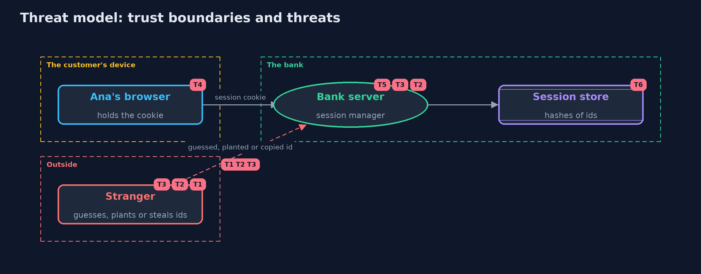

# Threat Model — Session Management: Ids, Rotation, Timeouts and Sign-Out

A threat model answers four questions: what are we protecting, who or what could harm it, how, and what do we do about it. This one covers this project's own demo system, not a production deployment. Domain: an online bank.

## Scope

An online bank's session management: making, storing and checking session ids, rotation at sign-in and step-up, timeouts, sign-out and revocation, and the session cookie.
It does not cover how the password is checked beyond a salted hash, multi-factor authentication, or the transport, which is assumed to be HTTPS in production.

## What we protect (assets)

- Live session ids, each as good as the customer's password while it lives.
- The session store.
- The customer's account and payments.

## Who and what acts on the system

- Ana, the customer.
- A stranger who guesses, plants or copies session ids.
- Someone who obtains a copy of the session store.

## Trust boundaries

A trust boundary is a line that data or a request crosses between parts that trust each other differently. Threats cluster where those lines are.

- Browser to bank: every request carries an id that must be checked.
- Bank to session store: only hashes of ids cross it.

Each dashed box is a trust boundary. A rose tag such as T1 shows where the threat of that number, in the table below, applies.

## Threats, using STRIDE

STRIDE is a checklist of six kinds of threat: **Spoofing** (S), **Tampering** (T), **Repudiation** (R), **Information disclosure** (I), **Denial of service** (D), **Elevation of privilege** (E).

| Id | Kind | Threat | Where it shows up | Control in this project | What is left |
| --- | --- | --- | --- | --- | --- |
| T1 | Spoofing | A session id is guessed | `SessionIds.newId` | 128 bits from SecureRandom, with nothing from the user or the time | None that is practical, as long as the random source is a secure one |
| T2 | Spoofing | A stranger plants a known id before the customer signs in (session fixation) | `SessionManager.signIn`, `SessionManager.stepUp` | A new id at every sign-in and step-up; the earlier id is removed | A framework setting that turns rotation off brings the threat back, so it is tested |
| T3 | Elevation of privilege | A copied or stolen id keeps working long after it was taken | `SessionManager.check`, `SessionManager.signOut` | Idle and absolute timeouts, sign-out on the server, sign-out everywhere and revocation on a password change | A stolen id works until one of these ends it, so payments ask for the password again |
| T4 | Information disclosure | The cookie is read by a script or sent over plain HTTP | `Cookies.sessionCookie` | Secure, HttpOnly, SameSite=Strict and the __Host- prefix | Malware on the customer's device can still read cookies |
| T5 | Denial of service | Unlimited sessions per customer, or sessions that never end, fill the store | `SessionManager.enforceLimit`, `Settings` | A limit of three sessions per customer, and timeouts that delete expired sessions | Visitor sessions need their own limits and cleanup in a real store |
| T6 | Information disclosure | A copy of the session store gives live sessions | `SessionStore` | Only the SHA-256 of each id is stored, and lookups compare in constant time | The store still reveals who is signed in and when, so it is protected like other customer data |

## Assumptions

- The connection is HTTPS in production, so the Secure cookie is never sent in the clear.
- The clock is trustworthy; in the demo it is simulated.
- In the demo, the password is a demo value and sessions are kept in memory.

## Out of scope

- Stealing the cookie through script injection: HttpOnly limits it, and the cross-site-scripting project covers the cause.
- Requests forged from other sites: the cross-site-request-forgery project.
- Shared session stores: the -with-spring-session-and-redis version.

## How the tests check this

- `SessionIdsTest` checks the length and alphabet of ids, that many are distinct, SHA-256 against FIPS 180-2, and that the store holds no live ids.
- `SessionManagerTest` checks rotation, fixation without it, step-up, both timeouts, re-authentication, sign-out, everywhere, password change, the limit and shared stores.
- `CookieAndServerTest` checks the cookie's attributes and the real local server's sign-in, sign-out and rotation.
- `DemoRunsTest` compares the whole demo with the golden output.

## Where this model goes next

The next projects in api-security look at cross-origin access and the rest of an API's surface: request and response shapes and rate limits.
