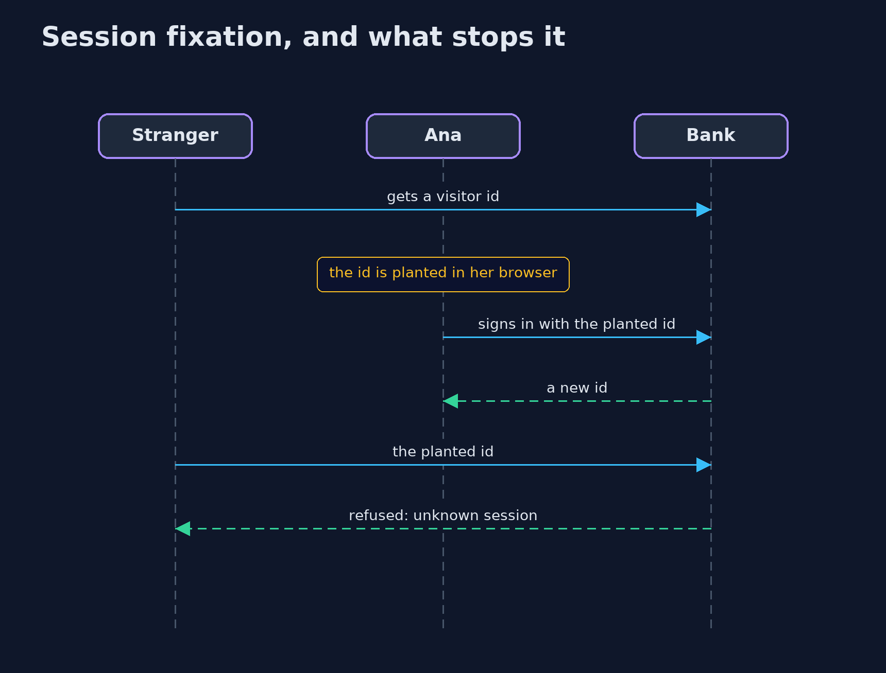
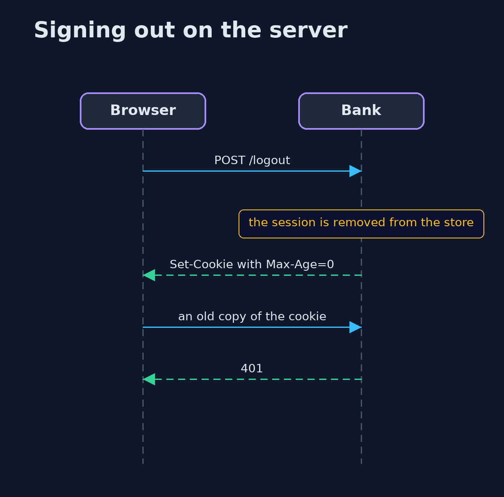

# Session Management: Ids, Rotation, Timeouts and Sign-Out — UML Sequence Diagrams

## 1. Session fixation, and what stops it

The planted id is worthless once sign-in issues a new one.

## 2. Signing out on the server

A copy of the cookie is worthless once the server has forgotten the session.

