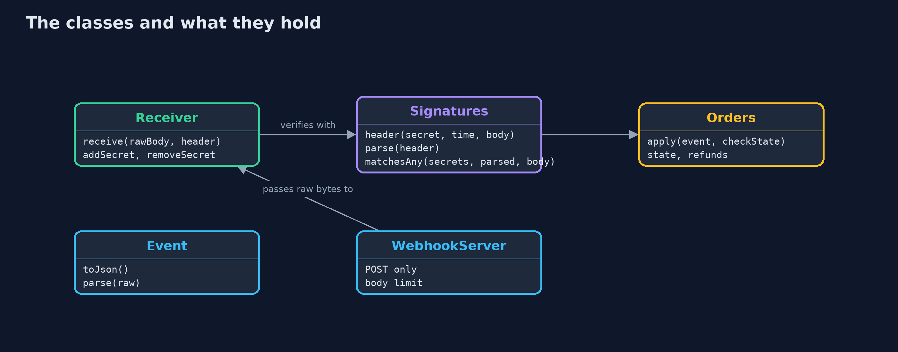

# Webhook Security: Signatures, Replays and Idempotency

```
src/main/java/com/jk/explore/security/webhooks/
├── Event.java          A payment event: its unique id, its type, the order and the amount in cents
├── Orders.java         The store's orders and the money a refund event pays out
├── Provider.java       The payment provider, simulated: it records what really happened, signs the events it sends, and answers a status query from the store
├── Receiver.java       The store's webhook endpoint logic, with each check switched on by its {@link Policy}
├── Reply.java          What the store's webhook endpoint answers: an HTTP status and a short message
├── Signatures.java     The signature a payment provider puts on each webhook: an HMAC-SHA256, with a secret shared with the store, over the timestamp and the exact raw body, sent in one header as {@code t=<seconds>,v1=<hex>}
├── SimClock.java       A clock in whole seconds that only moves when told, so every timestamp in the demo is the same on every run
├── WebhookDemo.java    Runs the online store story in five numbered acts and prints exact, repeatable results
└── WebhookServer.java  The store's webhook endpoint on a real HTTP server on the loopback address, at POST /webhooks/payments, in front of a {@link Receiver}
```

**A webhook endpoint is a public address that anyone can post to, so the store must verify every message: a signature over the exact raw bytes, a signed time inside a short window, a record of events already processed, and handlers that are idempotent and check the order's state.**

A **webhook** is a message that another service posts to your application when something happens: a payment provider tells an online store that a
payment succeeded, or that a refund went through. The store's webhook address is public, so anyone can post to it. A message that arrives there
proves nothing about who sent it, whether it was changed, or whether it is new.

The defences, in the order this project builds them:
- An **HMAC-SHA256 signature** over the signed time and the **exact raw body**, with a secret shared with the provider, compared in constant time.
- A **signed timestamp** inside a short window, and a **record of processed event ids**, so a real message cannot be replayed.
- **Idempotent handlers** that check the order's state, because providers retry and events arrive late, twice or out of order.
- **Secret rotation** with two valid secrets during a changeover.

**Maps to:** OWASP API Security Top 10 (2023) API8 Security Misconfiguration and API10 Unsafe Consumption of APIs · CWE-345 Insufficient
Verification of Data Authenticity · CWE-294 Authentication Bypass by Capture-replay · CWE-347 · OWASP ASVS 5.0, the web services and API chapter.

## The idea in everyday terms

Think of a shop that ships whenever a note saying "paid" is pushed through its letterbox. Anyone can push a note. A wax seal that only the bank owns
stops forged notes; a date in the seal stops someone from pushing yesterday's real note again; a list of note numbers already handled stops the same
note being acted on twice; and for anything valuable, the shop still phones the bank before it ships.

## The scenario

An online store sells through a payment provider. The provider posts payment and refund events to the store's webhook address. The demo runs the store's
endpoint in process and on a real local HTTP server, with the provider simulated, a clock that moves only when told, and two orders: A-1001 for 4200 cents
and A-1002 for 1999 cents.

## Run

```bash
./gradlew run
```

The demo tells the story in 5 acts, each printing exact numbers that the tests check:

| Act | What it shows |
| --- | --- |
| 1. An endpoint that trusts whatever is posted | Anyone posts a payment-succeeded event with no signature, and the store marks order A-1001 paid, while the provider has no payment for it. |
| 2. A signature over the exact bytes | An HMAC-SHA256 of the signed time and raw body accepts the real event and refuses a changed body, a missing signature and another secret, compared in constant time. |
| 3. A real message sent again | With signatures only, a real refund replayed an hour later pays 8400 cents for a 4200-cent order; a signed time window and a record of event ids stop it. |
| 4. Twice, out of order, and a new secret | A retried event changes the order once; a refund before its payment is answered 409 and applied on retry; old and new secrets both work during a changeover. |
| 5. The bill | A re-serialized body fails the signature, so raw bytes must be kept; critical events are confirmed with the provider's API; the secret is kept and rotated; handlers stay idempotent. |

## Test

```bash
./gradlew test
```

16 tests in `DemoRunsTest`, `ReceiverTest`, `ServerTest`, `SignaturesTest`. The HMAC is checked against RFC 4231 test case two, and the header against a value the test computes independently with the JDK's Mac class. The clock is simulated, so every signature and answer is the same on every run.

## What the simulation got right, and what it left out

The store's endpoint runs in process and on a real HTTP server on the loopback address of this machine; the port is never printed. The payment provider is
simulated in Java, and the clock moves only when the demo moves it, so every signature and every answer is the same on every run.

## Technologies and versions

Every version below is pinned in the project's build files and was the latest stable release when the project was built.

| Technology | Version | Used for |
| --- | --- | --- |
| Java | 25 | the language and runtime; a Gradle toolchain finds or downloads the JDK |
| Gradle | 9.8.1 (wrapper) | build and run; nothing to install, the wrapper downloads it |
| org.junit.jupiter:junit-jupiter | 6.1.3, set by junit-bom | JUnit 5: the tests (tests only) |
| org.junit.platform:junit-platform-launcher | 6.1.3, set by junit-bom | JUnit platform launcher, which Gradle needs to run the tests (tests only) |
| videokit | repository tool (`tools/videokit`) | the narrated video and animation: Piper `en_US-amy-medium`, speed 0.8, longer pauses (the amy-slow voice) |

## Learning Material

| Document | What it is for |
| --- | --- |
| [Problem statement](docs/problem-statement.md) | the situation and what the project must show |
| [Prerequisites](docs/prerequisites.md) | what you need to know first |
| [Webhook Security: Signatures, Replays and Idempotency, explained](docs/webhook-security-explained.md) | the acts in prose |
| [Session guide](docs/session.md) | a one-hour lesson with exercises |
| [Animated walkthrough](docs/animation.html) | the acts step by step, narrated |
| [Threat model](docs/threat-model.md) | what is protected, who could harm it, and how, using STRIDE |
| [Spec](docs/spec.md) | what this project must be true of |
| [Expected output](docs/expected-output.txt) | the golden demo output every test and every port checks against |

### The idea in one picture

The address is public; only the checks decide whether a message is from the provider, unchanged and new.


### Where each piece sits

Receiver runs the checks in order; Signatures does the cryptography; Orders enforces the allowed state changes.



### How the data moves

The signature covers the time and the raw body; the checks run before the body is parsed.


### Who calls whom, in order


### Video

`video/webhook-security-explained.mp4` (with `.m4a` audio and `.srt` subtitles) is built by `video/build_video.sh`. Rendered media is not committed.

## What it costs

- **The secret must be kept and rotated.** Anyone with the shared secret can forge any event, so it lives outside the code, and a change needs a window in which both secrets are accepted.
- **The raw bytes must be kept.** The signature covers the exact body; a framework that parses and re-serializes it first will see every real event fail.
- **Clocks must be roughly right.** The time window refuses messages from a clock that is too far ahead or behind, so servers need time synchronization.
- **The record of events grows.** Processed event ids must be kept at least as long as the provider retries, and in a store shared by every server.
- **A signature is not the provider's final word.** For anything valuable, such as shipping goods, confirm the event with the provider's API.

## When this is too much

Every webhook endpoint that changes state needs signature verification and replay protection; there is no small version. A purely informational webhook
that only triggers a fresh fetch from the provider's API needs less, because the store then trusts the API answer and not the message.

## Where you have already met this

- `Stripe-Signature`, `X-Hub-Signature-256` and similar headers on webhooks from payment providers and code hosts.
- Webhook settings pages that show a signing secret and a "roll secret" button.
- Delivery logs that show the same event retried several times.
- Incident reports where orders were marked paid by forged callbacks.

## Where this sits

This project is in [api-security](..) and builds on [hashing-and-integrity](../../../beginner/cryptography/hashing-and-integrity), which introduced HMAC,
and [keystore-basics](../../../beginner/cryptography/keystore-basics), which introduced key rotation by name.
