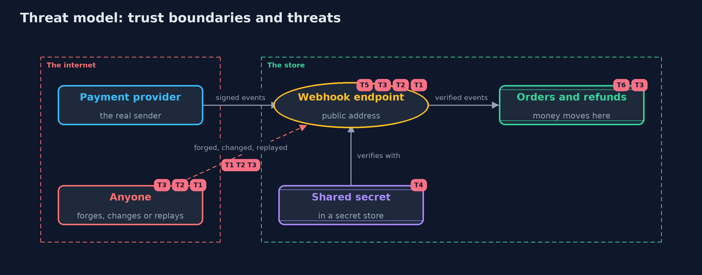

# Threat Model — Webhook Security: Signatures, Replays and Idempotency

A threat model answers four questions: what are we protecting, who or what could harm it, how, and what do we do about it. This one covers this project's own demo system, not a production deployment. Domain: an online store.

## Scope

An online store's webhook endpoint for payment and refund events from a payment provider: verification of each message, replay protection, idempotent handling and the shared
secret. It does not cover the provider's own security, the store's other APIs, or the transport, which is assumed to be HTTPS in production.

## What we protect (assets)

- Orders and their payment state, which decide whether goods ship.
- Refunds, which move money out of the store.
- The shared signing secret.
- The record of processed event ids.

## Who and what acts on the system

- The payment provider, the only legitimate sender.
- Anyone on the internet who can post to the webhook address.
- Someone who has seen a real message, for example in a log or a proxy.

## Trust boundaries

A trust boundary is a line that data or a request crosses between parts that trust each other differently. Threats cluster where those lines are.

- Internet to the webhook endpoint: every message crosses it, and none is trusted until verified.
- Endpoint to orders and refunds: only verified, fresh, state-appropriate events cross it.

Each dashed box is a trust boundary. A rose tag such as T1 shows where the threat of that number, in the table below, applies.

## Threats, using STRIDE

STRIDE is a checklist of six kinds of threat: **Spoofing** (S), **Tampering** (T), **Repudiation** (R), **Information disclosure** (I), **Denial of service** (D), **Elevation of privilege** (E).

| Id | Kind | Threat | Where it shows up | Control in this project | What is left |
| --- | --- | --- | --- | --- | --- |
| T1 | Spoofing | A forged event claims to come from the provider | `Receiver.receive` | An HMAC-SHA256 signature with the shared secret, required on every message | Anyone who obtains the secret can forge events, so the secret is stored and rotated with care |
| T2 | Tampering | A real event's body is changed, for example to another order | `Signatures.matchesAny` | The signature covers the exact raw body and is compared in constant time | A framework that verifies a re-serialized body breaks verification, so raw bytes are kept |
| T3 | Spoofing | A real, correctly signed message is replayed, paying a refund twice | `Receiver.receive`, `Orders.apply` | A signed time inside a 300-second window, a record of processed event ids, and state checks | The record must be shared by every server and kept as long as the provider retries |
| T4 | Information disclosure | The shared secret leaks from code, configuration or logs | the secret store | The secret is kept outside the code and rotated with a changeover in which both secrets work | Between a leak and a rotation, forged events are possible; confirm valuable events with the provider's API |
| T5 | Denial of service | Oversized or malformed messages exhaust the endpoint | `WebhookServer`, `Event.parse` | POST only, a 4096-byte body limit, and a strict parser that refuses anything unexpected | A flood of small messages needs rate limiting in front of the endpoint |
| T6 | Tampering | Events out of order, such as a refund before its payment, leave an order in a wrong state | `Orders.apply` | Only allowed state changes are applied; others are answered 409 and retried by the provider | Events the provider stops retrying need monitoring and manual review |

## Assumptions

- The secret is known only to the provider and the store.
- Server clocks are synchronized to within the time window.
- In the demo, the provider is simulated and the secrets are demo values.

## Out of scope

- Transport security, which HTTPS provides: the transport-security module.
- Asymmetric webhook signatures and key distribution.
- Denial of service against the endpoint beyond the body size limit.

## How the tests check this

- `SignaturesTest` checks the HMAC against RFC 4231, the header against an independent computation, strict parsing, and matching under any listed secret.
- `ReceiverTest` checks refusals, the time window both ways, replays, idempotency, events out of order, wrong amounts, rotation and re-serialized bodies.
- `ServerTest` checks the real loopback endpoint: POST only, the body limit and the same verification.
- `DemoRunsTest` compares the whole demo with the golden output.

## Where this model goes next

The next projects in api-security look at the rest of an API's surface: request and response shapes, rate limits, sessions and cross-origin access.
