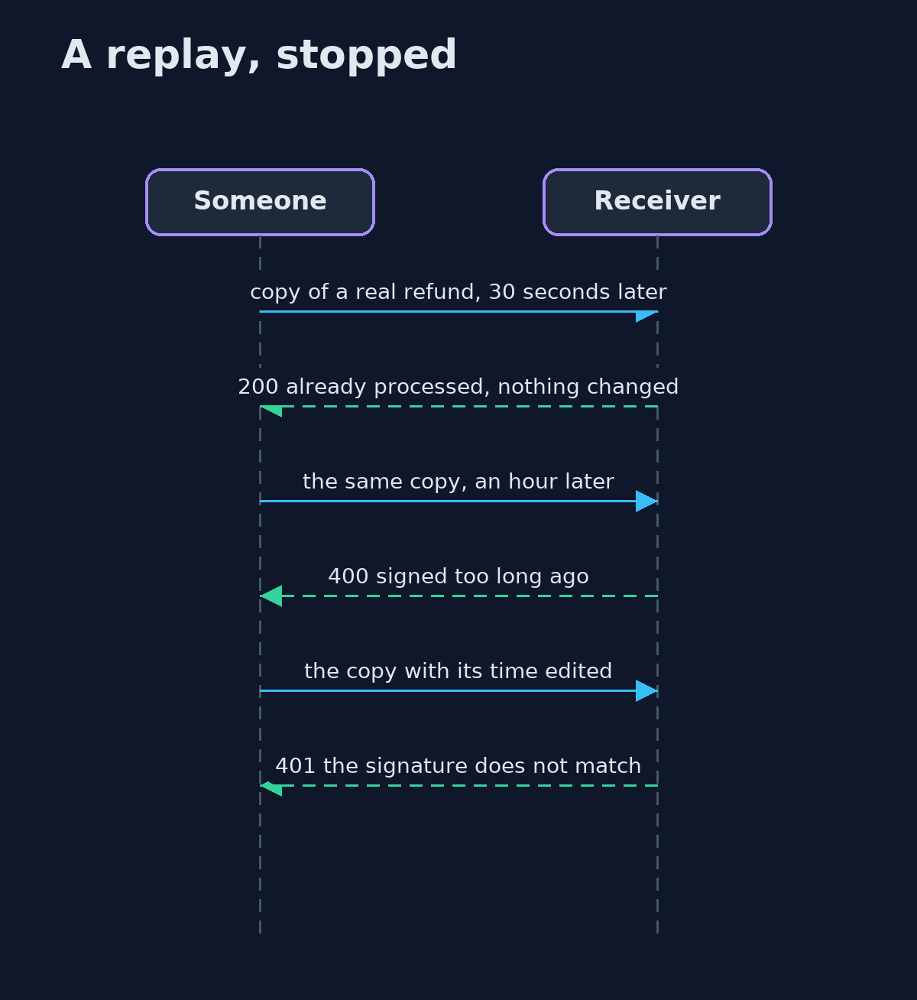
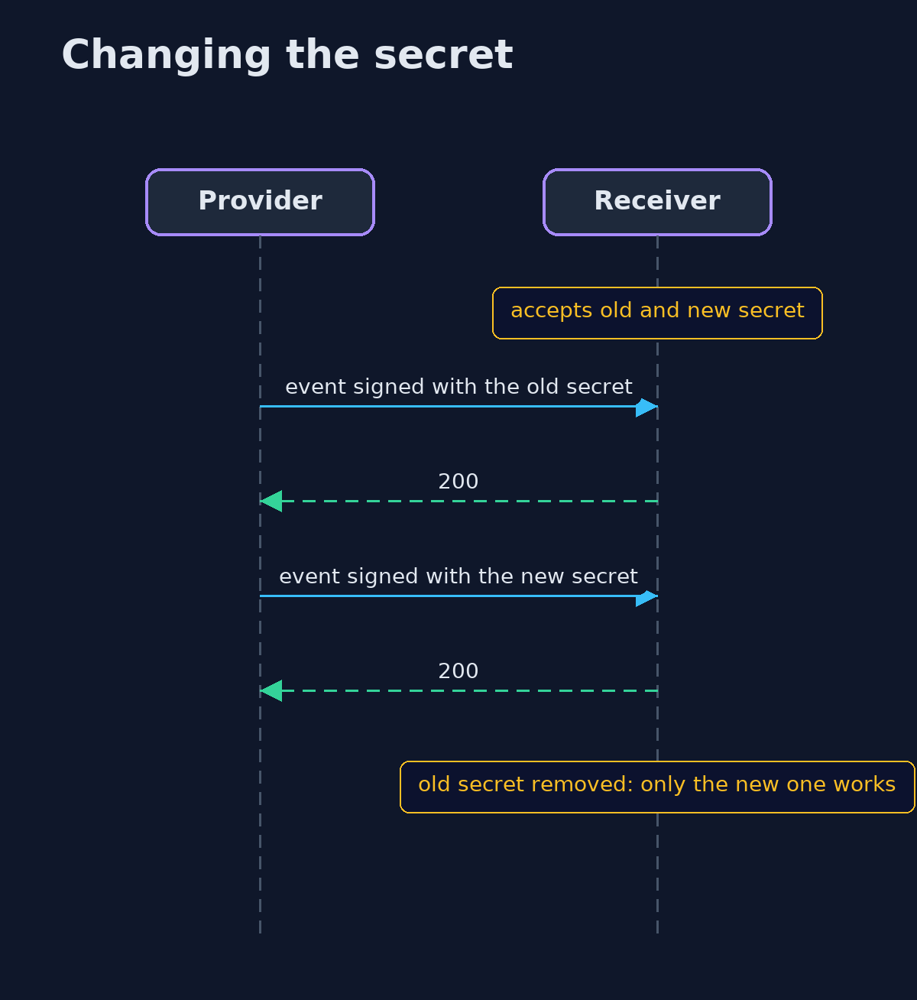

# Webhook Security: Signatures, Replays and Idempotency — UML Sequence Diagrams

## 1. A replay, stopped

The copy is correctly signed, so only the time window and the record of events stop it.

## 2. Changing the secret

Both secrets are accepted while the provider switches; the old one is removed afterwards.

