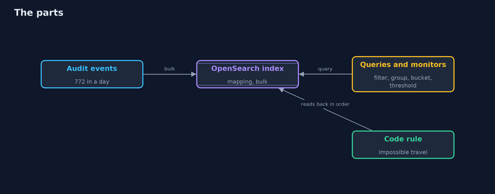
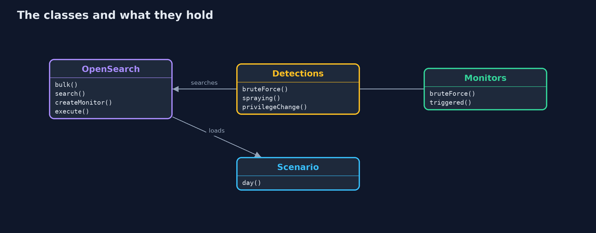
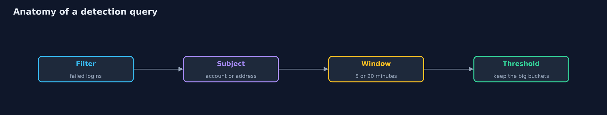

# Detecting Attacks with OpenSearch

```
src/main/java/com/jk/explore/security/searchdetect/
├── Alert.java                 What a rule reports: which rule, about whom, when, and the events that made it fire
├── City.java                  A place with coordinates, for distance calculations
├── Detections.java            The detections as OpenSearch queries: filters, a terms aggregation for the subject, a date histogram for the window, and a pipeline aggregation that keeps only the buckets over the threshold
├── Event.java                 One line of the audit log
├── Hit.java                   One alert from a query: the subject (an account, an address), the window it fell in (or empty), how many events made it, and the real attacks behind it (scoring only)
├── ImpossibleTravelRule.java  Two successful logins by one account from places an aeroplane could not connect in the time between them
├── Lab.java                   A real OpenSearch 3.9 (with its alerting plugin) in a container on a free loopback port, with the security plugin off because this is a lab, removed on close
├── Monitors.java              The same detections as monitors of OpenSearch's alerting plugin: a schedule, the query, and a trigger that decides which buckets are alerts
├── OpenSearch.java            OpenSearch's HTTP API: indices, bulk loading, searches, and the alerting plugin's monitors
├── OpenSearchDetectDemo.java  A sliding five-minute window, as the plain project has, for comparison with fixed buckets
├── Rule.java                  A detection rule: reads the whole log, in time order, and returns alerts
└── Scenario.java              One synthetic Monday for a company with 200 accounts: ordinary logins with a few typos, five VPN users, a traveller, two people who forgot their password after a holiday, ticketed admin grants and one break-glass grant, and four real attacks
```

**A real OpenSearch 3.9 holds one Monday of 772 events and answers the plain project's detections as filter, group, time bucket and threshold: brute force (1 true alert at a threshold of 10), spraying (1), success after failures (2) and privilege change (2, one false), as monitors of the alerting plugin that are run once for repeatable results; impossible travel compares a login with the person's previous one, which a query cannot say, so the events are read back and a few lines of code decide; together the day gives 10 alerts, 8 true, and all four attacks are noticed, but a mapping decides what a rule can say, fixed time buckets miss an attack that crosses their edge, and a monitor changed in a console leaves no trace in the code.**

The plain [detecting-attacks](../detecting-attacks) project writes detection rules in Java and scores them on one synthetic Monday of 772 events with four hidden attacks. This one puts the same Monday in a real **OpenSearch 3.9** (Docker, with the alerting plugin; the security plugin is off because this is a lab) and writes the detections as **queries**. It needs Docker; the tests are tagged `integration`: `./gradlew integrationTest`.

What it shows:
- **The day in an index.** 772 events through the bulk API (768 logins, 4 role grants), with a mapping: keywords for what a rule filters or groups by, a date for the time. An `attack` label is indexed only so the lesson can score; no rule reads it.
- **A rule is a query.** A filter, a terms aggregation for the subject (account or address), a date histogram for the window, and a pipeline aggregation or `min_doc_count` that keeps the buckets over a threshold. First versions: brute-force(3) 3 alerts, 1 true; spraying(8) 1; privilege-change 2, 1 true; success-after-failures(1) 23 alerts, 2 true.
- **Tuning.** `brute-force` at 3, 5, 10, 25, 40: the false alerts go away at 10 and the attack is lost at 40.
- **Monitors.** The tuned set as bucket-level and query-level monitors of the alerting plugin, each run once with `dryrun`: brute-force(10) 1, spraying(8) 1, success-after-failures(20) 2, privilege-change 2. **Impossible travel** compares a login with the same person's previous one, which a query cannot say: the events are read back in order and the plain project's rule decides (4 alerts, 3 true). Together: **10 alerts, 8 true, 2 false, all four attacks**.
- **The bill.** With no mapping an aggregation on a text field is refused; thirty failures that cross a five-minute boundary are 15 and 15 in fixed buckets and no alert at a threshold of 20, but one for a sliding window; monitors changed in a console leave no trace in the code.

**Maps to:** OWASP Top 10 (2025) A09 Security Logging and Alerting Failures · NIST CSF 2.0 Detect · MITRE ATT&CK (T1110 brute force, T1078 valid accounts, T1098 account manipulation).

## The idea in everyday terms

A night guard with a clipboard of questions: how many times has someone failed at this door, how many different doors has one visitor tried. A clipboard is good for counting. It cannot answer "did this person leave Paris an hour ago", which needs someone to remember the last visit.

## The scenario

An online store's audit log for one Monday: 772 events, four attacks. The demo writes the guard's clipboard as queries, tunes it, saves it as monitors, and finds the question that the clipboard cannot hold.

## Run

```bash
./gradlew run
```

The demo tells the story in 5 acts, each printing exact numbers that the tests check:

| Act | What it shows |
| --- | --- |
| 1. One Monday of logs, in OpenSearch | 772 events loaded with the bulk API under a mapping of keywords and a date. |
| 2. A first version of each rule, as a query | A filter, a group by the subject, a bucket of time and a threshold: three alerts for brute force at 3, of which one is true. |
| 3. Tuning one threshold | At 10 the false alerts go away; at 40 the attack is lost. |
| 4. The tuned set as monitors of the alerting plugin | Four monitors and one rule in code give 10 alerts, 8 true, and notice all four attacks; impossible travel needs the previous login, which a query cannot say. |
| 5. The bill | A mapping decides what a rule can say, fixed buckets split an attack at their edge, and a console change leaves no trace in the code. |

## Test

```bash
./gradlew test
```

19 tests in `DemoRunsTest`, `OpenSearchTest`, `QueryShapeTest`. The scenario and the shapes of the queries are tested with no server. The rest start one OpenSearch for the whole class and remove it (./gradlew integrationTest). They need Docker.

## What the simulation got right, and what it left out

OpenSearch is the real server in Docker on a loopback port, loaded with a seeded synthetic day, so the counts are the same on every run. The monitors are run once with dryrun, which sends nothing. Ports and container names are never printed; the demo takes about a minute.

## Technologies and versions

Every version below is pinned in the project's build files and was the latest stable release when the project was built.

| Technology | Version | Used for |
| --- | --- | --- |
| Java | 25 | the language and runtime; a Gradle toolchain finds or downloads the JDK |
| Gradle | 9.8.1 (wrapper) | build and run; nothing to install, the wrapper downloads it |
| tools.jackson.core:jackson-databind | 3.1.5 | library the code uses |
| org.junit.jupiter:junit-jupiter | 6.1.3, set by junit-bom | JUnit 5: the tests (tests only) |
| org.junit.platform:junit-platform-launcher | 6.1.3, set by junit-bom | JUnit platform launcher, which Gradle needs to run the tests (tests only) |
| videokit | repository tool (`tools/videokit`) | the narrated video and animation: Piper `en_US-amy-medium`, speed 0.8, longer pauses (the amy-slow voice) |

## Learning Material

| Document | What it is for |
| --- | --- |
| [Problem statement](docs/problem-statement.md) | the situation and what the project must show |
| [Prerequisites](docs/prerequisites.md) | what you need to know first |
| [Detecting Attacks with OpenSearch, explained](docs/detecting-attacks-with-opensearch-explained.md) | the acts in prose |
| [Session guide](docs/session.md) | a one-hour lesson with exercises |
| [Animated walkthrough](docs/animation.html) | the acts step by step, narrated |
| [Threat model](docs/threat-model.md) | what is protected, who could harm it, and how, using STRIDE |
| [Spec](docs/spec.md) | what this project must be true of |
| [Expected output](docs/expected-output.txt) | the golden demo output every test and every port checks against |

### The idea in one picture

Events in, queries and monitors on top, code where a query cannot go.



### Where each piece sits

The server, the queries and monitors, and the scenario.



### How the data moves

Each part of the query is a decision.



### Who calls whom, in order


### Video

`video/detecting-attacks-with-opensearch-explained.mp4` (with `.m4a` audio and `.srt` subtitles) is built by `video/build_video.sh`. Rendered media is not committed.

## What it costs

- **Every rule needs a mapping that lets it say what it means.**
- **Fixed time buckets have edges,** and attackers do not respect them.
- **Thresholds are tuned to one day** and drift with the business.
- **A query cannot remember:** rules about sequences and "the previous event" need code or a different engine.
- **A monitor in a console is configuration that nobody reviews.**

## When this is too much

A shop with one server and a few hundred events a day can read its log. A search engine and alerting pay off when events come from many places, when several rules watch them, and when the rules must be tuned over time.

## Where you have already met this

- A Kibana or OpenSearch Dashboards "Discover" screen.
- A saved search with a count and a threshold.
- A rule list in a SIEM with names like "Brute force" and "Impossible travel".
- A false alert at three in the morning.

## Where this sits

This is the tools version of [detecting-attacks](../detecting-attacks), in the [detection-and-response](..) module. Getting the events there is [security-logging-with-loki-and-grafana](../security-logging-with-loki-and-grafana); what to do after an alert is [incident-response](../incident-response).
