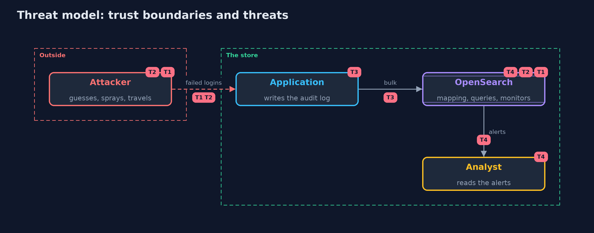

# Threat Model — Detecting Attacks with OpenSearch

A threat model answers four questions: what are we protecting, who or what could harm it, how, and what do we do about it. This one covers this project's own demo system, not a production deployment. Domain: an online store.

## Scope

The audit events of one day in an OpenSearch index, the detections over them, and the alerts that reach an analyst. It does not cover the security of the OpenSearch cluster itself, which runs here with its security plugin off.

## What we protect (assets)

- The accounts and the privileges they hold.
- The audit log as evidence.

## Who and what acts on the system

- An attacker who guesses, sprays or uses stolen credentials.
- An analyst who reads alerts.

## Trust boundaries

A trust boundary is a line that data or a request crosses between parts that trust each other differently. Threats cluster where those lines are.

- The index: whoever can write to it can hide an attack.

Each dashed box is a trust boundary. A rose tag such as T1 shows where the threat of that number, in the table below, applies.

## Threats, using STRIDE

STRIDE is a checklist of six kinds of threat: **Spoofing** (S), **Tampering** (T), **Repudiation** (R), **Information disclosure** (I), **Denial of service** (D), **Elevation of privilege** (E).

| Id | Kind | Threat | Where it shows up | Control in this project | What is left |
| --- | --- | --- | --- | --- | --- |
| T1 | Spoofing | Guessed or sprayed passwords go unnoticed | login events and the queries over them | Queries by account and by address, tuned thresholds | Slow attacks that stay under the threshold |
| T2 | Spoofing | Stolen credentials are used from far away | successful logins | A code rule on the previous login, with a list of known egress addresses | A VPN or a phone carrier that shows the wrong city |
| T3 | Repudiation | Events are missing or have no ticket or approver | the application's audit log | Log every login and grant with its actor and ticket | Events the application never writes |
| T4 | Denial of service | False alerts teach the analyst to ignore alerts | thresholds and rules | Tune against known days, test rules, review thresholds | Thresholds tuned to one Monday |

## Assumptions

- The application writes every login and role grant.
- The clocks of the writers agree.

## Out of scope

- Securing the cluster.
- Response to an alert.

## How the tests check this

- `QueryShapeTest` checks the scenario, the documents and the shape of the queries and monitors with no server.
- `OpenSearchTest` runs a real OpenSearch for the index, every detection, the tuning, the monitors, the read-back for impossible travel, the mapping and the bucket edge.
- `DemoRunsTest` compares the whole demo with the golden output.

## Where this model goes next

The next project in this module, incident-response, comes after the alert; the next module is secure-design.
