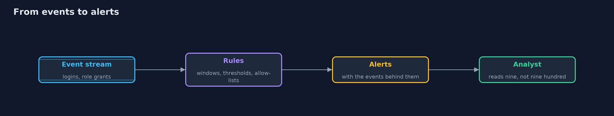
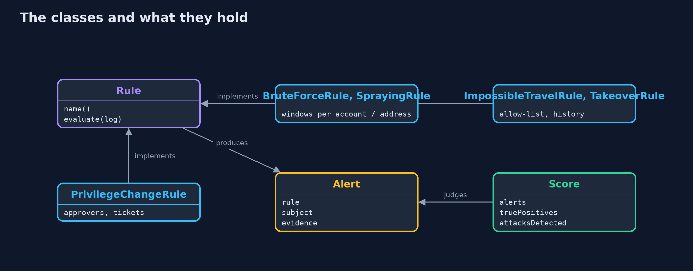
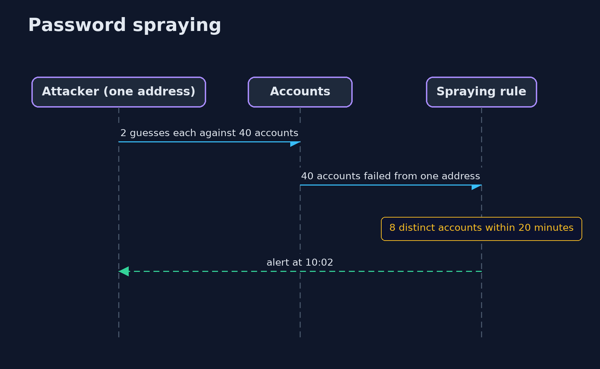

# Detecting Attacks in Logs

```
src/main/java/com/jk/explore/security/detect/
├── Alert.java                 What a rule reports: which rule, about whom, when, and the events that made it fire
├── BruteForceRule.java        At least {@code threshold} failed logins for one account within {@code window}: someone is guessing that account's password
├── City.java                  A place with coordinates, for distance calculations
├── DetectionDemo.java         Runs the detection story in four numbered acts and prints exact, repeatable results
├── Event.java                 One line of the audit log
├── ImpossibleTravelRule.java  Two successful logins by one account from places an aeroplane could not connect in the time between them
├── PrivilegeChangeRule.java   Granting the admin role is rare and always approved: alert when the actor is not an approver, or when the grant has no change ticket
├── Rule.java                  A detection rule: reads the whole log, in time order, and returns alerts
├── Scenario.java              One synthetic Monday for a bank with 200 accounts: ordinary logins with a few typos, five VPN users, a traveller, two people who forgot their password after a holiday, ticketed admin grants and one break-glass grant, and four real attacks
├── Score.java                 How a rule did against the ground truth: alerts, true and false positives, and which attacks it noticed at all
├── SprayingRule.java          Password spraying tries one or two common passwords against <em>many</em> accounts, staying under the per-account limit that the brute-force rule watches
└── TakeoverRule.java          A success right after a run of failures, from an address that has never succeeded for this account before: the guesses worked
```

**Logs only help if rules turn them into alerts: brute force, password spraying, impossible travel, takeover and privilege changes each need a rule, and each rule must be measured against a normal day of the same logs, because a threshold that catches the attack and buries the analyst in false alarms is not detection.**

Logging records what happened. **Detection** decides which of it is an attack. The two are different jobs: a log with every event and no rules is a library no one reads. This project writes five **detection rules** over the sign-in and admin events of a bank with 200 accounts, runs them on one
synthetic Monday that contains both ordinary behaviour and four real attacks, and *measures* them, because a rule is only as good as the alerts it produces on a normal day.

The rules, each a hypothesis about an attacker:
- **Brute force:** at least N failed logins for one account within five minutes. Someone is guessing that account's password.
- **Password spraying:** failures against many *different* accounts from one address. The attacker tries one or two common passwords per account, so the per-account rule never fires. The rule counts accounts per address.
- **Impossible travel:** two successful logins by one account from places that no aeroplane connects in that time. Needs a list of the VPN's addresses, which otherwise look like the VPN's city.
- **Success after failures:** a success from an address that has just failed repeatedly and has never succeeded for that account before: the guesses worked.
- **Privilege change:** the admin role granted by someone who is not an approver, or without a change ticket.

The day has the usual noise: typing mistakes, two people back from holiday who forget their passwords, five staff on the VPN, a break-glass admin grant at 3 a.m., and a phone whose carrier address is placed in the wrong city. The scoring compares every alert with ground truth: true positives, false positives and which attacks were noticed at all.

**Maps to:** OWASP Top 10 (2025) A09 Security Logging and Alerting Failures · NIST CSF Detect (DE.CM, DE.AE) · MITRE ATT&CK T1110 (brute force, including password spraying) and T1078 (valid accounts) · OWASP ASVS 5.0, the logging and monitoring chapter.

## The idea in everyday terms

A night guard watching one hundred doors. A rule that rings an alarm at every rattled handle will ring all night and be switched off; a rule that waits for three handles on the same door in a minute, and ignores the cleaners' door, rings rarely and means it.
The guard's value is the alarms people act on, not the doors watched.

## The scenario

One Monday of logs for a bank with 200 accounts: 768 logins and 4 role grants, 113 events of which belong to four attacks (spraying, brute force, impossible travel, privilege change). The data is synthetic and generated with a fixed random seed, so every run is the same and the ground truth is known.

## Run

```bash
./gradlew run
```

The demo tells the story in 4 acts, each printing exact numbers that the tests check:

| Act | What it shows |
| --- | --- |
| 1. One Monday of logs | 772 events: 768 logins and 4 role grants; 113 of them belong to 4 real attacks (spraying, brute force, impossible travel, privilege change). |
| 2. A first version of each rule | The first versions notice all four attacks but raise 29 alerts, 21 of them false: impossible travel flags the VPN, success-after-failures flags every typo. |
| 3. Tuning one threshold | Brute-force thresholds of 3 and 5 raise 2 false alarms (two people who forgot their password); 10 and 25 catch the attack with none; 40 misses it. |
| 4. The tuned set, and what it tells the analyst | Five tuned rules give 9 alerts for the day, 7 true and 2 false, and every attack (A, B, C, D) is noticed; the false ones are a break-glass admin grant and a phone placed in the wrong city. |

## Test

```bash
./gradlew test
```

13 tests in `DemoRunsTest`, `DetectionTest`. The day of logs is synthetic with a fixed seed, so the demo prints the same text on every run.

## What the simulation got right, and what it left out

The events are objects, the rules are classes with sliding windows, and the scenario is generated by a seeded random generator, so the ground truth is exact. The rules are written the way a detection engineer would write them, and could be translated to queries. Nothing reads real logs.

## Technologies and versions

Every version below is pinned in the project's build files and was the latest stable release when the project was built.

| Technology | Version | Used for |
| --- | --- | --- |
| Java | 25 | the language and runtime; a Gradle toolchain finds or downloads the JDK |
| Gradle | 9.8.1 (wrapper) | build and run; nothing to install, the wrapper downloads it |
| org.junit.jupiter:junit-jupiter | 6.1.3, set by junit-bom | JUnit 5: the tests (tests only) |
| org.junit.platform:junit-platform-launcher | 6.1.3, set by junit-bom | JUnit platform launcher, which Gradle needs to run the tests (tests only) |
| videokit | repository tool (`tools/videokit`) | the narrated video and animation: Piper `en_US-amy-medium`, speed 0.8, longer pauses (the amy-slow voice) |

## Learning Material

| Document | What it is for |
| --- | --- |
| [Problem statement](docs/problem-statement.md) | the situation and what the project must show |
| [Prerequisites](docs/prerequisites.md) | what you need to know first |
| [Detecting Attacks in Logs, explained](docs/detecting-attacks-explained.md) | the acts in prose |
| [Session guide](docs/session.md) | a one-hour lesson with exercises |
| [Animated walkthrough](docs/animation.html) | the acts step by step, narrated |
| [Threat model](docs/threat-model.md) | what is protected, who could harm it, and how, using STRIDE |
| [Spec](docs/spec.md) | what this project must be true of |
| [Expected output](docs/expected-output.txt) | the golden demo output every test and every port checks against |

### The idea in one picture

Rules read the event stream and produce alerts that an analyst can act on.



### Where each piece sits

Every rule has the same shape; the score compares alerts with ground truth.



### How the data moves

Each attack leaves a different trace.


### Who calls whom, in order




### Video

`video/detecting-attacks-explained.mp4` (with `.m4a` audio and `.srt` subtitles) is built by `video/build_video.sh`. Rendered media is not committed.

## What it costs

- **Every threshold is a trade.** Lower finds more attacks and more noise; higher is quiet and blind. The right value depends on your normal day, which is why you measure.
- **Allow-lists need owners.** A VPN address list that is not kept up to date silently turns the rule off, or turns it back into noise.
- **Context cuts false positives most:** knowing an account's usual addresses, roles and change tickets (the history and ticket data here) is worth more than a smarter threshold.
- **Some false positives are healthy.** A break-glass grant should alert; it is a false positive for an attack and a true positive for a review.
- **Attackers adapt.** Low and slow guessing, residential proxies near the victim, and logins at the victim's usual hours defeat simple rules, so rules need layers and review.

## When this is too much

Do not write a hundred rules before the first ten are tuned and owned. Start with the attacks that matter to your system, measure each rule on a week of real logs, and keep a short list that people trust. A rules engine, a SIEM or an OpenSearch alert is where these rules run in production.

## Where you have already met this

- SIEM correlation rules and "detection as code" repositories (Sigma rules).
- Cloud sign-in alerts such as "unfamiliar sign-in properties" and "atypical travel".
- Account lockout, which stops brute force but is itself a denial of service for spraying.
- MITRE ATT&CK technique pages for brute force and valid accounts.

## Where this sits

This project is in [detection-and-response](..) and builds on [security-logging](../security-logging), which makes the events these rules read. The with-OpenSearch version expresses the same rules as saved queries and alerts. The next project, incident-response, takes over when an alert is real.
