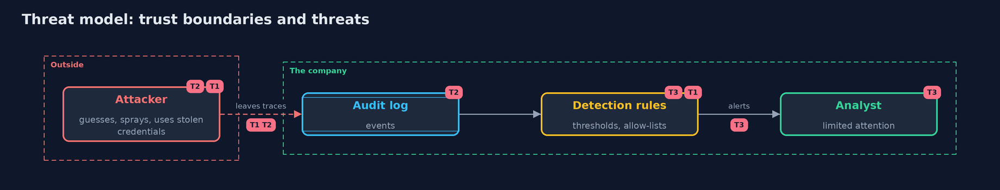

# Threat Model — Detecting Attacks in Logs

A threat model answers four questions: what are we protecting, who or what could harm it, how, and what do we do about it. This one covers this project's own demo system, not a production deployment. Domain: a company's sign-in and admin logs.

## Scope

Rules that read sign-in and admin events. It covers detecting credential attacks and privilege changes and the cost of false alarms.
It does not cover how logs are collected and protected, or what the company does after an alert.

## What we protect (assets)

- Accounts, especially administrators.
- The analyst's time and trust in the alerts.

## Who and what acts on the system

- An attacker guessing, spraying or using stolen credentials.
- A detection engineer who writes and tunes rules.
- An analyst who reads alerts.

## Trust boundaries

A trust boundary is a line that data or a request crosses between parts that trust each other differently. Threats cluster where those lines are.

- The log: events that were not written cannot be detected.
- Rule configuration: thresholds and allow-lists can be set so that the rule never fires.

Each dashed box is a trust boundary. A rose tag such as T1 shows where the threat of that number, in the table below, applies.

## Threats, using STRIDE

STRIDE is a checklist of six kinds of threat: **Spoofing** (S), **Tampering** (T), **Repudiation** (R), **Information disclosure** (I), **Denial of service** (D), **Elevation of privilege** (E).

| Id | Kind | Threat | Where it shows up | Control in this project | What is left |
| --- | --- | --- | --- | --- | --- |
| T1 | Elevation of privilege | Guessing and spraying find a valid credential | `BruteForceRule`, `SprayingRule`, `TakeoverRule` | Rules by account, by address and on success after failures; rate limits and multi-factor | Low and slow guessing from many addresses |
| T2 | Spoofing | A valid credential or stolen session is used from far away, and the account is made an administrator | `ImpossibleTravelRule`, `PrivilegeChangeRule` | Travel rule with a VPN list; admin grants need an approver and a ticket | An attacker who logs in from near the victim |
| T3 | Repudiation | Alert fatigue and a stale allow-list make real alerts get ignored | Thresholds, allow-lists, the analyst | Measure each rule on a normal day, own and review the lists, keep the alert count readable | Tuning that is never revisited |

## Assumptions

- The log is complete and its timestamps are right.
- The ground truth in the synthetic day is the same kind of attack as real ones.

## Out of scope

- Attacks that leave no sign-in or admin events.
- Response: incident-response.

## How the tests check this

- `DetectionTest` checks each rule on hand-made logs with their near misses, the shape of the synthetic day, the tuned set's numbers, the effect of thresholds and the allow-list, and the scoring rule.
- `DemoRunsTest` compares the whole demo with the golden output.

## Where this model goes next

The next project, incident-response, picks up when an alert is real: how an organisation contains, removes and learns from an attack.
