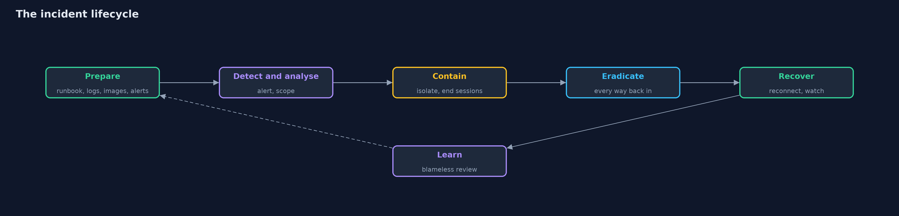
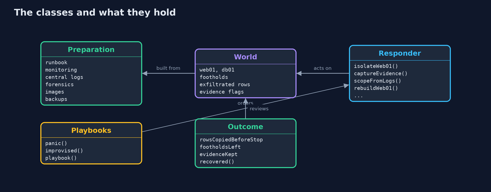
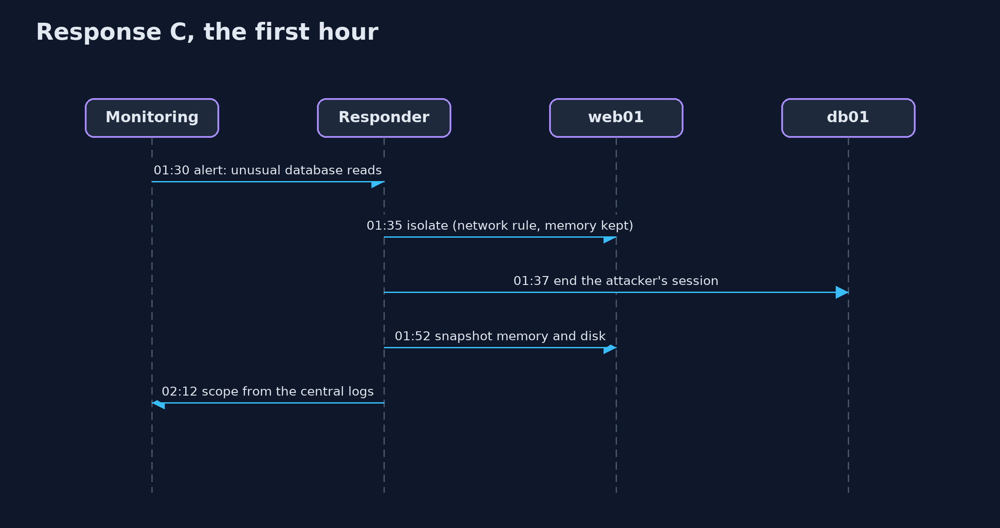

# Incident Response: Prepare, Contain, Eradicate, Recover, Learn

```
src/main/java/com/jk/explore/security/ir/
├── IncidentDemo.java  Runs the same incident three times in six numbered acts and prints exact, repeatable results
├── Outcome.java       What a response achieved, in the terms of the post-incident review
├── Playbooks.java     Three ways the same incident can go, from what was prepared and what is done first
├── Preparation.java   What the organisation did <em>before</em> the incident
├── Responder.java     The actions an incident responder can take, each with a duration and a real effect on the {@link World}
└── World.java         The shop's systems during the incident, and the attacker's ground truth
```

**The same breach ends very differently depending on what was prepared (alerts, central logs, snapshots, images) and on the order of the response: contain without destroying evidence, scope from logs, close every way back in, rebuild from a known-good image, and watch, because an attacker with one way back in will use it.**

At 01:00 an attacker gets into the shop's web server through a flaw in the application. They read the database password from its configuration, from 01:20 copy the customer table at a thousand rows a minute (50,000 customers in all), and at 01:40 leave **three ways back in**: a cron job and an SSH key on
the web server, and a hidden admin account in the shop's own admin panel. This project replays that same incident **three times**, with different preparation and a different response, and compares the outcomes.

The structure is the NIST SP 800-61 incident lifecycle, which this project makes concrete:
- **Prepare:** six things decided before anything happens (runbook, alert on unusual database reads, logs kept centrally for at least a week, a way to snapshot memory and disk, a known-good image to rebuild from, tested backups). With none of them the breach is found by a customer after three days; with an alert it is found in 30 minutes.
- **Detect and analyse:** scope the incident from logs. Without logs that reach back to the start, nobody knows what the attacker did or which accounts they created.
- **Contain:** stop the damage. **Isolate** the host from the network (which keeps its memory) rather than rebooting it (which destroys memory evidence and leaves the persistence).
- **Eradicate:** remove *every* way back in: rotate the stolen password, disable the hidden account, patch the flaw, and rebuild the host from a known-good image instead of cleaning it by hand.
- **Recover:** reconnect, and watch. An attacker with one remaining foothold comes back within hours.
- **Learn:** the review table compares the three runs on time to detect, data lost, evidence, root cause, outage and recurrence.

**Maps to:** NIST SP 800-61 (Computer Security Incident Handling Guide) · NIST CSF Respond and Recover · OWASP Top 10 (2025) A09 Security Logging and Alerting Failures · ISO/IEC 27035 · SANS PICERL (Preparation, Identification, Containment, Eradication, Recovery, Lessons learned).

## The idea in everyday terms

A house fire. If there are smoke alarms, an exit plan and a fire extinguisher in the kitchen, the fire is small and the family is outside in a minute. If someone turns on the lights and runs around opening windows, they feed the fire. And when the firemen leave, someone must check the walls,
because a smouldering beam restarts the fire at night.

## The scenario

The shop's web server (web01) and database (db01), one attacker with a scripted behaviour, and three responses to the same incident. The simulation counts minutes from 01:00 on day 0; each response action has a duration and an effect on the systems, and the engine records a timeline and a review.

## Run

```bash
./gradlew run
```

The demo tells the story in 6 acts, each printing exact numbers that the tests check:

| Act | What it shows |
| --- | --- |
| 1. The attack | 01:00 entry through a flaw, 01:05 the database password, 01:20 copying starts at 1000 rows a minute out of 50000, 01:40 three ways back in. |
| 2. What was prepared | Nothing: 0 of 6; an alert only: 1 of 6; everything: 6 of 6. |
| 3. Response A: nothing prepared, and a panicked fix | A customer finds the breach on day 3; the fix is a reboot and a changed password, and two hours after going back online the attacker returns through the cron job. |
| 4. Response B: an alert, but no plan | The alert comes at 01:30 and isolation at 01:35 stops the copying at 15000 rows; but a hand rebuild, no scope, an unrotated password and an unpatched flaw leave three ways in, and the attacker returns. |
| 5. Response C: the playbook | Isolate and kill sessions (15000 rows), capture evidence, scope from logs, rotate the password, disable svc-backup, patch, rebuild from the image, reconnect, and two quiet hours. |
| 6. The review | A was found after 3 days with all data copied and 4 ways in open; B and C stopped the copying at 15000 rows, but only C kept evidence, knows the root cause, left no way in, and recovered. |

## Test

```bash
./gradlew test
```

15 tests in `DemoRunsTest`, `IncidentTest`. The attacker is scripted and the clock is simulated, so the demo prints the same text on every run.

## What the simulation got right, and what it left out

The world is a small state machine: two hosts, the attacker's three footholds and a copying loop, with a simulated clock. Each responder action takes the time it would take and changes exactly what it would change. The attacker is scripted and fixed, so a difference in outcome is always a difference in preparation or response. It is a teaching model of the lifecycle, not a forensics tool.

## Technologies and versions

Every version below is pinned in the project's build files and was the latest stable release when the project was built.

| Technology | Version | Used for |
| --- | --- | --- |
| Java | 25 | the language and runtime; a Gradle toolchain finds or downloads the JDK |
| Gradle | 9.8.1 (wrapper) | build and run; nothing to install, the wrapper downloads it |
| org.junit.jupiter:junit-jupiter | 6.1.3, set by junit-bom | JUnit 5: the tests (tests only) |
| org.junit.platform:junit-platform-launcher | 6.1.3, set by junit-bom | JUnit platform launcher, which Gradle needs to run the tests (tests only) |

## Learning Material

| Document | What it is for |
| --- | --- |
| [Problem statement](docs/problem-statement.md) | the situation and what the project must show |
| [Prerequisites](docs/prerequisites.md) | what you need to know first |
| [Incident Response: Prepare, Contain, Eradicate, Recover, Learn, explained](docs/incident-response-explained.md) | the acts in prose |
| [Session guide](docs/session.md) | a one-hour lesson with exercises |
| [Animated walkthrough](docs/animation.html) | the acts step by step |
| [Threat model](docs/threat-model.md) | what is protected, who could harm it, and how, using STRIDE |
| [Spec](docs/spec.md) | what this project must be true of |
| [Expected output](docs/expected-output.txt) | the golden demo output every test and every port checks against |

### The idea in one picture

After the review, preparation improves, and the cycle starts again.



### Where each piece sits

A preparation sets the world's detection time; a responder acts on the world; the outcome reviews it.



### How the data moves

Eradication has to remove all of them; the review counts what is left.


### Who calls whom, in order




## What it costs

- **Preparation costs money before any benefit is visible.** Central logs, retention, images and monitoring are the first things cut and the first things missed.
- **Containment hurts the business.** Isolating the web server takes the shop offline; the playbook decides who may make that call, quickly.
- **Evidence and speed pull against each other.** Capturing memory takes minutes during which the attacker may still be active; isolating by network keeps both.
- **Rebuilding is slower than cleaning, and safer.** You cannot prove a cleaned host is clean; an image can be proven.
- **Legal and communication duties** (breach notification to authorities and customers within set times) start when the breach is confirmed; the runbook must name who decides.

## When this is too much

Do not write a 100-page plan nobody reads. A runbook that fits on a few pages, with names and phone numbers, practised once a year in a tabletop exercise, beats a large plan. Do not rebuild everything on suspicion: scope first, so that the response matches the incident.

## Where you have already met this

- "Turn it off and on again", which is exactly wrong in an incident.
- Breach notifications that say the attackers were inside "for several months".
- Post-incident reviews and "blameless postmortems".
- The NIST incident response lifecycle diagram, and tabletop exercises.

## Where this sits

This project is in [detection-and-response](..) and follows [detecting-attacks](../detecting-attacks): the alert there is the starting gun here. It relies on [security-logging](../security-logging) for the evidence, and on the images and backups of the platform projects.
