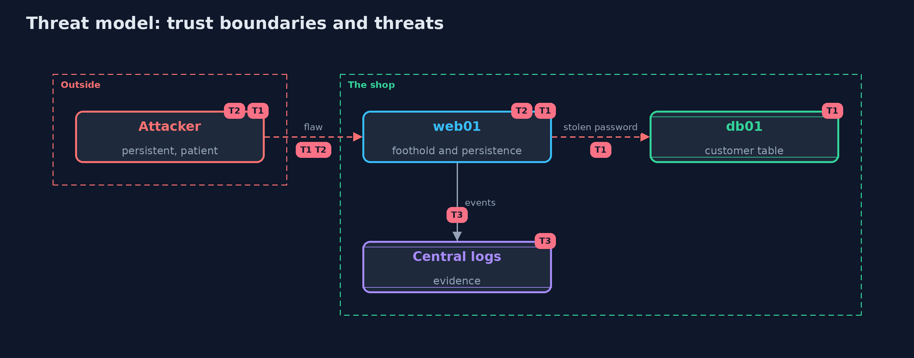

# Threat Model — Incident Response: Prepare, Contain, Eradicate, Recover, Learn

A threat model answers four questions: what are we protecting, who or what could harm it, how, and what do we do about it. This one covers this project's own demo system, not a production deployment. Domain: an online shop's breach.

## Scope

The response to a breach of a web server that leads to a theft of customer data. It covers what the responders do between the first alert and the return to service, and what they decide before.
It does not cover how the flaw is fixed in the code, legal duties, or public communication.

## What we protect (assets)

- Customer data.
- The integrity of the shop's systems.
- The evidence needed to know what happened.

## Who and what acts on the system

- The attacker, with three footholds.
- The incident responders.
- Customers, regulators and management who must be told.

## Trust boundaries

A trust boundary is a line that data or a request crosses between parts that trust each other differently. Threats cluster where those lines are.

- The shop's systems to the attacker: every foothold is a trust boundary that stayed open.
- Evidence to the response: actions that change systems can destroy it.

Each dashed box is a trust boundary. A rose tag such as T1 shows where the threat of that number, in the table below, applies.

## Threats, using STRIDE

STRIDE is a checklist of six kinds of threat: **Spoofing** (S), **Tampering** (T), **Repudiation** (R), **Information disclosure** (I), **Denial of service** (D), **Elevation of privilege** (E).

| Id | Kind | Threat | Where it shows up | Control in this project | What is left |
| --- | --- | --- | --- | --- | --- |
| T1 | Information disclosure | The theft continues while the team decides what to do | `Responder.isolateWeb01`, `killDatabaseSessions` | An alert on unusual reads, a runbook that names who may isolate, containment by network rule first | Rows already copied before the alert |
| T2 | Elevation of privilege | The attacker returns through a way back in that the response missed | `World.footholdsLeft` | Scope from logs, rotate every seen credential, rebuild from an image, patch the flaw, monitor after recovery | Footholds that the logs do not show |
| T3 | Repudiation | Evidence is destroyed or never kept, so the cause and extent are unknown | `Responder.rebootWeb01`, `Preparation.logsShippedCentrally` | Isolate instead of rebooting, snapshot memory and disk, central logs with retention, hashes for chain of custody | Attackers who delete or alter the central logs; keep them append-only |

## Assumptions

- The attacker's behaviour is fixed and scripted.
- The responders' actions take the stated times.

## Out of scope

- Notification duties and public statements.
- Attribution of the attacker.

## How the tests check this

- `IncidentTest` checks the preparation checklist, detection times, the copying rate and its stop, the effect of a reboot, a rebuild with and without an image, scoping with enough and too little log history, the account that cannot be disabled when unknown, and the three outcomes.
- `DemoRunsTest` compares the whole demo with the golden output.

## Where this model goes next

The next module, secure-design, steps back from incidents to the design decisions that shape them, starting with threat modeling and requirements.
