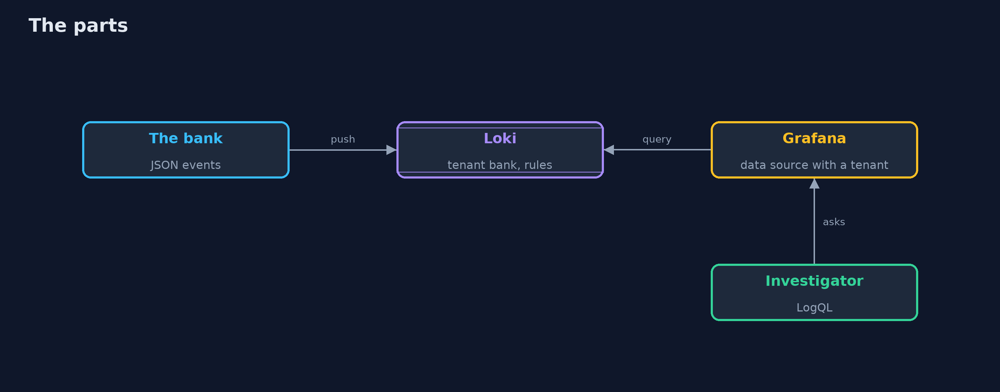
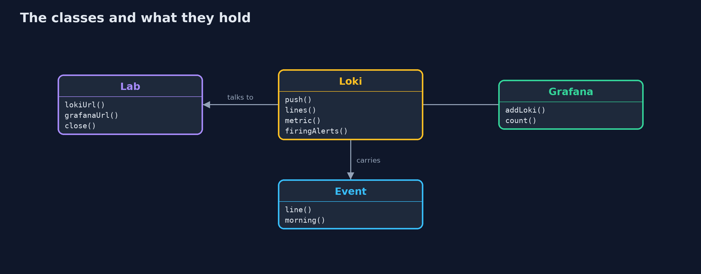

# Security Logging with Loki and Grafana

```
src/main/java/com/jk/explore/security/lokilogs/
├── Event.java         One security event of the bank: who did what to what, from where, and how it ended
├── Grafana.java       Grafana's HTTP API: a Loki data source for one tenant, and a query sent through it
├── Lab.java           A real Loki 3 (with its rule evaluator) and a real Grafana 13 on a private Docker network, each bound to a free loopback port and removed on close
├── Loki.java          Loki's HTTP API, for one tenant: push lines, ask LogQL questions, list labels and streams, read the alerts the rule evaluator holds
└── LokiLogsDemo.java  
```

**A real Loki 3 holds the bank's eight security events as JSON lines with two labels, answers who moved 500 and what else came from that address in LogQL, shows through Grafana the same lines for the same tenant and none for another, evaluates a rule that fires on four failed logins from one address, and does it per tenant; but a user as a label makes a stream for each user, a rule with a typo runs in silence, an old event is refused, Loki neither signs nor lets you change a line, and access to Grafana is access to the logs.**

The plain [security-logging](../security-logging) project writes a security log that answers who, what, when, where from and how it ended, keeps secrets out, and shows when it was changed. Its last line says "a log that nobody reads is evidence only after the fact: the -with-loki-and-grafana version ships, queries and alerts." This is that version, against a real **Loki 3.7** (with its rule evaluator) and a real **Grafana 13**, both in Docker on a private network. It needs Docker; the tests are tagged `integration`: `./gradlew integrationTest`.

What it shows:
- **Shipping.** The morning's eight events are pushed as JSON lines with two labels (`app`, `event_type`); every push needs a tenant (`X-Scope-OrgID`), and a push without one gets `401 no org id`.
- **Asking in LogQL.** Which events mention ANA-1; who moved 500 or more (`ana` from `198.51.100.66`, request `req-0006`); everything from that address in time order (`login failure, login failure, login success, money-movement success`); failures counted by address. The question the old logger could not answer is one line.
- **Labels and content.** 150 users as a label make 150 streams; the same users in the line make one. Labels are for what you always select by.
- **Alerting.** A rule fires when one address has 3 failed logins in 5 minutes. Ana's two do not; four from `203.0.113.9` do, and the alert names the address. A second rule with a typo in a field name stays `inactive/ok` for ever: **test your rules**.
- **The bill.** Another tenant sees none of the bank's lines; an event ten days old is refused; there is no delete route; Grafana reads the same data through a data source that sends the tenant, and whoever can use that data source sees the logs.

**Maps to:** OWASP Top 10 (2025) A09 Security Logging and Alerting Failures · ASVS V16 Security Logging and Error Handling · CWE-778 (insufficient logging) · NIST CSF 2.0 Detect.

## The idea in everyday terms

A security office with a filing room and a night guard. The filing room (Loki) keeps every event in an order that can be searched; the guard (the rule) rings a bell when one visitor has failed at the door three times; and a guard who looks for the wrong colour of coat never rings at all.

## The scenario

A bank's security events from one morning, shipped to a log store. The demo asks the questions an investigator asks, then sets a rule that a night operator would rely on.

## Run

```bash
./gradlew run
```

The demo tells the story in 5 acts, each printing exact numbers that the tests check:

| Act | What it shows |
| --- | --- |
| 1. Shipping the events | Eight JSON lines with two labels are pushed and answered with 204; a push with no tenant is refused with 401. |
| 2. Asking questions in LogQL | Who moved 500 or more, everything from that address in order, and failures by address: the old logger's question in one line. |
| 3. Labels and content | A user as a label makes 150 streams; the same users in the line make one, and both answer the question. |
| 4. Alerting | A rule fires for four failed logins from one address; a rule with a typo runs without complaint and never fires. |
| 5. The bill | Tenants separate data, old events are refused, there is no delete route, and access to Grafana is access to the logs. |

## Test

```bash
./gradlew test
```

13 tests in `DemoRunsTest`, `EventTest`, `LokiTest`. The event tests run with no server. The rest start Loki and Grafana once for the whole class and remove them (./gradlew integrationTest). They need Docker.

## What the simulation got right, and what it left out

Loki and Grafana are the real servers in Docker on loopback ports, with a rule file for the tenant bank. The events carry the time of the run, so times are never printed; counts, names and addresses are, and they are the same on every run. The demo takes about twenty seconds.

## Technologies and versions

Every version below is pinned in the project's build files and was the latest stable release when the project was built.

| Technology | Version | Used for |
| --- | --- | --- |
| Java | 25 | the language and runtime; a Gradle toolchain finds or downloads the JDK |
| Gradle | 9.8.1 (wrapper) | build and run; nothing to install, the wrapper downloads it |
| tools.jackson.core:jackson-databind | 3.1.5 | library the code uses |
| org.junit.jupiter:junit-jupiter | 6.1.3, set by junit-bom | JUnit 5: the tests (tests only) |
| org.junit.platform:junit-platform-launcher | 6.1.3, set by junit-bom | JUnit platform launcher, which Gradle needs to run the tests (tests only) |
| videokit | repository tool (`tools/videokit`) | the narrated video and animation: Piper `en_US-amy-medium`, speed 0.8, longer pauses (the amy-slow voice) |

## Learning Material

| Document | What it is for |
| --- | --- |
| [Problem statement](docs/problem-statement.md) | the situation and what the project must show |
| [Prerequisites](docs/prerequisites.md) | what you need to know first |
| [Security Logging with Loki and Grafana, explained](docs/security-logging-with-loki-and-grafana-explained.md) | the acts in prose |
| [Session guide](docs/session.md) | a one-hour lesson with exercises |
| [Animated walkthrough](docs/animation.html) | the acts step by step, narrated |
| [Threat model](docs/threat-model.md) | what is protected, who could harm it, and how, using STRIDE |
| [Spec](docs/spec.md) | what this project must be true of |
| [Expected output](docs/expected-output.txt) | the golden demo output every test and every port checks against |

### The idea in one picture

The bank pushes events; Loki stores and evaluates; Grafana and the investigator ask.



### Where each piece sits

Two API wrappers, the lab, and the events.



### How the data moves

Stream, line, field, count, rule.


### Who calls whom, in order


### Video

`video/security-logging-with-loki-and-grafana-explained.mp4` (with `.m4a` audio and `.srt` subtitles) is built by `video/build_video.sh`. Rendered media is not committed.

## What it costs

- **Labels are an index:** every value makes a stream, and too many streams make the store slow and expensive.
- **A rule can be silently wrong** and nothing says so.
- **Tenants separate data but do not authenticate people:** that is the job of what sits in front.
- **Logs need a retention,** and what is old is refused or removed.
- **The store does not prove the lines are true:** the sender signs or chains them.

## When this is too much

A single service on a single machine with a week of logs can read them with grep. Use a log store when logs come from many places, when more than one team reads them, or when a rule must watch them all the time.

## Where you have already met this

- A Grafana dashboard with an "Explore" button.
- A `{app="..."}` selector in a query.
- A log agent such as Promtail or Alloy configured with labels.
- A page at night because of an alert rule.

## Where this sits

This is the tools version of [security-logging](../security-logging), in the [detection-and-response](..) module. What goes into the lines is the subject of [secrets-in-errors-and-logs-with-logback](../../secure-coding/secrets-in-errors-and-logs-with-logback); what the rules look for next is in [detecting-attacks](../detecting-attacks) and its OpenSearch version.
