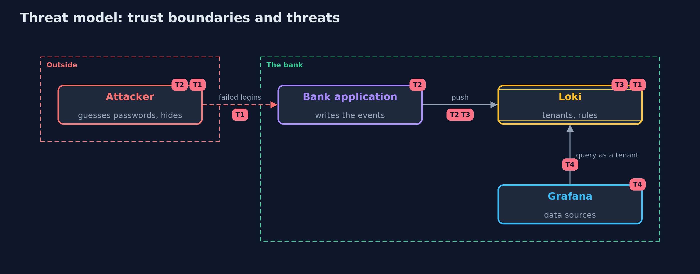

# Threat Model — Security Logging with Loki and Grafana

A threat model answers four questions: what are we protecting, who or what could harm it, how, and what do we do about it. This one covers this project's own demo system, not a production deployment. Domain: a bank.

## Scope

The path of the bank's security events from the application to a log store, the questions asked of it, the rule that watches it, and the access to it through Grafana. It does not cover the host that runs the store.

## What we protect (assets)

- The security events, which are evidence.
- The people's names and addresses they contain.

## Who and what acts on the system

- An attacker who guesses passwords.
- An investigator and a night operator.
- Another team's tenant.

## Trust boundaries

A trust boundary is a line that data or a request crosses between parts that trust each other differently. Threats cluster where those lines are.

- The tenant: one team's logs are not another's.
- The data source: whoever can use it sees the tenant's logs.

Each dashed box is a trust boundary. A rose tag such as T1 shows where the threat of that number, in the table below, applies.

## Threats, using STRIDE

STRIDE is a checklist of six kinds of threat: **Spoofing** (S), **Tampering** (T), **Repudiation** (R), **Information disclosure** (I), **Denial of service** (D), **Elevation of privilege** (E).

| Id | Kind | Threat | Where it shows up | Control in this project | What is left |
| --- | --- | --- | --- | --- | --- |
| T1 | Repudiation | Password guessing goes unnoticed | login events and the rules over them | A rule on failures by address, tested with a known bad event | Guessing spread over many addresses |
| T2 | Tampering | Events are lost, late or changed before they are stored | the path from the application | Ship as they happen, bound the age, chain or sign at the sender | Events the application never writes |
| T3 | Denial of service | Too many labels make the store unusable | label design | Few labels, the rest in the line | A label that becomes high-cardinality later |
| T4 | Information disclosure | Someone reads logs that are not theirs | Grafana data sources, tenants | A tenant per team and data sources limited by role | Anyone who may use a data source |

## Assumptions

- The application sends the events as they happen.
- Grafana users are authenticated and limited by the data sources they may use.

## Out of scope

- Alert routing and paging.
- Compromise of the Loki host.

## How the tests check this

- `EventTest` checks the events and their JSON lines with no server.
- `LokiTest` runs a real Loki and Grafana for the labels and streams, the refused push, the LogQL questions, tenant isolation, the old event, the cost of a label, Grafana's query and the rules.
- `DemoRunsTest` compares the whole demo with the golden output.

## Where this model goes next

The next project in this module is detecting-attacks-with-opensearch.
