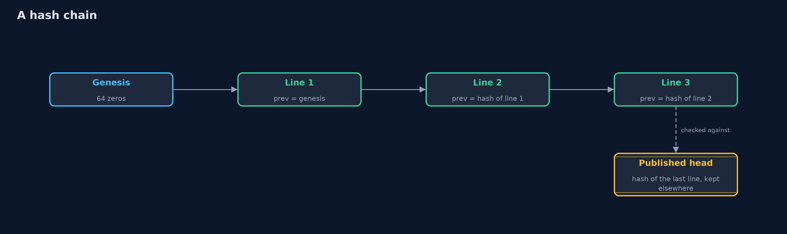
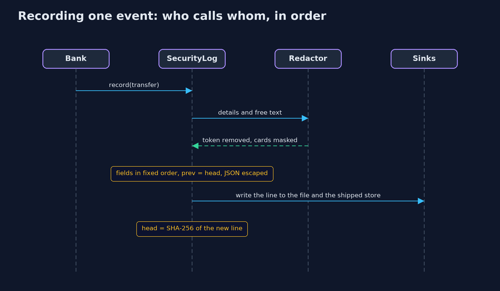

# Security Logging

```
src/main/java/com/jk/explore/security/securitylogging/
├── BankDay.java              One morning at the online bank, a minute per event: Ana logs in, someone else guesses her password from another address and moves money to an unknown account, Ben is refused another customer's account, Carol changes a role, and Ana pays by card
├── ChainCheck.java           Walks a hash-chained log and reports the first line that does not follow the one before it
├── EventType.java            The kinds of event a bank must be able to answer questions about later
├── FileSink.java             A log file created readable and writable by its owner only, and written only by appending
├── Hashes.java               SHA-256 of a log line, as lower-case hex
├── Json.java                 A flat JSON object of string values, written and read without a library
├── LogQuery.java             The questions an investigator asks of a structured log, answered by field instead of by guessing at text
├── LogSink.java              Where finished log lines go
├── MemorySink.java           Keeps lines in memory: the demo's view of a log, and the second store that shipped lines arrive in
├── Outcome.java              How an event ended
├── PlainLogger.java          The bank's old logger: a timestamp, a level and whatever message the code built, with user input pasted straight in
├── Redactor.java             Decides what of an event may be written down
├── Retention.java            Removes lines older than the retention period
├── SecurityEvent.java        One security event: who did what, to what, when, from where, how it ended, and the request it belongs to
├── SecurityLog.java          The bank's security log
├── SecurityLoggingDemo.java  Runs the online bank story in five numbered acts and prints exact, repeatable results
└── SimClock.java             A clock that moves only when told to, so every timestamp in the demo is the same on every run
```

**A security log must answer who did what, when, from where and how it ended, must never hold a password, token or card number, must not let user text write its lines, and must show when it was changed, which means structured events, a redactor, escaping, a hash chain and a copy that leaves the host.**

**Security logging and alerting failures** are number nine in the OWASP Top 10 (2025, A09). When something goes wrong at a bank, the first questions are always the same: **who** did it, **what** did they
do, **when**, **from where**, and **how did it end**. A log written as free text for developers cannot answer them. A **security log** records each security event, such as a login, an access decision, a money movement or an admin
change, as a **structured record** with the same fields every time and a **request id** that ties the record to everything else that request did. It must also never record what would make the log itself a target:
**passwords, tokens, session ids and full card numbers**. It must not let text a user typed **write its own lines**. And it must show when someone has **deleted or edited** a line, which a **hash chain** does: each line carries the
SHA-256 of the line before it.

The demo follows one morning at an online bank: a customer's password is used from another address to move money, and the log either can or cannot say so.

Maps to: OWASP Top 10 2025 A09 (Security Logging and Alerting Failures); CWE-778 (insufficient logging), CWE-117 (improper output neutralization for logs), CWE-532 (sensitive information in a log file); OWASP ASVS 5.0, the security logging chapter; NIST SP 800-92 (log management).

## The idea in everyday terms

Think of a bank's visitor book. A good one records who came in, when, which door they used, whom they saw and when they left, every time in the same columns. It never records the combination of the safe, even if a visitor says it out loud.
Nobody can write a fake visit between two real ones, because the pages are numbered and stamped. And a copy goes to head office every evening, so a burglar who burns the book has not burned the record.

## The scenario

An online bank logs one morning: Ana logs in, someone else fails twice with her password from another address, then succeeds and moves 500 to an unknown account, Ben is refused another customer's account, Carol changes a role,
and Ana pays by card. The demo asks the questions an investigator would, tries to forge and change log lines, and counts what logging costs.

## Run

```bash
./gradlew run
```

The demo tells the story in 5 acts, each printing exact numbers that the tests check:

| Act | What it shows |
| --- | --- |
| 1. What a security log must answer | The old logger's 8 lines cannot say who moved 500 from ANA-1 to MAL-9; the structured security log says it was ana's account, from 198.51.100.66, after 2 failed logins from that address. |
| 2. What never to log | The old logger wrote the full card number; the security log removes the tried password, the session id and the Authorization header, masks card numbers to the last four, even in a free-text note, and holds 0 of 5 secrets. |
| 3. Text that tries to write the log | A username with a line break forges a second line in the old logger's file; the security log writes one line whose actor is exactly what was typed, and a quote with a fake field cannot change the outcome. |
| 4. A log that shows it was changed | Each line carries the SHA-256 of the line before; deleting line 6 breaks the chain at line 6, editing it breaks it at line 7, and an edited last line is found only by comparing with the latest hash published elsewhere. |
| 5. The bill | A shipped copy survives the local log's deletion; keeping 30 days removes 10 old lines while the rest still check from their anchor; 2000000 logins a day are about 582 megabytes; and a log nobody reads protects nothing. |

## Test

```bash
./gradlew test
```

15 tests in `DemoRunsTest`, `JsonAndRedactorTest`, `SecurityLogTest`. The clock is simulated and the events are fixed, so timestamps, request ids and hashes are the same on every run. Tests feed every secret the bank's events carry through the log and check none reaches it, and check the chain against deleted, edited, garbled and truncated logs.

## What the simulation got right, and what it left out

The bank's events are fixed, and the clock is simulated, so every timestamp, request id and hash is the same on every run. The log is written in memory and, in act four, to a file in a temporary folder created with owner-only permissions.
No secret is ever printed: the demo checks for them and prints only whether they were found.

## Technologies and versions

Every version below is pinned in the project's build files and was the latest stable release when the project was built.

| Technology | Version | Used for |
| --- | --- | --- |
| Java | 25 | the language and runtime; a Gradle toolchain finds or downloads the JDK |
| Gradle | 9.8.1 (wrapper) | build and run; nothing to install, the wrapper downloads it |
| org.junit.jupiter:junit-jupiter | 6.1.3, set by junit-bom | JUnit 5: the tests (tests only) |
| org.junit.platform:junit-platform-launcher | 6.1.3, set by junit-bom | JUnit platform launcher, which Gradle needs to run the tests (tests only) |
| videokit | repository tool (`tools/videokit`) | the narrated video and animation: Piper `en_US-amy-medium`, speed 0.8, longer pauses (the amy-slow voice) |

## Learning Material

| Document | What it is for |
| --- | --- |
| [Problem statement](docs/problem-statement.md) | the situation and what the project must show |
| [Prerequisites](docs/prerequisites.md) | what you need to know first |
| [Security Logging, explained](docs/security-logging-explained.md) | the acts in prose |
| [Session guide](docs/session.md) | a one-hour lesson with exercises |
| [Animated walkthrough](docs/animation.html) | the acts step by step, narrated |
| [Threat model](docs/threat-model.md) | what is protected, who could harm it, and how, using STRIDE |
| [Spec](docs/spec.md) | what this project must be true of |
| [Expected output](docs/expected-output.txt) | the golden demo output every test and every port checks against |

### The idea in one picture

Every event passes through the redactor and the JSON writer, is chained to the line before it, and is written locally and shipped elsewhere at once.


### Where each piece sits

SecurityLog turns events into chained JSON lines; Redactor decides what survives; ChainCheck and Retention work on the lines.


### How the data moves

Each line names the hash of the one before, so a change anywhere breaks the link after it; the last link is checked against the published head.



### Who calls whom, in order




### Video

`video/security-logging-explained.mp4` (with `.m4a` audio and `.srt` subtitles) is built by `video/build_video.sh`. Rendered media is not committed.

## What it costs

- **Logs are personal data.** Names, account numbers and addresses make a security log subject to privacy law, so it needs a stated purpose, limited access and a retention period after which lines are deleted.
- **A log on the host dies with the host.** An attacker with root can rewrite a file and its whole hash chain, so lines must be shipped to a separate store as they are written, and the latest hash published there.
- **Volume costs money.** Hundreds of bytes per event, millions of events a day: what is logged needs a budget, and the security events must not drown in debug noise.
- **Redaction is never finished.** Each new field can carry a new kind of secret, so the redactor needs tests that feed it every secret the application handles.
- **A log nobody reads protects nothing.** Logging is evidence after the fact unless something watches it and alerts, which is the next project.

## When this is too much

For a toy program, a print statement is fine. For anything that handles accounts or money, structured security events, redaction and a request id are the minimum, and shipping lines off the host is
cheap compared with a breach nobody can explain. A hash chain matters most where logs are evidence: payments, admin actions and access to personal data.

## Where you have already met this

- Audit logs in banking, card payment (PCI DSS) and health systems, which must say who accessed what and when.
- JSON log lines in cloud log services, with a trace or request id on every line.
- Breach reports that say the attackers were inside for months and nobody noticed.
- Incidents where passwords or tokens were found in plain text in log files.

## Where this sits

This project is the first in the intermediate track's **detection-and-response** module ([detection-and-response](..)). It builds on the beginner projects
[hashing-and-integrity](../../../beginner/cryptography/hashing-and-integrity) and [password-attacks-and-defences](../../../beginner/passwords-and-mfa/password-attacks-and-defences).
