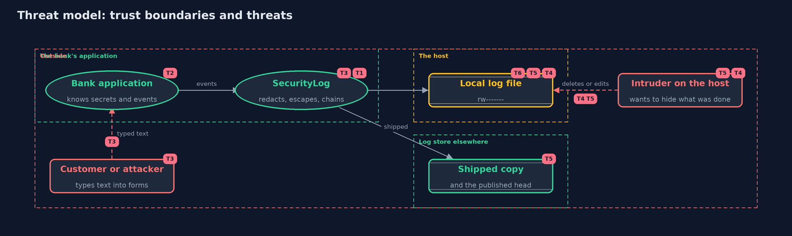

# Threat Model — Security Logging

A threat model answers four questions: what are we protecting, who or what could harm it, how, and what do we do about it. This one covers this project's own demo system, not a production deployment. Domain: an online bank.

## Scope

The security log of an online bank: what each event records, how secrets are kept out, how typed text is written, how the log is chained, stored, shipped and pruned. It covers an attacker who types text into forms, a thief who reads
the log, and an intruder on the host who wants to hide what was done. It does not cover alerting on the log, or the log store's own security.

## What we protect (assets)

- The record of who did what, which an investigation and a dispute depend on.
- The secrets the application handles: passwords, tokens, session ids and card numbers.
- The personal data in the log: names, account numbers and addresses.

## Who and what acts on the system

- Customers and staff whose actions are logged.
- An attacker who types text into forms, hoping to forge or hide records.
- A thief who gets a copy of the log file.
- An intruder on the host with the application's account, or with root.

## Trust boundaries

A trust boundary is a line that data or a request crosses between parts that trust each other differently. Threats cluster where those lines are.

- Form input to the log writer: every typed character crosses it.
- The application to its log file on the host.
- The host to the separate log store, where shipped lines and the published head live.

Each dashed box is a trust boundary. A rose tag such as T1 shows where the threat of that number, in the table below, applies.

## Threats, using STRIDE

STRIDE is a checklist of six kinds of threat: **Spoofing** (S), **Tampering** (T), **Repudiation** (R), **Information disclosure** (I), **Denial of service** (D), **Elevation of privilege** (E).

| Id | Kind | Threat | Where it shows up | Control in this project | What is left |
| --- | --- | --- | --- | --- | --- |
| T1 | Repudiation | An action cannot be traced to who did it, from where, because the log does not record it | `SecurityLog.record`, `SecurityEvent` | Structured events with fixed fields and a request id for logins, access decisions, money movements and admin changes | Events the application never sends are still missing, so the event list needs review with each feature |
| T2 | Information disclosure | Passwords, tokens, session ids or card numbers end up in the log and are stolen with it | `Redactor` | Removal by field name, masking by shape in free text, and tests that feed every known secret through the log | A new kind of secret in an unexpected field needs a new rule |
| T3 | Tampering | Typed text forges a log line or a field, misleading an investigation | `Json.write` | JSON lines with every control character and quote escaped, and text kept whole | Tools that render log text unescaped, such as a web viewer, need their own output encoding |
| T4 | Tampering | An intruder deletes or edits lines to hide what was done | `ChainCheck`, the log file | A hash chain that breaks at the first changed or missing line, and a published head for the last line | An intruder with root can rebuild the whole chain, so only the shipped copy and the published head are trustworthy |
| T5 | Denial of service | The log is destroyed with the host | the local file | Every line shipped to a separate store as it is written | Lines written in the moment before shipping can be lost |
| T6 | Information disclosure | The log is read by someone who should not see personal data, or kept longer than needed | the log file, `Retention` | Owner-only permissions and a retention period with an anchor so pruning keeps the chain checkable | Copies in backups and shipped stores need the same retention |

## Assumptions

- The separate log store is outside the intruder's reach.
- The clock is trusted; in the demo it is simulated.
- In the demo all names, addresses and secrets are fictional, and no secret is printed.

## Out of scope

- Alerting and detection rules: the detecting-attacks project.
- The log store's own access control.
- Signing the head hash: an exercise.

## How the tests check this

- `JsonAndRedactorTest` checks escaping and parsing of any text, refusals of malformed lines, and redaction by name and by shape.
- `SecurityLogTest` checks that no secret reaches the log, the fields of every line, forged lines, the chain against deletion, edits, garbling and truncation, file permissions and retention.
- `DemoRunsTest` compares the whole demo with the golden output.

## Where this model goes next

The next project, detecting-attacks, reads the security log and raises alerts for password spraying, impossible travel and privilege changes.
