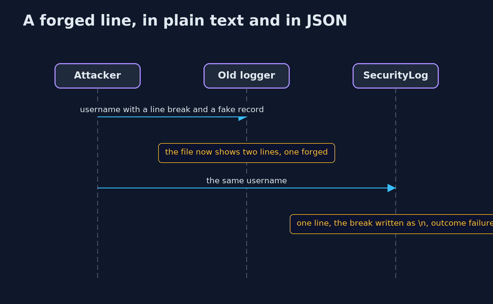
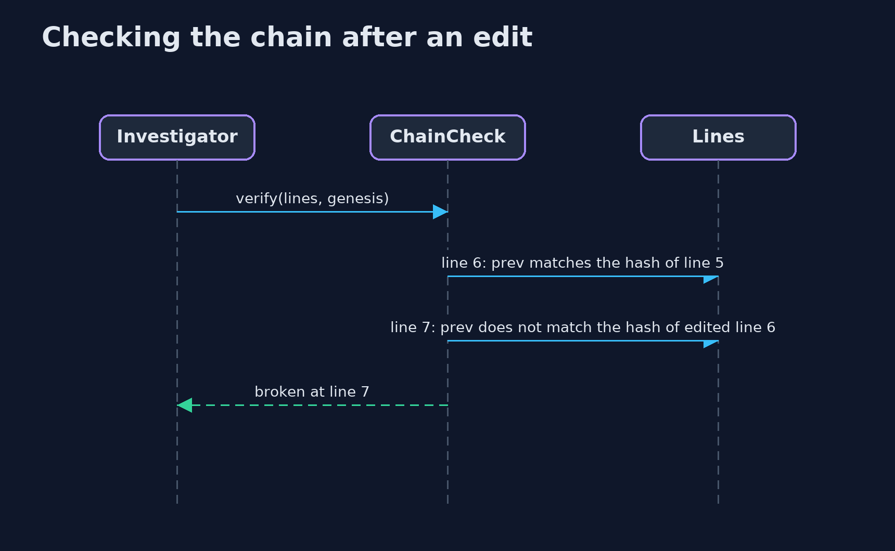

# Security Logging — UML Sequence Diagrams

## 1. A forged line, in plain text and in JSON

A line break in a username becomes a new line in a text file, and an escaped \n in a JSON line.

## 2. Checking the chain after an edit

The edited line still follows its predecessor, but the line after it no longer follows the edited line.

