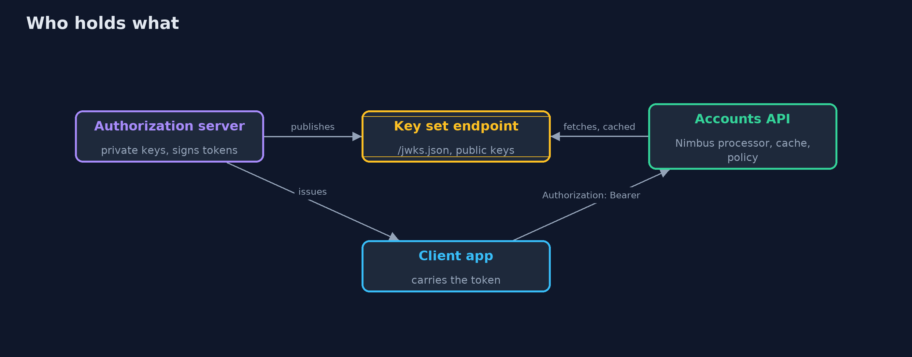
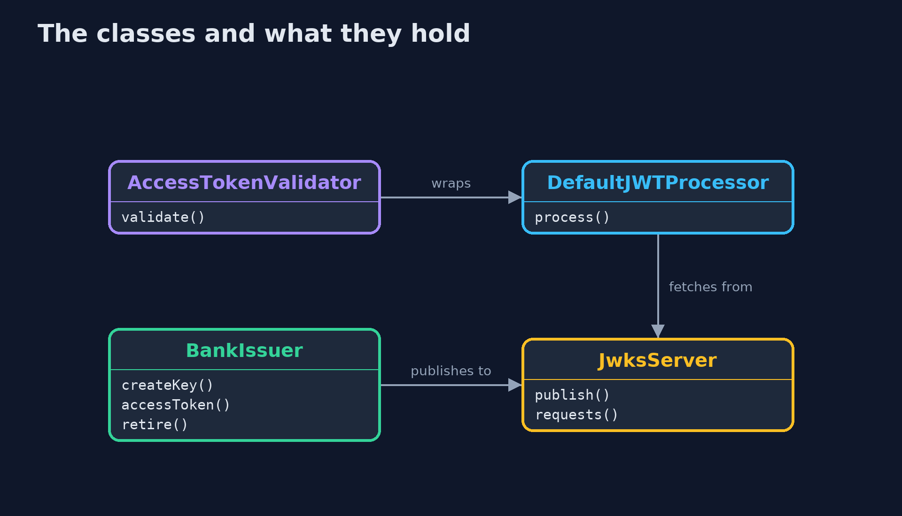
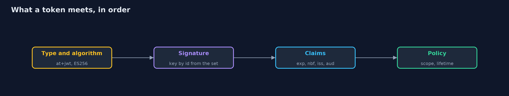
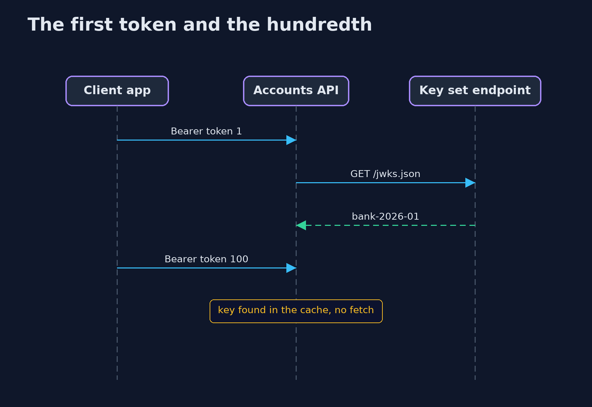

# JWT Done Right with Nimbus JOSE + JWT

```
src/main/java/com/jk/explore/security/jwtnimbus/
├── AccessTokenValidator.java  What the accounts API does with a bearer token
├── BankIssuer.java            The bank's authorization server: it holds the signing keys, signs access tokens with the current one, and says what it publishes
├── JwksServer.java            The bank's published key set at /jwks.json: a real HTTP server on the loopback interface that counts how often it is asked
├── NimbusJwtDemo.java         Runs the bank's token story in five numbered acts with Nimbus JOSE + JWT and a real key-set server on the loopback interface
├── RefreshTokens.java         Refresh tokens are not JWTs: they are random strings that the server looks up, so it can take one back at any moment
├── Refused.java               A token the API will not accept, with the reason the library gave
└── SimClock.java              A clock that stands still until the demo moves it, so a token's life of five minutes takes no time to wait for
```

**With Nimbus JOSE + JWT an API verifies a bearer token by fixing the algorithm and the type, taking keys only from the one key set URL in its settings, and letting the library check the signature, expiry, issuer, audience and required claims; but the scope, the lifetime policy, the cache time of the key set and the fact that a token cannot be taken back remain the API's own decisions.**

The plain [jwt-done-right](../jwt-done-right) project builds a token validator from scratch. This one uses the library most Java stacks already contain, **Nimbus JOSE + JWT 10.10** (the one behind Spring Security's resource server), against a **real key set endpoint** on the loopback address, with **ES256** tokens. It needs no Docker.

What it shows:
- **Parsing is not verifying.** `SignedJWT.parse` reads the claims of a token whose claims were edited to `sub=mallory`; the processor refuses it with `Invalid signature`.
- **The server chooses the algorithm and the type.** A token with `alg: none` and the right type (`Unsecured (plain) JWTs are rejected`), an HS256 token signed with the bank's public key as the secret (`Another algorithm expected`), and a correctly signed token of type `id+jwt` are all refused, because `JWSVerificationKeySelector` is built for ES256 and the type verifier for `at+jwt`.
- **Every claim.** Expiry with 30 seconds of clock skew, not-before, exact issuer, audience and required claims are checked by `DefaultJWTClaimsVerifier` (with a clock the demo can move); the scope and the 15-minute lifetime policy are two checks of our own.
- **Keys by id, from one URL.** 100 tokens cost **one** fetch of the key set. An unknown key id makes the library ask once more and then it is rate limited. A **`jku` header** pointing at the attacker's own key set is never followed (the attacker's server is asked 0 times), and a `jwk` header is ignored. A new key is **published before it is used**, and a **retired key lives on in the cache** until it expires.
- **The bill.** Ana's access token still works two minutes after her access was removed, her refresh token (a random string looked up on the server) does not, and a token that asks for 24 hours is refused.

**Maps to:** OWASP Top 10 (2025) A07 Authentication Failures · CWE-347 (improper verification of cryptographic signature) · CWE-345 · RFC 7519 (JWT), RFC 7515 (JWS), RFC 7517 (JWK), RFC 8725 (JWT best current practice), RFC 9068 (JWT access tokens).

## The idea in everyday terms

A bank teller who has to check a cheque. The printing, the signature and the date can be checked by anyone with the right stamp and a reference book, and a library is that stamp and that book. Whether this cheque is for this bank, today, for this much, is still the teller's decision.

## The scenario

An online bank's authorization server signs access tokens and publishes its keys at a URL. The accounts API verifies each bearer token with Nimbus. The demo runs a real key set server on a loopback port and sends the API good tokens and every kind of bad one.

## Run

```bash
./gradlew run
```

The demo tells the story in 5 acts, each printing exact numbers that the tests check:

| Act | What it shows |
| --- | --- |
| 1. Decoding is not verifying | A token is three base64url parts; anyone can read the claims, and a reader that only parses says mallory for a token whose claims were edited, while the processor refuses it. |
| 2. The server chooses the algorithm | A token with alg none, an HS256 token signed with the public key as the secret, and a correctly signed token of the wrong type are all refused, because the algorithm and the type are settings of the API. |
| 3. Every claim that matters | Expiry with 30 seconds of skew, not-before, issuer and audience are checked by the library; the scope is one check of our own. |
| 4. Keys by id, from one URL | 100 tokens cost one fetch of the key set; unknown key ids, jku and jwk headers never make the API trust an attacker's key; a new key is published before it is used, and a retired key lives on in the cache. |
| 5. The bill: a token cannot be taken back | Ana's access token works two minutes after her access was removed, her refresh token is revoked at once, the token expires after 5 minutes 31 seconds, and a lifetime of 24 hours is refused. |

## Test

```bash
./gradlew test
```

25 tests in `DemoRunsTest`, `NimbusJwtTest`. Every test generates new keys and starts its own key set server on a free loopback port. The key set cache tests wait a fraction of a second on purpose.

## What the simulation got right, and what it left out

The key set server is a real HTTP server on the loopback interface, and the keys are generated fresh on every run and never printed. The demo takes its time from a clock it can move, so a token's life of five minutes takes no time to wait for; only the cache of the key set uses real time, in a second or two, and it is shown on purpose.

## Technologies and versions

Every version below is pinned in the project's build files and was the latest stable release when the project was built.

| Technology | Version | Used for |
| --- | --- | --- |
| Java | 25 | the language and runtime; a Gradle toolchain finds or downloads the JDK |
| Gradle | 9.8.1 (wrapper) | build and run; nothing to install, the wrapper downloads it |
| com.nimbusds:nimbus-jose-jwt | 10.10 | library the code uses |
| org.junit.jupiter:junit-jupiter | 6.1.3, set by junit-bom | JUnit 5: the tests (tests only) |
| org.junit.platform:junit-platform-launcher | 6.1.3, set by junit-bom | JUnit platform launcher, which Gradle needs to run the tests (tests only) |
| videokit | repository tool (`tools/videokit`) | the narrated video and animation: Piper `en_US-amy-medium`, speed 0.8, longer pauses (the amy-slow voice) |

## Learning Material

| Document | What it is for |
| --- | --- |
| [Problem statement](docs/problem-statement.md) | the situation and what the project must show |
| [Prerequisites](docs/prerequisites.md) | what you need to know first |
| [JWT Done Right with Nimbus JOSE + JWT, explained](docs/jwt-done-right-with-nimbus-jose-jwt-explained.md) | the acts in prose |
| [Session guide](docs/session.md) | a one-hour lesson with exercises |
| [Animated walkthrough](docs/animation.html) | the acts step by step, narrated |
| [Threat model](docs/threat-model.md) | what is protected, who could harm it, and how, using STRIDE |
| [Spec](docs/spec.md) | what this project must be true of |
| [Expected output](docs/expected-output.txt) | the golden demo output every test and every port checks against |

### The idea in one picture

The bank holds the private keys and publishes the public ones; the API holds a URL, a cache and a policy.



### Where each piece sits

The validator wraps the library's processor and adds the two checks the library does not do.



### How the data moves

The type and algorithm first, then the signature, then the claims, then the policy.



### Who calls whom, in order




### Video

`video/jwt-done-right-with-nimbus-jose-jwt-explained.mp4` (with `.m4a` audio and `.srt` subtitles) is built by `video/build_video.sh`. Rendered media is not committed.

## What it costs

- **A cache means a retired key lives on.** Until the cache expires, a token signed with a key the bank has stopped publishing is still accepted, so the cache time is part of a key compromise plan.
- **A rate limit on refetches protects the key set endpoint** and also delays the first use of a key that was published late; publish a new key before you sign with it.
- **Clock skew is a tolerance an attacker also enjoys.** The 30 seconds should be as small as the clocks allow.
- **The library does not know your policy.** Scope, maximum lifetime and which type of token this API takes are your code.
- **An access token cannot be taken back,** so short lives and a revocable refresh token are the answer.

## When this is too much

For one service that is the only issuer and the only verifier, a shared secret and a few lines may do, but the day a second service verifies tokens it should have the public half only, and a key set endpoint is how it gets it.

## Where you have already met this

- `NimbusJwtDecoder.withJwkSetUri(...)` in Spring Security's resource server.
- `/.well-known/jwks.json` on an identity provider.
- A token with `"alg":"none"` in a pen test report.
- `kid` in a JWT header.

## Where this sits

This is the tools version of [jwt-done-right](../jwt-done-right), in the [identity-and-access](..) module. It follows the same five acts with the same checks, on a standard library and a real key set endpoint.
