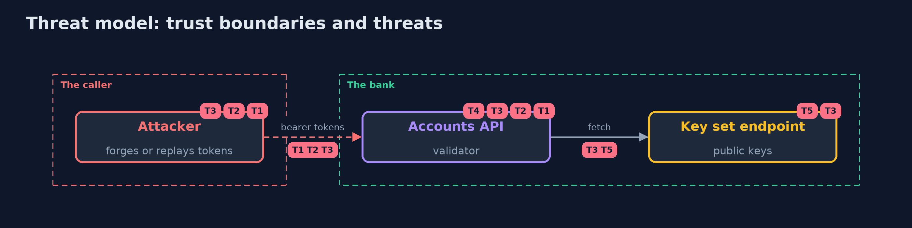

# Threat Model — JWT Done Right with Nimbus JOSE + JWT

A threat model answers four questions: what are we protecting, who or what could harm it, how, and what do we do about it. This one covers this project's own demo system, not a production deployment. Domain: an online bank.

## Scope

An accounts API that verifies bearer tokens with Nimbus JOSE + JWT against a key set published by the bank. It covers forgery, algorithm and type confusion, claims, key sources and rotation, and revocation. It does not cover how tokens are issued or stored by clients.

## What we protect (assets)

- The customers' accounts behind the API.
- The bank's signing keys.

## Who and what acts on the system

- An attacker who can send any bearer token.
- A customer whose access was removed.
- An operator who rotates keys.

## Trust boundaries

A trust boundary is a line that data or a request crosses between parts that trust each other differently. Threats cluster where those lines are.

- The caller to the API: the whole token is untrusted.
- The API to the key set endpoint: only the configured URL.

Each dashed box is a trust boundary. A rose tag such as T1 shows where the threat of that number, in the table below, applies.

## Threats, using STRIDE

STRIDE is a checklist of six kinds of threat: **Spoofing** (S), **Tampering** (T), **Repudiation** (R), **Information disclosure** (I), **Denial of service** (D), **Elevation of privilege** (E).

| Id | Kind | Threat | Where it shows up | Control in this project | What is left |
| --- | --- | --- | --- | --- | --- |
| T1 | Spoofing | A forged or edited token is accepted | `AccessTokenValidator` | Signature verified before any claim is believed, with a key chosen by id from the configured set | A stolen signing key |
| T2 | Spoofing | The token chooses its own algorithm or type | `JWSVerificationKeySelector`, the type verifier | ES256 and at+jwt are settings of the API; none, HS256 and other types are refused | A configuration that allows a second algorithm for a migration and keeps it |
| T3 | Spoofing | The token names the key that verifies it | `jku`, `jwk` and `kid` headers | Keys come only from the configured URL; the headers are never followed | A compromised key set endpoint |
| T4 | Elevation of privilege | A valid token for another API, scope or lifetime is accepted | claims and policy checks | Exact issuer and audience, a scope check and a maximum lifetime | A scope that is broader than the user's real rights |
| T5 | Denial of service | Tokens with unknown key ids make the API hammer the key set endpoint | `JWKSourceBuilder` | A cache and a minimum time between refetches | A key set endpoint that is down for longer than the cache |

## Assumptions

- The key set endpoint is reached over a trusted channel (https in production).
- The bank's private keys are not stolen.

## Out of scope

- Theft of tokens from a client.
- Compromise of the signing key.

## How the tests check this

- `NimbusJwtTest` generates fresh keys per test and checks parse versus verify, the signature length, none, HS256 confusion, the type, skew, not-before, issuer, audience, scope, missing claims, lifetime, refresh revocation, the key cache, unknown key ids, jku and jwk, the refetch limit, publishing before use and a retired key in the cache.
- `DemoRunsTest` compares the whole demo with the golden output.

## Where this model goes next

The next project in this module, oauth2-authorization-code-pkce-with-keycloak, moves from checking a token to getting one: the authorization code flow with PKCE against a real authorization server.
