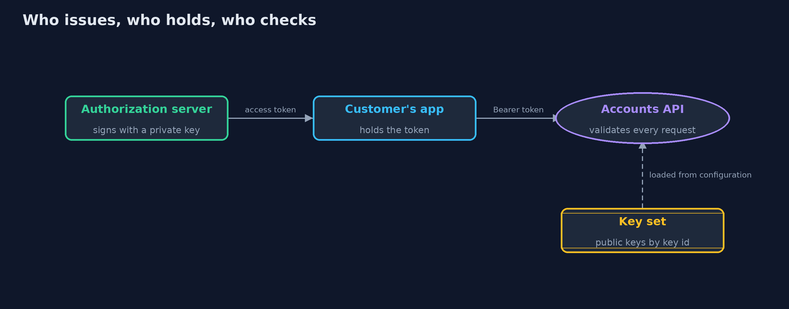
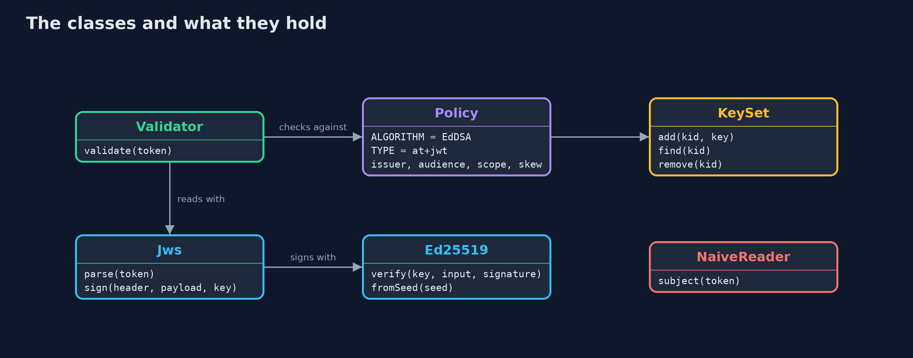
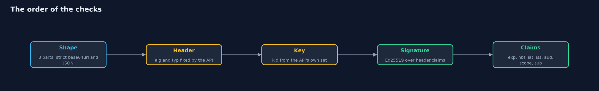
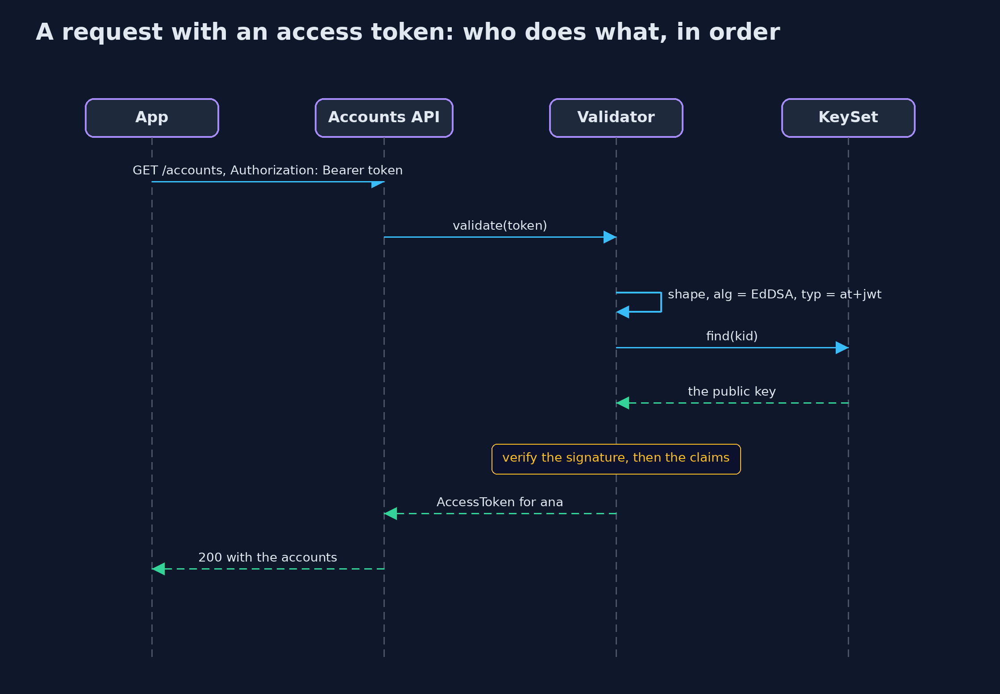

# JWT Done Right

```
src/main/java/com/jk/explore/security/jwt/
├── AccessToken.java            A token that passed every check: who it is for, what it allows, and when it stops working
├── Base64Url.java              Base64url without padding, as JWS uses it (RFC 7515 section 2)
├── Base64UrlSteps.java         Base64url by hand, for teaching: three bytes are 24 bits, cut into four groups of 6 bits, and each group picks one of 64 characters
├── Ed25519.java                Ed25519 keys and signatures with the JDK alone (RFC 8032, used in JOSE as "EdDSA", RFC 8037)
├── InvalidTokenException.java  A token the validator refuses
├── Issuer.java                 The bank's authorization server, reduced to the part that signs access tokens
├── Json.java                   A small, strict JSON reader and writer for token headers and claims: objects, arrays, strings, integers, booleans and null
├── Jws.java                    The compact JWS form, header.payload.signature (RFC 7515 section 7.1), with Ed25519 signatures
├── JwtDemo.java                Runs the online bank story in six numbered acts and prints exact, repeatable results
├── KeySet.java                 The public keys the bank's API trusts, by key id: the API's own copy of the authorization server's JWKS
├── NaiveReader.java            What too many APIs do: split the token, decode the claims, check that it has not expired, and trust the subject
├── Policy.java                 What the bank's accounts API accepts
├── RefreshTokens.java          Refresh tokens kept on the server
├── SimClock.java               A clock in whole seconds that only moves when told, so expiry checks are exact and repeatable
└── Validator.java              Validates the bank's access tokens, in this order: the shape, the algorithm and type the server expects, a key the server already holds, the signature, and only then the claims (expiry, not-before, issuer, audience, scope)
```

**A JSON Web Token is only as trustworthy as the checks around it: the server fixes the algorithm and the type, picks the key from a set it already holds, verifies the signature, and only then believes expiry, issuer, audience and scope. And because a token cannot be taken back, it must not live long.**

A **JSON Web Token (JWT)** is a set of **claims** (who it is for, who issued it, which API it is for, until when) in JSON, signed as a **JWS**
(RFC 7515). Bank APIs and almost every OAuth 2.0 deployment carry their **access tokens** this way. The format is simple, and most of the damage comes
from validators that check too little. **RFC 8725, JSON Web Token Best Current Practices**, lists the checks: let the server, not the token, choose the
algorithm; verify the signature before believing anything; check the issuer, the audience and the expiry; type tokens explicitly so one kind cannot
be used as another; and use keys the server already trusts.

This project maps to **OWASP Top 10 (2025) A07 Authentication Failures**; to **CWE-347**, improper verification of a cryptographic signature,
**CWE-345**, insufficient verification of data authenticity, and **CWE-613**, insufficient session expiration; and to the **self-contained tokens**
chapter of **OWASP ASVS 5.0**.

The demo builds a strict validator with the JDK alone, using **Ed25519** signatures (`EdDSA` in JOSE, RFC 8037), and checks it against the example
token that RFC 8037 publishes. Each check a naive validator skips is shown as a token the naive reader believes and the validator refuses.

## The idea in everyday terms

Think of a cinema ticket. Anyone can read what is printed on it: the film, the seat, the time. That is decoding. What makes it valid is the box office's
stamp, checked by an usher who knows what the stamp looks like, and who also checks that it is for this cinema, this film and tonight. An usher who
lets in anyone holding a piece of paper with a film name on it has decoded the ticket and verified nothing. And a ticket cannot be taken back once
sold, which is why it is only good for one evening.

## The scenario

An online bank's authorization server issues access tokens for its accounts API. The demo reads one token, forges and alters others, rotates the
bank's signing key, and removes a customer's access, and shows for each what a naive reader believes and what the strict validator does.

## Run

```bash
./gradlew run
```

The demo tells the story in 6 acts, each printing exact numbers that the tests check:

| Act | What it shows |
| --- | --- |
| 1. How the bank builds a token | The header (51 bytes) and claims (143 bytes) are JSON; base64url turns every 3 bytes into 4 characters (68 and 191); Ed25519 signs the 260-byte signing input into 64 bytes (86 characters); the token is 347 characters. |
| 2. Decoding is not verifying | The claims part is replaced to say sub mallory while ana's signature is kept: a reader that only decodes says mallory; the validator verifies the signature over parts 1 and 2 first, gets false, and refuses. |
| 3. The server chooses the algorithm, never the token | The API accepts only alg EdDSA and typ at+jwt, checked against RFC 8037; headers saying none, HS256, or id+jwt are refused, and Ana's real token is accepted. |
| 4. Every claim that matters is checked | Ana's token (iat and nbf 1800000000, exp 1800000300) is accepted at issue and at exp + 20, refused at exp + 30 = 1800000330; tokens with a later nbf, another iss, another aud or scope cards:read are refused. |
| 5. Keys by id, from a set the API already holds | During a changeover the API holds bank-2026-01 and bank-2026-07 and accepts tokens from both; after bank-2026-01 retires its token is refused, as are an unknown kid and an intruder's signature under bank-2026-07. |
| 6. The bill: a token cannot be taken back | Ana's access is removed at 120 seconds: at 240 her access token is still accepted while her refresh token rt-1 is refused; the access token stops at 330; a token lasting 3600 seconds breaks the 900-second policy. |

## Test

```bash
./gradlew test
```

40 tests in `Base64UrlStepsTest`, `DemoRunsTest`, `JsonAndBase64UrlTest`, `KeysTest`, `NaiveReaderTest`, `RefreshTokensTest`, `Rfc8037Test`, `ValidatorTest`. The Ed25519 code is checked against RFC 8037 appendix A: the published token verifies, signing its input gives the published signature, and the published public key is derived from the published private key. Every refusal is a test with its exact reason.

## What the simulation got right, and what it left out

Everything runs in memory with a simulated clock in whole seconds. Ed25519 signatures are deterministic, so the same key and claims always give the
same token, and the demo prints exact tokens. The bank's first signing key is the RFC 8037 test key, so its signatures can be checked by anyone; the
other keys come from fixed seeds and protect nothing. No key is ever fetched over a network.

## Technologies and versions

Every version below is pinned in the project's build files and was the latest stable release when the project was built.

| Technology | Version | Used for |
| --- | --- | --- |
| Java | 25 | the language and runtime; a Gradle toolchain finds or downloads the JDK |
| Gradle | 9.8.1 (wrapper) | build and run; nothing to install, the wrapper downloads it |
| org.junit.jupiter:junit-jupiter | 6.1.3, set by junit-bom | JUnit 5: the tests (tests only) |
| org.junit.platform:junit-platform-launcher | 6.1.3, set by junit-bom | JUnit platform launcher, which Gradle needs to run the tests (tests only) |
| videokit | repository tool (`tools/videokit`) | the narrated video and animation: Piper `en_US-amy-medium`, speed 0.8, longer pauses (the amy-slow voice) |

## Learning Material

| Document | What it is for |
| --- | --- |
| [Problem statement](docs/problem-statement.md) | the situation and what the project must show |
| [Prerequisites](docs/prerequisites.md) | what you need to know first |
| [JWT Done Right, explained](docs/jwt-done-right-explained.md) | the acts in prose |
| [Session guide](docs/session.md) | a one-hour lesson with exercises |
| [Animated walkthrough](docs/animation.html) | the acts step by step, narrated |
| [Threat model](docs/threat-model.md) | what is protected, who could harm it, and how, using STRIDE |
| [Spec](docs/spec.md) | what this project must be true of |
| [Expected output](docs/expected-output.txt) | the golden demo output every test and every port checks against |

### The idea in one picture

The token travels through the customer's hands, so the API checks every part of it against its own settings and keys.



### Where each piece sits

The validator reads the token with Jws and Json, chooses a key from KeySet, and checks everything against Policy.



### How the data moves

Nothing in the claims is believed until the signature has been checked with a key the API already holds.



### Who calls whom, in order




### Video

`video/jwt-done-right-explained.mp4` (with `.m4a` audio and `.srt` subtitles) is built by `video/build_video.sh`. Rendered media is not committed.

## What it costs

- **A token cannot be taken back.** Until it expires, an access token works even after the customer's access is removed. Keep lifetimes to minutes, and keep refresh tokens on the server, where they can be revoked.
- **Clock skew is a trade-off.** Servers' clocks differ, so a few seconds of leeway are needed; every second of leeway is a second an expired token still works.
- **Keys need operations.** A key set must be updated before a new key is used and kept until the last token signed with the old key has expired.
- **Claims are readable by anyone.** A JWS is signed, not encrypted: never put secrets or personal data in it that the holder should not see.
- **A hand-written validator is for learning.** Production code should use a maintained library configured as strictly as this one; see the `-with-nimbus-jose-jwt` version.

## When this is too much

For a single application with server-side sessions, a JWT adds nothing but risk: a session cookie is simpler and can be revoked at once. JWTs earn
their place when an API must check a token without calling the server that issued it, which is the usual case for OAuth 2.0 access tokens.

## Where you have already met this

- `Authorization: Bearer eyJ...` headers in API calls; every token starting with `eyJ` is base64url of `{"`.
- OAuth 2.0 and OpenID Connect providers such as Keycloak, and their `/.well-known/jwks.json` key sets.
- Debugging sites that decode a JWT: they show the claims without checking anything, which is exactly the point of act two.
- Advisories about `alg: none` and algorithm confusion in JWT libraries.

## Where this sits

This is the first project of [identity-and-access](..) in the [intermediate track](../..). It builds on the beginner projects
[digital-signatures](../../../beginner/cryptography/digital-signatures) and [authentication-vs-authorization](../../../beginner/identity/authentication-vs-authorization).
