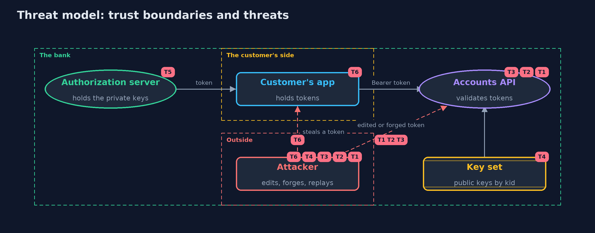

# Threat Model — JWT Done Right

A threat model answers four questions: what are we protecting, who or what could harm it, how, and what do we do about it. This one covers this project's own demo system, not a production deployment. Domain: an online bank.

## Scope

The validation of access tokens by an online bank's accounts API: reading the token, choosing the key, verifying the signature and checking the claims,
plus key rotation and token lifetime. It does not cover how tokens are issued (OAuth flows), how they are stored in browsers, or encrypted tokens.

## What we protect (assets)

- Customers' accounts behind the API.
- The authorization server's private signing keys.
- The API's key set and settings.
- Access and refresh tokens in customers' hands.

## Who and what acts on the system

- Customers' apps presenting tokens.
- An attacker who edits, forges or replays tokens, or steals one.
- Operators who rotate keys.

## Trust boundaries

A trust boundary is a line that data or a request crosses between parts that trust each other differently. Threats cluster where those lines are.

- Customer's app to the accounts API: every token crosses it and may have been changed.
- Authorization server to the key set: only the bank publishes keys.

Each dashed box is a trust boundary. A rose tag such as T1 shows where the threat of that number, in the table below, applies.

## Threats, using STRIDE

STRIDE is a checklist of six kinds of threat: **Spoofing** (S), **Tampering** (T), **Repudiation** (R), **Information disclosure** (I), **Denial of service** (D), **Elevation of privilege** (E).

| Id | Kind | Threat | Where it shows up | Control in this project | What is left |
| --- | --- | --- | --- | --- | --- |
| T1 | Spoofing | Edited claims are believed because the token was decoded but not verified | `NaiveReader`, `Validator.validate` | The signature is verified before any claim is read | Any code path that reads claims before validation reintroduces the flaw; keep one validator at one choke point |
| T2 | Spoofing | A token chooses a weak or absent algorithm (`none`, HS256 with a public key as the secret) | the token header | One algorithm, fixed in `Policy`; the header is only compared with it | A library left on its defaults may still honour the header; configure it strictly |
| T3 | Elevation of privilege | A valid token is used where it was not meant: another API, another token type, too wide a scope, after expiry | `Validator` claim checks | Explicit type, issuer, audience, scope, expiry with a small skew, not-before and a maximum lifetime | Every API must configure its own audience and scope; a shared default undoes the check |
| T4 | Spoofing | A token points to a key of the attacker's choosing, or the API fetches one because the token asked | `KeySet`, the `kid` header | Keys come only from the API's own set; an unknown key id is refused | The key set itself must be loaded from a trusted source and kept current |
| T5 | Information disclosure | A signing key leaks and every token it signed must be distrusted | the authorization server | Key ids and rotation with a changeover: a new key is trusted first, the old one removed | Until the old key is removed from every API, its forgeries are accepted |
| T6 | Repudiation | A stolen or revoked customer's access token keeps working | the customer's app, `Validator` | Short lifetimes and a cap on them; refresh tokens checked on the server | A stolen access token works until it expires; sender-constrained tokens (DPoP) are the tokens-in-the-browser project |

## Assumptions

- The private signing keys stay inside the authorization server.
- The API's clock is close to the authorization server's, within the configured skew.
- In the demo, the first key is the published RFC 8037 test key and the others come from fixed seeds; none of them protects anything.

## Out of scope

- Issuing tokens through OAuth 2.0 and OpenID Connect flows.
- Token storage in browsers.
- Encrypted tokens (JWE) and token introspection.

## How the tests check this

- `Rfc8037Test` checks the Ed25519 code against RFC 8037 appendix A.
- `ValidatorTest` checks every refusal with its exact reason, including the skew boundaries and the locale-free type check.
- `NaiveReaderTest` shows, for each missing check, a token the naive reader believes and the validator refuses.
- `KeysTest` checks rotation, unknown and missing key ids, and that a token cannot pick another key from the set.
- `JsonAndBase64UrlTest` checks the strict readers; `RefreshTokensTest` checks server-side revocation.
- `DemoRunsTest` compares the whole demo with the golden output.

## Where this model goes next

The next project, oauth2-authorization-code-pkce, shows how a customer's app obtains these tokens safely in the first place.
