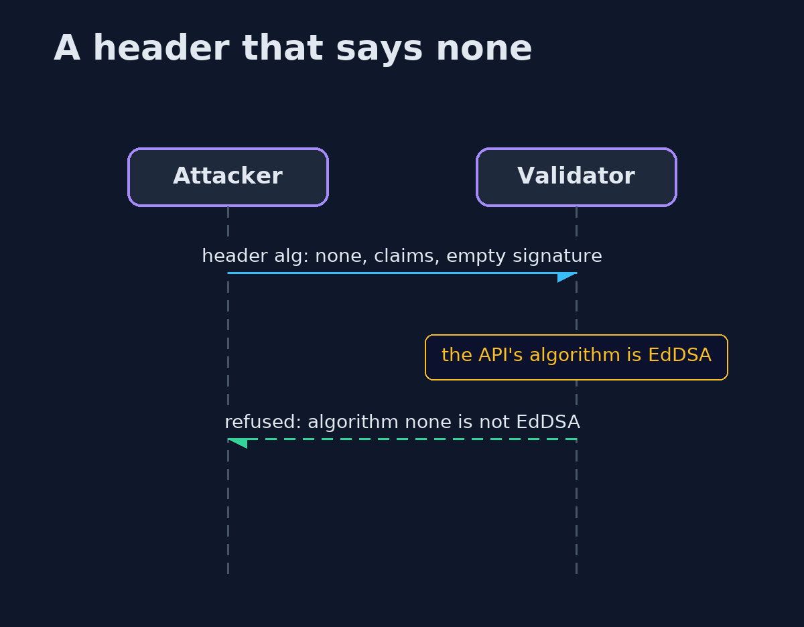
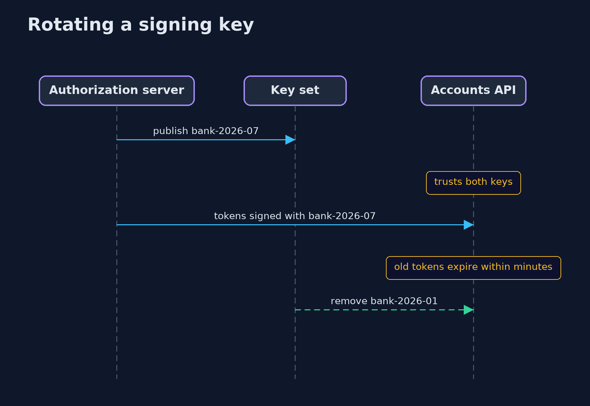

# JWT Done Right — UML Sequence Diagrams

## 1. A header that says none

The validator compares the header with its own setting before anything else, so an unsigned token never reaches the claims.

## 2. Rotating a signing key

The new key is trusted before it is used, and the old one is removed after its last tokens have expired.

