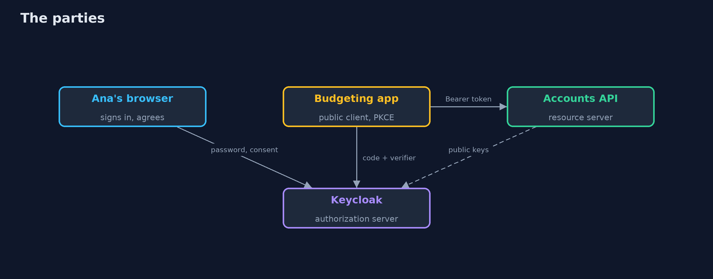
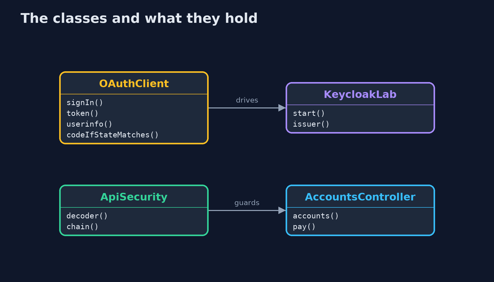
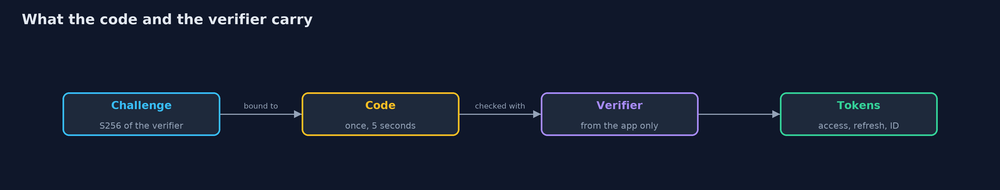
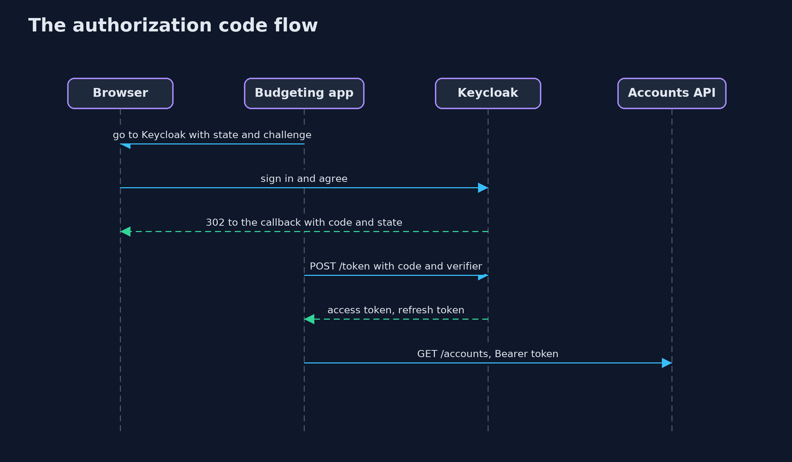

# OAuth 2.0 Authorization Code with PKCE and Keycloak

```
src/main/java/com/jk/explore/security/oauthkeycloak/
├── AccountsController.java  
├── ApiApp.java              
├── ApiSecurity.java         The accounts API is a resource server: it holds no passwords, keeps no session, and believes a bearer token only if Keycloak's published key signed it, it was issued by the bank realm for this API, and it has not expired
├── KeycloakLab.java         One Keycloak in a Docker container, bound to the loopback address on a free port, with the bank realm imported from {@code infra/bank-realm.json} and removed on close
├── OAuthClient.java         The budgeting app and the customer's browser, as far as this lesson needs them
├── OAuthKeycloakDemo.java   Runs the bank's OAuth 2.0 story in five numbered acts against a real Keycloak in Docker and a real resource server, all on the loopback interface
├── OffsetClock.java         The system clock plus an offset the demo can move forward, so a token's five minutes take no time to wait for
└── Running.java             The accounts API, a resource server on a free loopback port that trusts the bank realm of the given Keycloak
```

**Against a real Keycloak the authorization code flow with PKCE is a handful of client settings, exact redirect addresses, S256 required, no implicit flow, no password grant, rotated refresh tokens and short code and token lives, and the app still has to check the state; a reused code or a reused refresh token ends the session at Keycloak, which a resource server that validates tokens locally cannot see until the token expires.**

The plain [oauth2-authorization-code-pkce](../oauth2-authorization-code-pkce) project builds an authorization server from scratch. This one runs the same five acts against a real **Keycloak 26.8** in Docker, with a **Spring Security 7** resource server checking the tokens. It needs Docker; its tests are tagged `integration`: `./gradlew integrationTest`.

What it shows:
- **The flow, step by step.** The budgeting app's request (response type `code`, `state`, an S256 `code_challenge`), Ana signing in at Keycloak and agreeing on the **consent page** (the app never sees her password), the redirect with `code`, `state` and `iss`, the token exchange made by the app directly, and an access token for 300 seconds with audience `accounts-api`, accepted by the API.
- **PKCE.** The RFC 7636 example gives the published challenge. A thief with a leaked code and **no verifier is refused, and the failed try burns the code**, so the real app is refused too and Ana signs in again. A wrong verifier is a `PKCE verification failed`. A `plain` challenge or no challenge at all is refused at the authorization endpoint.
- **Exact redirects, state and one-time codes.** Of six addresses only the registered one gets a code; the path trick, the lookalike host, the query, the upper-case host and the trailing slash get an error page and **no redirect**. A callback carrying Mallory's code fails the app's own state check. A **reused code ends the session**: Keycloak's userinfo says 401, while the API that validates the signature itself still says 200. A code lives 5 seconds in this realm.
- **Scopes and refresh tokens.** `POST /payments` with an `accounts.read` token is `403 insufficient_scope`; asking for `payments.write` is `invalid_scope`. A refresh token is rotated; **using the old one again ends the session**, so the thief and the real app both lose.
- **Current practice.** The implicit flow and the password grant are switched off on the client, a confidential client needs its secret and **still needs PKCE**.

**Maps to:** OWASP Top 10 (2025) A07 Authentication Failures · RFC 6749 (OAuth 2.0), RFC 7636 (PKCE), RFC 9700 (OAuth 2.0 Security Best Current Practice), RFC 9207 (issuer identification) · OAuth 2.1 draft.

## The idea in everyday terms

A coat check run by a hotel, not by the shop. You show the hotel your room key, never the shop, and the hotel gives the shop a numbered ticket that works once, and only for the person who holds the matching stub. If someone tries a ticket with the wrong stub, the hotel tears the ticket up.

## The scenario

A budgeting app wants to read Ana's accounts at the bank. The demo starts a real Keycloak and the bank's accounts API in Docker and on a loopback port, drives the authorization code flow as a browser would, and then tries the mistakes: a leaked code, a wrong redirect address, a replayed code, a thief with an old refresh token.

## Run

```bash
./gradlew run
```

The demo tells the story in 5 acts, each printing exact numbers that the tests check:

| Act | What it shows |
| --- | --- |
| 1. The flow, step by step | The budgeting app sends Ana to Keycloak with a state and a PKCE challenge, she signs in and agrees there, the app exchanges the code for an access token, and the API accepts it. |
| 2. PKCE: a code is useless without the verifier | A leaked code with no verifier is refused and burned, a wrong verifier is refused, a plain challenge or none is refused at the authorization endpoint. |
| 3. Exact redirects, state, and codes that work once | Only the registered redirect address gets a code, the state check stops Mallory's code, a reused code ends the session at Keycloak but not at a local check, and a code lives 5 seconds. |
| 4. Scopes and refresh tokens | An accounts.read token cannot pay, an unregistered scope is refused, a refresh token is rotated, and using the old one again ends the session so the thief and the real app both lose. |
| 5. Current practice, and the bill | The implicit flow and the password grant are off, a confidential client needs its secret and still needs PKCE, and the resource server holds no passwords and no session. |

## Test

```bash
./gradlew test
```

33 tests in `DemoRunsTest`, `KeycloakFlowTest`, `PkceTest`, `RealmFileTest`. The tests that need Keycloak are tagged integration and start one container for the whole class (./gradlew integrationTest). The realm file and PKCE tests need no Docker.

## What the simulation got right, and what it left out

Keycloak is a real container bound to 127.0.0.1 on a free port, with the bank realm imported from infra/bank-realm.json and removed at the end. The resource server is a real Spring Boot application. The browser is a few lines of Java that keep Keycloak's cookies and follow its pages. Codes, tokens, ports and session ids are never printed.

## Technologies and versions

Every version below is pinned in the project's build files and was the latest stable release when the project was built.

| Technology | Version | Used for |
| --- | --- | --- |
| Java | 25 | the language and runtime; a Gradle toolchain finds or downloads the JDK |
| Gradle | 9.8.1 (wrapper) | build and run; nothing to install, the wrapper downloads it |
| org.springframework.boot:spring-boot-starter-webmvc | 4.1.1, set by spring-boot-dependencies | library the code uses |
| org.springframework.boot:spring-boot-starter-security | 4.1.1, set by spring-boot-dependencies | library the code uses |
| org.springframework.boot:spring-boot-starter-security-oauth2-resource-server | 4.1.1, set by spring-boot-dependencies | library the code uses |
| org.junit.jupiter:junit-jupiter | 6.1.3, set by junit-bom | JUnit 5: the tests (tests only) |
| org.junit.platform:junit-platform-launcher | 6.1.3, set by junit-bom | JUnit platform launcher, which Gradle needs to run the tests (tests only) |
| videokit | repository tool (`tools/videokit`) | the narrated video and animation: Piper `en_US-amy-medium`, speed 0.8, longer pauses (the amy-slow voice) |

## Learning Material

| Document | What it is for |
| --- | --- |
| [Problem statement](docs/problem-statement.md) | the situation and what the project must show |
| [Prerequisites](docs/prerequisites.md) | what you need to know first |
| [OAuth 2.0 Authorization Code with PKCE and Keycloak, explained](docs/oauth2-authorization-code-pkce-with-keycloak-explained.md) | the acts in prose |
| [Session guide](docs/session.md) | a one-hour lesson with exercises |
| [Animated walkthrough](docs/animation.html) | the acts step by step, narrated |
| [Threat model](docs/threat-model.md) | what is protected, who could harm it, and how, using STRIDE |
| [Spec](docs/spec.md) | what this project must be true of |
| [Expected output](docs/expected-output.txt) | the golden demo output every test and every port checks against |

### The idea in one picture

The user signs in at the authorization server; the app only ever sees a code and then a token.



### Where each piece sits

The app and the browser share one class; the lab and the API are separate.



### How the data moves

The challenge goes out through the browser, the code comes back through the browser, and the verifier goes straight to the token endpoint.



### Who calls whom, in order




### Video

`video/oauth2-authorization-code-pkce-with-keycloak-explained.mp4` (with `.m4a` audio and `.srt` subtitles) is built by `video/build_video.sh`. Rendered media is not committed.

## What it costs

- **Keycloak is a service to run:** its database, its keys, its upgrades and its logins are now part of the bank's security.
- **An exact redirect address is one more thing to register** for every environment and every app version, and a wildcard is the shortcut to avoid.
- **Reuse detection can sign a real user out** when a retry looks like a replay, so the app must handle a refused refresh by asking Ana to sign in again.
- **Short lives mean refreshing,** and a refresh token is worth more than an access token, so it needs the most care.
- **A resource server that checks tokens locally cannot see a revoked session** until the token expires; checking online costs a call for every request.

## When this is too much

For one app and one API that you own together, a session cookie is simpler. Use OAuth when a third party app must act for a user, or when many apps and APIs share one place to sign in.

## Where you have already met this

- A "Sign in with" button, and a consent screen asking to read your accounts.
- `code_challenge` and `code_verifier` in a mobile app's network log.
- "Invalid parameter: redirect_uri" from Keycloak when a callback address was mistyped.
- `spring.security.oauth2.client` and `oauth2ResourceServer` in a Spring Boot project.

## Where this sits

This is the tools version of [oauth2-authorization-code-pkce](../oauth2-authorization-code-pkce), in the [identity-and-access](..) module. It follows the same five acts, against a real authorization server, and ends with the resource server that real banks run.
