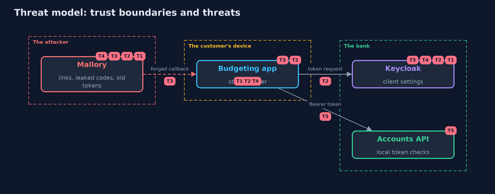

# Threat Model — OAuth 2.0 Authorization Code with PKCE and Keycloak

A threat model answers four questions: what are we protecting, who or what could harm it, how, and what do we do about it. This one covers this project's own demo system, not a production deployment. Domain: an online bank.

## Scope

The authorization code flow between a public client, a confidential client, Keycloak and a resource server. It covers redirect handling, code and token theft, state, scopes and refresh tokens. It does not cover Keycloak's own security or the client app's storage of tokens.

## What we protect (assets)

- Ana's accounts.
- The authorization code, the refresh token and the access token.

## Who and what acts on the system

- Ana, who signs in and consents.
- An app the bank has registered.
- Mallory, who can leak or forge a link, a code or an old token.

## Trust boundaries

A trust boundary is a line that data or a request crosses between parts that trust each other differently. Threats cluster where those lines are.

- The browser to the app: the redirect carries the code.
- The app to Keycloak: the token endpoint.
- The app to the API: the bearer token.

Each dashed box is a trust boundary. A rose tag such as T1 shows where the threat of that number, in the table below, applies.

## Threats, using STRIDE

STRIDE is a checklist of six kinds of threat: **Spoofing** (S), **Tampering** (T), **Repudiation** (R), **Information disclosure** (I), **Denial of service** (D), **Elevation of privilege** (E).

| Id | Kind | Threat | Where it shows up | Control in this project | What is left |
| --- | --- | --- | --- | --- | --- |
| T1 | Information disclosure | The authorization code is sent to an address the attacker controls | Keycloak's redirect address check | Exact registered redirect addresses; no prefix or wildcard match | A registered address that the attacker can use |
| T2 | Spoofing | A leaked code is redeemed by someone else | the token endpoint | S256 PKCE on every client, codes that work once and for a few seconds | A leak of the verifier as well |
| T3 | Spoofing | Mallory's code signs Ana into Mallory's account | the app's callback | A state bound to the browser session that started the sign-in | An app that skips the state check |
| T4 | Elevation of privilege | A stolen refresh token keeps access alive | the refresh grant | Rotation with no reuse; one reuse ends the session | A thief who uses the token before the real app does |
| T5 | Elevation of privilege | A revoked session still opens the API | a resource server with local checks | Short access tokens, and an online check for sensitive operations | The minutes between revocation and expiry |

## Assumptions

- The redirect address uses https in production.
- Keycloak and the API are reached over TLS in production.

## Out of scope

- Theft of tokens from the phone's storage.
- Compromise of Keycloak.

## How the tests check this

- `KeycloakFlowTest` starts a real Keycloak and checks the flow, consent, a wrong password, tampered and ID tokens, scope, expiry, burned and expired codes, PKCE, redirect addresses, the state of the redirect, reuse of a code, refresh rotation, the implicit flow, the password grant and a confidential client.
- `RealmFileTest` checks the settings in the realm file, and `PkceTest` the parts of the app that need no server.
- `DemoRunsTest` compares the whole demo with the golden output.

## Where this model goes next

The next project in this module, openid-connect-with-spring-security-and-keycloak, uses the same server to sign users in to an application and to log them out everywhere.
