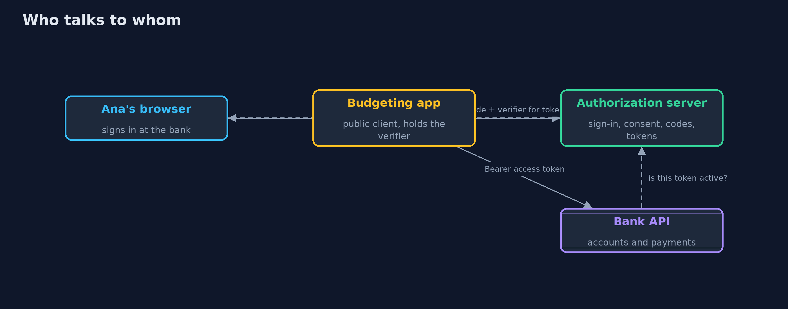
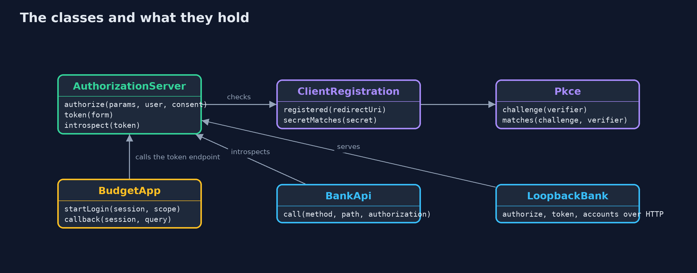
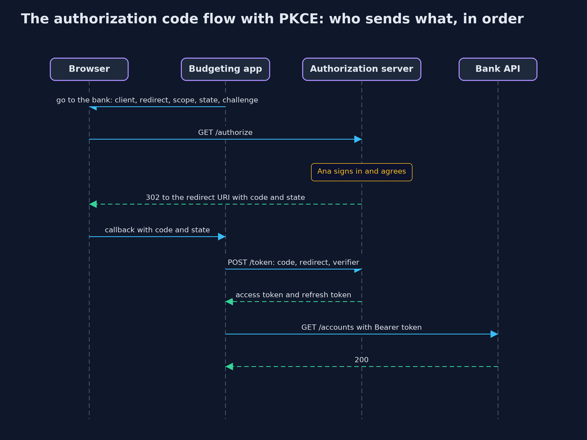

# OAuth 2.0 Authorization Code Flow with PKCE

```
src/main/java/com/jk/explore/security/oauth/
├── AuthorizationServer.java  The bank's authorization server: the authorization endpoint the browser visits, and the token endpoint the client calls directly
├── BankApi.java              The bank's accounts API, the resource server
├── BudgetApp.java            The budgeting app, a public OAuth client
├── ClientRegistration.java   What the bank knows about a client before any request arrives: its id, the exact redirect URIs it registered, the scopes it may ask for, and, for a confidential client that runs on a server, the SHA-256 of its secret
├── LoopbackBank.java         The same authorization server and API behind a real HTTP server on the loopback interface
├── OAuthDemo.java            Runs the online bank story in five numbered acts and prints exact, repeatable results
├── OAuthException.java       An OAuth 2.0 error response: an error code from RFC 6749 and a human-readable description
├── Pkce.java                 Proof Key for Code Exchange (RFC 7636)
├── SimClock.java             A clock in whole seconds that only moves when told, so lifetimes are exact and repeatable
├── TokenEndpoint.java        The bank's token endpoint as the client sees it: in-process for most acts, over a real local HTTP server in act one
└── Urls.java                 Builds and reads query strings and form bodies (application/x-www-form-urlencoded, UTF-8)
```

**The authorization code flow lets an app read a customer's bank accounts without ever seeing the password: the customer signs in at the bank, the browser carries only a short-lived code, and PKCE makes that code useless to anyone but the app that asked for it. Exact redirect addresses, a state bound to the browser, single-use codes, narrow scopes and rotating refresh tokens close the remaining gaps.**

**OAuth 2.0** (RFC 6749) lets a customer give an app limited access to an account without giving it the password. In the **authorization code flow**
the app sends the customer's browser to the bank's **authorization server**; the customer signs in there and agrees to a **scope**, such as
"read your accounts"; the browser comes back to the app's registered **redirect URI** with a short-lived **authorization code**; and the app swaps
that code, directly with the bank, for an **access token**. **PKCE**, Proof Key for Code Exchange (RFC 7636), adds a secret the app makes for each
sign-in, so that a code which leaks through a log or a browser history cannot be redeemed by anyone else. **RFC 9700**, the OAuth 2.0 Security Best
Current Practice, makes PKCE, exact redirect matching and refresh token rotation the norm, and removes the implicit flow and the password grant.

This project maps to **OWASP Top 10 (2025) A07 Authentication Failures**; to **CWE-352**, cross-site request forgery, which here takes the form of
login forgery, and **CWE-601**, open redirect; and to the **OAuth and OIDC** chapter of **OWASP ASVS 5.0**.

The demo builds an authorization server, a bank API and a budgeting app with the JDK alone, runs the whole flow in memory and over a real local HTTP
server, and checks PKCE against the example that RFC 7636 publishes. Every mistake is shown as a request that the correctly built server or app refuses.

## The idea in everyday terms

Think of a hotel. A guest never gives the cleaning company the master key. The front desk issues a key card for one room, for one stay, after checking
the guest's identity at the desk. OAuth is the front desk: the customer proves who they are to the bank, not to the app, and the app gets a card that
opens only what was agreed, only for a while. PKCE is the card being useless unless it is collected by the person holding the matching receipt.

## The scenario

An online bank lets a budgeting app read a customer's accounts. The demo walks through the flow message by message, then shows what happens when a code
leaks, when a redirect address is changed, when another person's sign-in is pushed into the customer's browser, when a code is used twice, when the app
asks for more than it registered, and when a refresh token is stolen.

## Run

```bash
./gradlew run
```

The demo tells the story in 5 acts, each printing exact numbers that the tests check:

| Act | What it shows |
| --- | --- |
| 1. The authorization code flow, step by step | The app sends the browser to the bank, Ana signs in and agrees to accounts.read, the browser returns with a 43-character code that works for 60 seconds once, the app swaps it directly for an access token of 300 seconds, and reads the accounts: 200, also over a real local HTTP server. |
| 2. PKCE: a code is useless without the verifier | The RFC 7636 verifier gives the published S256 challenge; only the challenge travels through the browser; a leaked code redeemed with no verifier or a made-up one is refused; plain and missing challenges are refused. |
| 3. Exact redirect addresses, state, and codes that work once | Only the exact registered redirect address gets a code; a forced sign-in into Mallory's account is refused by the state check; a reused code is refused and revokes the token it gave; a code 61 seconds old is refused. |
| 4. Scopes and refresh tokens | The token carries only accounts.read, so a payment is 403; asking for payments.write is refused; refresh tokens rotate, and reusing an old one revokes the whole family; an access token 300 seconds old is 401. |
| 5. Current practice, and the bill | The implicit flow and the password grant are refused, as RFC 9700 and OAuth 2.1 require; a confidential client must authenticate; and production needs a real authorization server. |

## Test

```bash
./gradlew test
```

28 tests in `AuthorizationServerTest`, `BudgetAppTest`, `DemoRunsTest`, `LoopbackTest`, `PkceTest`. PKCE is checked against RFC 7636 appendix B. Every refusal is a test with its exact OAuth error, and the whole flow is also tested over a real local HTTP server. Random codes and tokens are never printed, so the golden output is the same on every run.

## What the simulation got right, and what it left out

The authorization server, the bank API and the app run in memory with a simulated clock in whole seconds; act one also runs the flow over a real HTTP
server on the loopback interface, and prints only status codes. Codes, tokens and states come from a secure random source and are never printed:
messages show what each part is instead. The bank's sign-in and consent pages are stood in for by two parameters. Host names such as bank.example are
labels; nothing leaves the machine.

## Technologies and versions

Every version below is pinned in the project's build files and was the latest stable release when the project was built.

| Technology | Version | Used for |
| --- | --- | --- |
| Java | 25 | the language and runtime; a Gradle toolchain finds or downloads the JDK |
| Gradle | 9.8.1 (wrapper) | build and run; nothing to install, the wrapper downloads it |
| org.junit.jupiter:junit-jupiter | 6.1.3, set by junit-bom | JUnit 5: the tests (tests only) |
| org.junit.platform:junit-platform-launcher | 6.1.3, set by junit-bom | JUnit platform launcher, which Gradle needs to run the tests (tests only) |
| videokit | repository tool (`tools/videokit`) | the narrated video and animation: Piper `en_US-amy-medium`, speed 0.8, longer pauses (the amy-slow voice) |

## Learning Material

| Document | What it is for |
| --- | --- |
| [Problem statement](docs/problem-statement.md) | the situation and what the project must show |
| [Prerequisites](docs/prerequisites.md) | what you need to know first |
| [OAuth 2.0 Authorization Code Flow with PKCE, explained](docs/oauth2-authorization-code-pkce-explained.md) | the acts in prose |
| [Session guide](docs/session.md) | a one-hour lesson with exercises |
| [Animated walkthrough](docs/animation.html) | the acts step by step, narrated |
| [Threat model](docs/threat-model.md) | what is protected, who could harm it, and how, using STRIDE |
| [Spec](docs/spec.md) | what this project must be true of |
| [Expected output](docs/expected-output.txt) | the golden demo output every test and every port checks against |

### The idea in one picture

The browser carries only the code; the app swaps it directly with the bank; the API asks the bank about every token.



### Where each piece sits

The authorization server owns codes and tokens; the app owns states and verifiers; the API trusts only the server's answer.



### How the data moves

The challenge goes with the request; the verifier goes only with the token request, directly from the app.


### Who calls whom, in order




### Video

`video/oauth2-authorization-code-pkce-explained.mp4` (with `.m4a` audio and `.srt` subtitles) is built by `video/build_video.sh`. Rendered media is not committed.

## What it costs

- **More moving parts than a password form.** Redirects, codes, states, verifiers and two kinds of token must all be handled correctly, which is why a maintained authorization server and client library are used in production.
- **Access tokens cannot be called back instantly** unless the API checks with the authorization server on every request, as this one does; self-contained tokens trade that check for speed, so they must be short-lived.
- **Refresh token rotation punishes the honest app too.** When a stolen token is reused, the whole family is revoked and the customer must sign in again, which is the price of containing the theft.
- **Exact redirect matching is strict on purpose.** Every environment and every app variant needs its own registered address.
- **A hand-written server is for learning.** It leaves out discovery, signed tokens, consent records, key rotation and account recovery; see the `-with-keycloak` version.

## When this is too much

An application that signs its own users in, with no third-party app involved, does not need OAuth at all: a session cookie is simpler. OAuth earns its
place when one party's app needs limited access to an account held by another party, or when many applications share one sign-in.

## Where you have already met this

- "Connect your bank account" buttons in budgeting and accounting apps, and the bank page that asks what the app may see.
- "Sign in with" buttons, which use OpenID Connect, built on this flow (the openid-connect project).
- Addresses ending in `?code=...&state=...` after signing in somewhere.
- Advisories about stolen authorization codes, open redirects and leaked refresh tokens.

## Where this sits

This project follows [jwt-done-right](../jwt-done-right) in [identity-and-access](..), part of the [intermediate track](../..). It builds on the beginner
projects [authentication-vs-authorization](../../../beginner/identity/authentication-vs-authorization) and [hashing-and-integrity](../../../beginner/cryptography/hashing-and-integrity).
