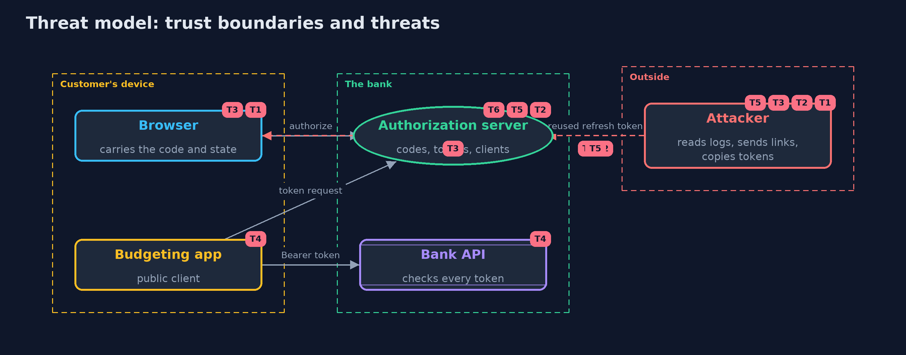

# Threat Model — OAuth 2.0 Authorization Code Flow with PKCE

A threat model answers four questions: what are we protecting, who or what could harm it, how, and what do we do about it. This one covers this project's own demo system, not a production deployment. Domain: an online bank.

## Scope

The OAuth 2.0 authorization code flow between a customer's browser, a public budgeting app, the bank's authorization server and the bank's accounts API:
authorization requests, redirects, the token endpoint, refresh tokens and API calls. It covers an attacker who can read logs and browser histories, send
links, change request parameters and copy tokens. It does not cover the bank's sign-in page itself, a compromised device, or OpenID Connect.

## What we protect (assets)

- Ana's password, which only the bank may see.
- Authorization codes, access tokens and refresh tokens.
- The registered redirect URIs and the confidential client's secret.
- Ana's accounts, and the ability to move money.

## Who and what acts on the system

- Ana, the customer, using a browser.
- The budgeting app, a public client.
- The bank's statements service, a confidential client.
- An attacker who reads logs, sends links and copies tokens.

## Trust boundaries

A trust boundary is a line that data or a request crosses between parts that trust each other differently. Threats cluster where those lines are.

- Browser to authorization server: everything in the address bar is visible and changeable.
- App to token endpoint: the only place codes become tokens.
- App to bank API: every request carries a token that the API must check.

Each dashed box is a trust boundary. A rose tag such as T1 shows where the threat of that number, in the table below, applies.

## Threats, using STRIDE

STRIDE is a checklist of six kinds of threat: **Spoofing** (S), **Tampering** (T), **Repudiation** (R), **Information disclosure** (I), **Denial of service** (D), **Elevation of privilege** (E).

| Id | Kind | Threat | Where it shows up | Control in this project | What is left |
| --- | --- | --- | --- | --- | --- |
| T1 | Information disclosure | An authorization code leaks through a log, a browser history or a referrer and is redeemed by someone else | `AuthorizationServer.token` | PKCE with S256: the code is bound to a challenge and redeemed only with its verifier | A device that is itself compromised can read the verifier too |
| T2 | Spoofing | A changed redirect URI sends the code to an attacker's address | `ClientRegistration.registered` | Exact string matching of registered redirect URIs; errors about the redirect are shown at the bank, never redirected | A registered address that itself has an open redirect would still leak codes |
| T3 | Tampering | A forced callback signs the customer into the attacker's account (login forgery) | `BudgetApp.callback` | A state made for each sign-in, bound to the browser session, checked in constant time and used once | An app that skips the state check is exposed; OpenID Connect adds a nonce as well |
| T4 | Elevation of privilege | An app uses its token for more than the customer agreed to | `BankApi.call`, `AuthorizationServer.authorize` | Scopes limited to what the client registered, shown at consent and enforced by the API on every call | A customer may agree to more than the app needs; consent screens must be clear |
| T5 | Spoofing | A stolen refresh token gives an attacker lasting access | `AuthorizationServer.token` (refresh) | Rotation on every use, and reuse detection that revokes the whole family | The attacker keeps access until the next real refresh; short access tokens limit the window |
| T6 | Information disclosure | The implicit flow or the password grant exposes tokens or passwords | `AuthorizationServer.authorize`, `AuthorizationServer.token` | Both are refused; confidential clients authenticate; public clients rely on PKCE | A real deployment must keep these off as it adds clients and features |

## Assumptions

- All real traffic uses TLS; the demo's loopback HTTP is for the lab only.
- The bank's sign-in page authenticates Ana correctly.
- Codes, tokens, states and verifiers come from a secure random source.

## Out of scope

- OpenID Connect and ID tokens: the openid-connect project.
- Tokens in single-page apps: the tokens-in-the-browser project.
- A compromised device or browser.

## How the tests check this

- `PkceTest` checks the RFC 7636 appendix B example, verifier rules and mismatches.
- `AuthorizationServerTest` checks exact redirects, PKCE, single-use and expiring codes, revocation on reuse, scopes, refresh rotation, removed grants and client authentication.
- `BudgetAppTest` checks states per browser session, forced callbacks and errors from the bank.
- `LoopbackTest` runs the whole flow over a real local HTTP server.
- `DemoRunsTest` compares the whole demo with the golden output.

## Where this model goes next

The next project, openid-connect, adds sign-in on top of this flow: ID tokens, nonce, discovery and logout.
