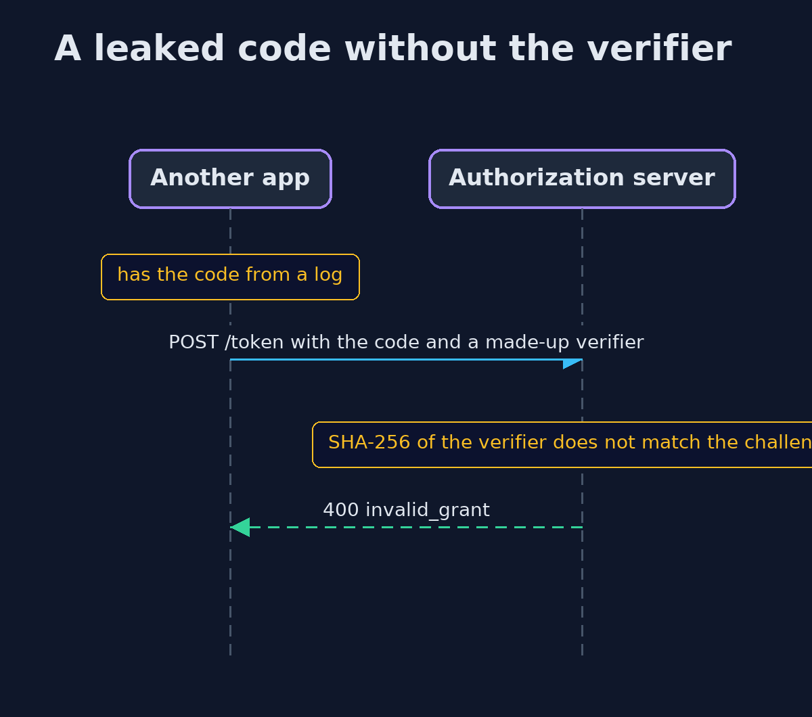
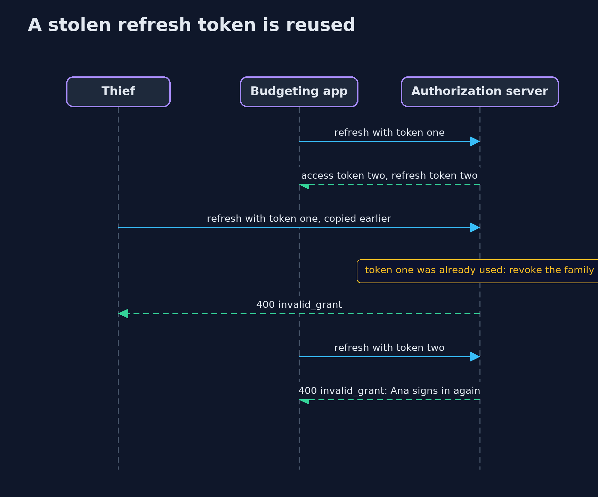

# OAuth 2.0 Authorization Code Flow with PKCE — UML Sequence Diagrams

## 1. A leaked code without the verifier

The code alone is not enough: the token endpoint hashes the verifier and compares.

## 2. A stolen refresh token is reused

Rotation makes the old token single-use; its reuse revokes the family.

