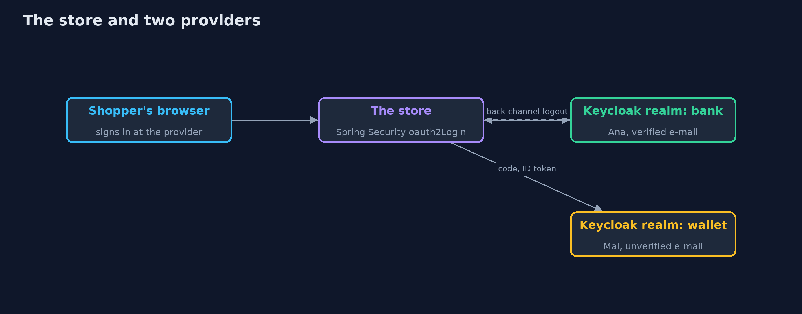

# OpenID Connect with Spring Security and Keycloak

```
src/main/java/com/jk/explore/security/oidcspring/
├── AccountsKeys.java     The fixed ids of the people in the realm files
├── KeycloakLab.java      One Keycloak in a Docker container, bound to the loopback address on a free port, with the bank and wallet realms imported from {@code infra/} and removed on close
├── LocalProvider.java    A small provider on the loopback interface whose only job is to sign ID tokens with claims Keycloak would never issue, so that Spring Security's checks can be seen refusing them
├── OidcSpringDemo.java   Runs the store's OpenID Connect story in five numbered acts against a real Keycloak in Docker and a real Spring Security 7 client, all on the loopback interface
├── Running.java          The store, a Spring Boot application on a loopback port that was chosen before Keycloak started, signing shoppers in with the bank and the wallet
├── Shopper.java          A shopper's browser as far as this lesson needs one: it keeps cookies for each address separately, follows redirects one hop at a time and remembers where it went, and when Keycloak shows its sign-in page it types the shopper's user name and password there
├── StoreAccounts.java    The store's customers
├── StoreApp.java         
├── StoreController.java  Who is signed in: the issuer and the subject, and the names of the claims in the ID token
├── StoreSecurity.java    The store signs shoppers in with OpenID Connect: the authorization code flow with PKCE, a state and a nonce that Spring Security keeps in the shopper's session, an ID token that Spring Security checks, and sign-out that reaches the provider (RP-initiated logout) and that the provider can start (back-channel logout)
└── Tokens.java           Gets the tokens that the store itself keeps out of the browser, so that the demo can look at them: a sign-in as the store would start it, stopped at the callback address, and the code redeemed at the token endpoint the way the store redeems it
```

**OpenID Connect login in Spring Security 7 against Keycloak gives the store a checked ID token, a state, a nonce and PKCE kept in the shopper's session, discovery that insists on the right issuer, and back-channel logout; the store still has to key its customers by issuer and subject and never by e-mail address, to keep the ID token away from APIs, and to tell the library its own logout address.**

The plain [openid-connect](../openid-connect) project builds the checks of an ID token from scratch. This one is the login most Spring Boot stores really run: **Spring Security 7** `oauth2Login()` against a real **Keycloak 26.8** in Docker, with two realms (the bank and a wallet). It needs Docker; its tests are tagged `integration`: `./gradlew integrationTest`.

What it shows:
- **Access is not identity.** The store sends Ana to the bank with scope `openid email`, a state, a nonce and a PKCE challenge, and Spring Security keeps them for her browser. The reply holds an ID token (typ `ID`, audience `store-web`) and an access token (typ `Bearer`, no audience). The access token offered as a sign-in is refused by Spring's decoder, and a request without the `openid` scope gets no ID token. A callback from another sign-in carried to Ana's browser is refused.
- **Checking the ID token.** With `OidcIdTokenDecoderFactory` and a local provider that signs claims Keycloak would never issue: a key the bank never published, an issuer with an extra slash, another issuer, another audience, two audiences with no `azp`, expiry (29 seconds past accepted, 31 refused, with a 30 second skew), no subject and `alg: none`.
- **Discovery and keys.** `ClientRegistrations.fromIssuerLocation` refuses a document that names another issuer, but **accepts one whose keys are on another site**; the issuer address must be trusted. When Keycloak adds a second signing key the store reloads the key set by itself.
- **Who signed in.** The wallet says its user `mal` has Ana's e-mail address, unverified. A store that keys accounts by e-mail gives **Mallory Ana's account**; keyed by issuer and subject it gives her a new one. Userinfo answers to the access token and not to the ID token.
- **Signing out.** RP-initiated logout sends the browser to Keycloak with `id_token_hint`. **Back-channel logout** from Keycloak ends the laptop's session and leaves the phone's. Spring Security posts to its own logout address to do it, and by default builds that from the request, so the store must be told its address. A made-up logout token and an ID token posted as one are both refused.

**Maps to:** OWASP Top 10 (2025) A07 Authentication Failures · OpenID Connect Core 1.0, OpenID Connect Discovery 1.0, RP-Initiated Logout 1.0, Back-Channel Logout 1.0 · RFC 9700 · CWE-287, CWE-639.

## The idea in everyday terms

A shop that lets customers show a library card as proof of who they are. The card says who issued it and carries a number; it does not matter what name is printed on it. A shop that files its customers by name will, one day, file two people under one name.

## The scenario

An online store lets shoppers sign in with their bank login, and with a wallet login. The demo starts a real Keycloak with the two realms and the real store, signs Ana and Mallory in, and tries the tokens and logouts that go wrong.

## Run

```bash
./gradlew run
```

The demo tells the story in 5 acts, each printing exact numbers that the tests check:

| Act | What it shows |
| --- | --- |
| 1. OAuth gives access; OpenID Connect adds who signed in | The store sends Ana to the bank with openid scope, state, nonce and PKCE; the reply holds an ID token for the store and an access token for the API; an access token is refused as a sign-in. |
| 2. Checking the ID token | Spring Security's decoder refuses a key never published, an issuer with an extra slash, another issuer or audience, a missing azp, an expired token, no subject and alg none. |
| 3. Discovery and keys | The store is configured with one issuer; discovery refuses a document that names another issuer but not one whose keys are elsewhere; a second signing key is picked up by itself. |
| 4. Who signed in: issuer and subject, never the email | A wallet user with Ana's unverified e-mail address takes over her account in a store that keys accounts by e-mail; keyed by issuer and subject Mallory gets a new account. |
| 5. Signing out, and the bill | Sign-out at the store reaches Keycloak with id_token_hint; Keycloak's back-channel logout ends the laptop's session and leaves the phone's; a made-up logout token and an ID token are refused. |

## Test

```bash
./gradlew test
```

33 tests in `DemoRunsTest`, `KeycloakLoginTest`, `ProviderChecksTest`, `RealmFilesTest`. The tests that need Keycloak are tagged integration and share one container per class (./gradlew integrationTest). The realm file tests and the ID token checks against a local provider need no Docker.

## What the simulation got right, and what it left out

Keycloak is a real container bound to 127.0.0.1 on a free port; its realms are imported from infra/, with the store's port written into a temporary copy. The store is a real Spring Boot application on a loopback port. The browser is a few lines of Java that keep cookies per address. Keycloak reaches the store through host.docker.internal for back-channel logout. Ports, codes, tokens and session ids are never printed.

## Technologies and versions

Every version below is pinned in the project's build files and was the latest stable release when the project was built.

| Technology | Version | Used for |
| --- | --- | --- |
| Java | 25 | the language and runtime; a Gradle toolchain finds or downloads the JDK |
| Gradle | 9.8.1 (wrapper) | build and run; nothing to install, the wrapper downloads it |
| org.springframework.boot:spring-boot-starter-webmvc | 4.1.1, set by spring-boot-dependencies | library the code uses |
| org.springframework.boot:spring-boot-starter-security | 4.1.1, set by spring-boot-dependencies | library the code uses |
| org.springframework.boot:spring-boot-starter-security-oauth2-client | 4.1.1, set by spring-boot-dependencies | library the code uses |
| org.junit.jupiter:junit-jupiter | 6.1.3, set by junit-bom | JUnit 5: the tests (tests only) |
| org.junit.platform:junit-platform-launcher | 6.1.3, set by junit-bom | JUnit platform launcher, which Gradle needs to run the tests (tests only) |
| videokit | repository tool (`tools/videokit`) | the narrated video and animation: Piper `en_US-amy-medium`, speed 0.8, longer pauses (the amy-slow voice) |

## Learning Material

| Document | What it is for |
| --- | --- |
| [Problem statement](docs/problem-statement.md) | the situation and what the project must show |
| [Prerequisites](docs/prerequisites.md) | what you need to know first |
| [OpenID Connect with Spring Security and Keycloak, explained](docs/openid-connect-with-spring-security-and-keycloak-explained.md) | the acts in prose |
| [Session guide](docs/session.md) | a one-hour lesson with exercises |
| [Animated walkthrough](docs/animation.html) | the acts step by step, narrated |
| [Threat model](docs/threat-model.md) | what is protected, who could harm it, and how, using STRIDE |
| [Spec](docs/spec.md) | what this project must be true of |
| [Expected output](docs/expected-output.txt) | the golden demo output every test and every port checks against |

### The idea in one picture

The store trusts each provider for its own users only, identified by issuer and subject.



### Where each piece sits

The store is small; the library carries the protocol.


### How the data moves

State, nonce and verifier stay in the browser's session; the ID token yields an issuer and a subject.


### Who calls whom, in order


### Video

`video/openid-connect-with-spring-security-and-keycloak-explained.mp4` (with `.m4a` audio and `.srt` subtitles) is built by `video/build_video.sh`. Rendered media is not committed.

## What it costs

- **Every provider is a trust decision:** its issuer address, its keys, and what it claims about e-mail addresses.
- **A library does the checks only for the flows it knows,** so the store's own account lookup is where the mistakes are made.
- **Back-channel logout needs the store to be reachable by Keycloak,** and to know its own address.
- **Sessions on the provider and in the store must be kept in step,** or signing out at one leaves the other signed in.
- **Key rotation depends on the cache:** a retired key lives on until the store reloads the key set.

## When this is too much

A store with one provider that it also runs can use a session cookie of its own. Use OpenID Connect when customers already have a login elsewhere, or when several applications should share one sign-in and one sign-out.

## Where you have already met this

- `spring.security.oauth2.client.registration` and `provider.*.issuer-uri` in an application.yml.
- A "Sign in with" button.
- `http.oauth2Login()` and `http.oidcLogout()` in a security configuration.
- An account table with an `email` column used as the key.

## Where this sits

This is the tools version of [openid-connect](../openid-connect), in the [identity-and-access](..) module. It follows the same five acts, on Spring Security and a real provider.
