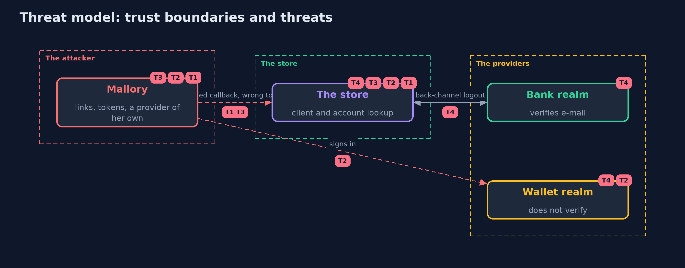

# Threat Model — OpenID Connect with Spring Security and Keycloak

A threat model answers four questions: what are we protecting, who or what could harm it, how, and what do we do about it. This one covers this project's own demo system, not a production deployment. Domain: an online store.

## Scope

A Spring Security OpenID Connect client with two providers, the accounts it keeps and its sign-out. It covers the sign-in request and response, the ID token checks, discovery and keys, the account lookup, and logout. It does not cover the providers' own security.

## What we protect (assets)

- The customers' store accounts.
- The customers' sessions at the store and at the providers.

## Who and what acts on the system

- A shopper, who signs in with a bank or a wallet.
- Mallory, who controls the wallet user she signs in with and can send a link.
- An operator of a provider, who can end sessions.

## Trust boundaries

A trust boundary is a line that data or a request crosses between parts that trust each other differently. Threats cluster where those lines are.

- The browser to the store: the callback carries a code and a state.
- The store to the provider: discovery, token and key requests.
- The provider to the store: the back-channel logout token.

Each dashed box is a trust boundary. A rose tag such as T1 shows where the threat of that number, in the table below, applies.

## Threats, using STRIDE

STRIDE is a checklist of six kinds of threat: **Spoofing** (S), **Tampering** (T), **Repudiation** (R), **Information disclosure** (I), **Denial of service** (D), **Elevation of privilege** (E).

| Id | Kind | Threat | Where it shows up | Control in this project | What is left |
| --- | --- | --- | --- | --- | --- |
| T1 | Spoofing | A callback or code from another sign-in signs the shopper into the attacker's account | the login callback | A state and a nonce kept in the shopper's session, and PKCE | A store that turns the checks off |
| T2 | Spoofing | A provider that does not verify e-mail addresses lets the attacker claim another customer's address | `StoreAccounts.byEmail` | Customers are keyed by issuer and subject; e-mail is an attribute | Account linking that trusts an unverified address |
| T3 | Spoofing | A token or provider document that is not the real provider's is accepted | ID token validation, discovery | Signature by a published key, exact issuer and audience, azp, expiry, and a trusted https issuer address | A discovery document served by a compromised provider |
| T4 | Repudiation | A session stays signed in after the provider ended it | back-channel logout | An OIDC session registry, back-channel logout and RP-initiated logout | A provider or store that is unreachable when the logout is sent |

## Assumptions

- The issuer addresses are https and belong to the providers in production.
- A provider is trusted only for its own users' subjects.

## Out of scope

- Compromise of a provider or its keys.
- Theft of the store's session cookie.

## How the tests check this

- `KeycloakLoginTest` starts a real Keycloak and the store and checks the redirect, the claims, a wrong password, the access token against the ID token, the openid scope, userinfo, the wallet user, the account keys, a callback from another sign-in, sign-out, a logout without a CSRF token, back-channel logout, a stranger's logout token and key rotation.
- `ProviderChecksTest` checks Spring Security's ID token validation and discovery against a local provider, and `RealmFilesTest` the realm files.
- `DemoRunsTest` compares the whole demo with the golden output.

## Where this model goes next

The next project in this module, tokens-in-the-browser-with-spring-boot, puts a small backend for the front end in front of the bank API so that the browser never holds a token.
