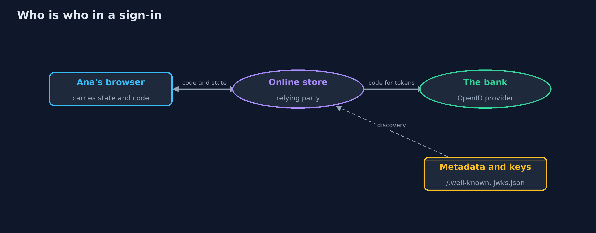

# OpenID Connect

```
src/main/java/com/jk/explore/security/oidc/
├── Base64Url.java              Base64url without padding, as JWS uses it (RFC 7515 section 2)
├── Discovery.java              OpenID Connect Discovery 1.0
├── Ed25519.java                Ed25519 keys and signatures with the JDK alone (RFC 8032, used in JOSE as "EdDSA", RFC 8037)
├── IdToken.java                An ID token that passed every check
├── IdTokenValidator.java       Validates an ID token the way OpenID Connect Core 1.0 section 3.1.3.7 requires, with the checks of RFC 8725 on top
├── InvalidTokenException.java  A token the validator refuses
├── Json.java                   A small, strict JSON reader and writer for token headers and claims: objects, arrays, strings, integers, booleans and null
├── Jws.java                    The compact JWS form, header.payload.signature (RFC 7515 section 7.1), with Ed25519 signatures
├── KeySet.java                 The provider's public keys, read from a JWKS document (RFC 7517) and looked up by key id
├── LoopbackProvider.java       The provider's discovery document and key set served over real HTTP on this machine's loopback address, on a free port
├── OidcDemo.java               Runs the "sign in with the bank" story in five numbered acts and prints exact, repeatable results
├── Provider.java               An OpenID Connect provider in one process: the bank, or another site the store lets customers sign in with
├── ProviderConfig.java         What the relying party knows about its provider after discovery: the exact issuer, its endpoints and its signing keys
├── SimClock.java               A clock in whole seconds that only moves when told, so expiry checks are exact and repeatable
├── Store.java                  The online store as an OpenID Connect relying party: "sign in with the bank"
└── Web.java                    A stand-in for the web inside one process: documents served at URLs
```

**OAuth 2.0 says what an app may do; OpenID Connect adds who signed in, in an ID token that the store must check against the provider it discovered: the exact issuer, its own audience, the time, and the nonce it gave this browser. The customer is the issuer and the subject together, never an email address.**

**OAuth 2.0** lets an app act on a user's behalf: it answers *what may this app do?* It does not say who the user is. **OpenID Connect (OIDC)**
is a thin identity layer on top. When the app asks for the `openid` scope, the provider returns an **ID token**: a signed JWT, meant for the app
itself, that says who signed in (`iss` and `sub`), for which app (`aud`), when (`iat`, `auth_time`), how strongly (`acr`, `amr`), and which
sign-in it belongs to (`nonce`). The app that relies on it is called the **relying party**.

Most OIDC failures are checks left out: an access token taken as a sign-in, an issuer compared loosely, a nonce never checked, keys loaded from
anywhere, or an account found by email address. This project builds a strict relying party with the JDK and shows each check refusing the token
it exists to refuse.

It maps to **OpenID Connect Core 1.0** (section 3.1.3.7, ID token validation), **OpenID Connect Discovery 1.0**, **OpenID Connect Back-Channel
Logout 1.0**, **RFC 9700** (OAuth 2.0 Security Best Current Practice), **OWASP Top 10 (2025) A07 Authentication Failures**, **CWE-287**
(improper authentication), **CWE-345** (insufficient verification of data authenticity), **CWE-347** (improper verification of a cryptographic
signature), and the **OAuth and OIDC** chapter of **OWASP ASVS 5.0**.

## The idea in everyday terms

Think of a hotel. An access token is a room key card: it opens a door, and the door does not care who holds it. An ID token is the passport shown
at the desk: it says who the guest is, who issued the passport, and the desk checks that it was issued by a country it recognises, that it has not
expired, and that the face matches tonight's booking. A desk that accepts a key card as a passport, or that books a room for anyone whose passport
shows the same name, has misunderstood both.

## The scenario

An online store lets customers sign in with their bank, and with a second provider, wallet.example. The demo follows Ana's sign-in, checks ID
tokens with one claim changed at a time, discovers the bank's metadata and keys and rotates them, shows an account takeover by email, and ends
with sign-out on one device and on all of them.

## Run

```bash
./gradlew run
```

The demo tells the story in 5 acts, each printing exact numbers that the tests check:

| Act | What it shows |
| --- | --- |
| 1. OAuth gives access; OpenID Connect adds who signed in | With the openid scope the bank returns an ID token for the store and an access token for its API; the ID token names Ana as https://bank.example | ana-0001, an access token offered as a sign-in is refused, and a reply without openid signs nobody in. |
| 2. Checking the ID token, as OpenID Connect Core requires | The bank's own token is accepted; a foreign signature, an issuer with an extra slash or another issuer, another audience, two audiences without azp, thirty seconds past expiry, another sign-in's nonce, no nonce and alg none are each refused. |
| 3. Discovery and keys | From one configured issuer the store reads the metadata and keys; a document naming another issuer or keys on another site is refused; a second key is added, the old one retired, and the same discovery works over real HTTP. |
| 4. Who signed in: issuer and subject, never the email | The bank and wallet.example both name the email ana@mail.example; a store keyed by email gives Mallory Ana's account, keyed by issuer and subject there are two accounts and the unverified email is not used; userinfo answers only a valid access token. |
| 5. Signing out, and the bill | Ana's sign-out ends the store's session and sends her to the bank's logout with id_token_hint; a back-channel logout token ends the laptop's session and leaves the phone's; a token with a nonce, without the event, or an ID token is refused. |

## Test

```bash
./gradlew test
```

27 tests in `DemoRunsTest`, `DiscoveryTest`, `IdTokenValidatorTest`, `StoreTest`. Ed25519 key derivation is checked against RFC 8032 test 1. Every ID token check, every discovery check and every logout-token check is a test with its exact refusal reason; the sign-in flow, state binding, single-use codes, account keys and userinfo have their own tests.

## What the simulation got right, and what it left out

Everything runs in one process with a simulated clock in whole seconds; one discovery check also runs over real HTTP on this machine's loopback
address, on a free port that is never printed. ID tokens are signed with Ed25519 from fixed seeds, so they are the same on every run. State, nonce
and session ids are random and never printed. Providers, users and email addresses are fictional.

## Technologies and versions

Every version below is pinned in the project's build files and was the latest stable release when the project was built.

| Technology | Version | Used for |
| --- | --- | --- |
| Java | 25 | the language and runtime; a Gradle toolchain finds or downloads the JDK |
| Gradle | 9.8.1 (wrapper) | build and run; nothing to install, the wrapper downloads it |
| org.junit.jupiter:junit-jupiter | 6.1.3, set by junit-bom | JUnit 5: the tests (tests only) |
| org.junit.platform:junit-platform-launcher | 6.1.3, set by junit-bom | JUnit platform launcher, which Gradle needs to run the tests (tests only) |
| videokit | repository tool (`tools/videokit`) | the narrated video and animation: Piper `en_US-amy-medium`, speed 0.8, longer pauses (the amy-slow voice) |

## Learning Material

| Document | What it is for |
| --- | --- |
| [Problem statement](docs/problem-statement.md) | the situation and what the project must show |
| [Prerequisites](docs/prerequisites.md) | what you need to know first |
| [OpenID Connect, explained](docs/openid-connect-explained.md) | the acts in prose |
| [Session guide](docs/session.md) | a one-hour lesson with exercises |
| [Animated walkthrough](docs/animation.html) | the acts step by step, narrated |
| [Threat model](docs/threat-model.md) | what is protected, who could harm it, and how, using STRIDE |
| [Spec](docs/spec.md) | what this project must be true of |
| [Expected output](docs/expected-output.txt) | the golden demo output every test and every port checks against |

### The idea in one picture

The store relies on the bank for identity: the browser carries the code, and the store fetches and checks the ID token itself.



### Where each piece sits

The store discovers each provider's configuration, and checks every ID token against it with IdTokenValidator.


### How the data moves

Nothing in the claims is believed until the signature has been checked with a key from the discovered issuer.


### Who calls whom, in order


### Video

`video/openid-connect-explained.mp4` (with `.m4a` audio and `.srt` subtitles) is built by `video/build_video.sh`. Rendered media is not committed.

## What it costs

- **Many checks, many options.** Core, Discovery, logout, and the provider's own choices add up; a hand-written relying party is for learning. Use a certified library and a real provider: see the `-with-spring-security-and-keycloak` version.
- **Discovery is a dependency.** The store must reach the provider's metadata and keys, cache them, and refresh them when keys rotate, without ever taking a key from a token's say-so.
- **Identity by issuer and subject means no easy account linking.** Linking a bank sign-in to an existing store account needs the customer to prove both, not a matching email.
- **Sign-out is a distributed problem.** Ending the store's session is easy; ending every application's session needs the provider to tell each of them, and each must listen.
- **ID tokens are personal data.** They carry email and session ids; keep them out of logs and do not send them to APIs.

## When this is too much

For a store with its own passwords and no single sign-on, OpenID Connect adds a dependency and a flow. It earns its place when customers already
have an account somewhere they trust, when several applications share one sign-in, or when the sign-in itself must meet a standard (passkeys,
second factors) that the provider already runs.

## Where you have already met this

- "Sign in with ..." buttons on websites and apps.
- Addresses ending in `/.well-known/openid-configuration`, and key sets at `jwks.json`.
- `id_token`, `nonce` and `prompt=login` in redirect URLs.
- Advisories about account takeover through unverified email claims in social sign-in.

## Where this sits

This project follows [oauth2-authorization-code-pkce](../oauth2-authorization-code-pkce) and [jwt-done-right](../jwt-done-right) in
[identity-and-access](..), part of the [intermediate track](../..). It uses their flow and their validator, and adds identity on top.
