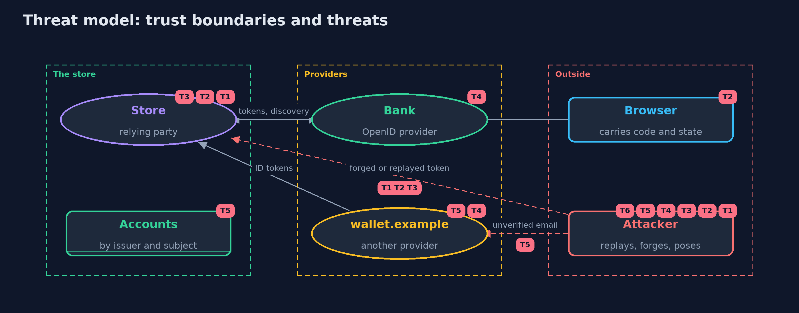

# Threat Model — OpenID Connect

A threat model answers four questions: what are we protecting, who or what could harm it, how, and what do we do about it. This one covers this project's own demo system, not a production deployment. Domain: an online store.

## Scope

An online store as an OpenID Connect relying party: starting a sign-in, redeeming the code, validating the ID token, discovering providers and their
keys, identifying customers, and signing them out. It does not cover the provider's own security, the customer's device, or the store's other features.

## What we protect (assets)

- Customers' store accounts and orders.
- The store's sessions.
- The trust the store places in each provider's issuer and keys.
- ID tokens, which carry personal data.

## Who and what acts on the system

- Customers signing in through their browsers.
- The bank and other providers.
- An attacker who replays, forges or substitutes tokens, poses as a provider, or controls an account at a provider with someone else's email.

## Trust boundaries

A trust boundary is a line that data or a request crosses between parts that trust each other differently. Threats cluster where those lines are.

- Browser to store: codes and state arrive from the customer's side.
- Provider to store: tokens, metadata and keys come from outside the store.
- One provider to another: the store must never let one provider's user stand for another's.

Each dashed box is a trust boundary. A rose tag such as T1 shows where the threat of that number, in the table below, applies.

## Threats, using STRIDE

STRIDE is a checklist of six kinds of threat: **Spoofing** (S), **Tampering** (T), **Repudiation** (R), **Information disclosure** (I), **Denial of service** (D), **Elevation of privilege** (E).

| Id | Kind | Threat | Where it shows up | Control in this project | What is left |
| --- | --- | --- | --- | --- | --- |
| T1 | Spoofing | An access token, a logout token or a token for another app is accepted as proof of sign-in | `Store.signIn`, `IdTokenValidator` | Token type, exact issuer, this client in the audience, and azp when there are several | Every relying party must configure its own client id; a shared default undoes the audience check |
| T2 | Spoofing | An ID token from another sign-in is replayed into this browser, or a callback is pushed into another browser | `Store.beginLogin`, `Store.callback` | State and nonce bound to the browser, compared in constant time; codes used once | Code interception is also covered by PKCE, shown in oauth2-authorization-code-pkce |
| T3 | Tampering | An expired or altered ID token is accepted | `IdTokenValidator` | Signature with a published key before any claim is read; expiry and issue time within a small skew | Skew lets a token live a few seconds longer; keep it small |
| T4 | Spoofing | A provider poses as another, or the store loads keys from somewhere an attacker controls | `Discovery` | Metadata must name the configured issuer; keys only from the issuer's own site; keys never taken from a token | If the issuer's own site is compromised, its keys are too; this is the provider's risk to manage |
| T5 | Elevation of privilege | Someone with an unverified email at another provider takes over a customer's account | `Store` account keys | Accounts keyed by issuer and subject; unverified email never stored or used for linking | Linking accounts across providers needs the customer to prove both, which costs a step |
| T6 | Repudiation | A customer signs out but other sessions stay alive | `Store.logout`, `Store.backchannelLogout` | RP-initiated logout at the provider, and back-channel logout tokens validated and applied per session | Applications that ignore logout tokens stay signed in until their sessions expire |

## Assumptions

- The providers keep their private signing keys secret.
- The store's connection to each provider uses TLS, which the demo does not model.
- In the demo, keys come from fixed seeds and protect nothing; all names and addresses are fictional.

## Out of scope

- Front-channel logout and session-management iframes.
- Dynamic client registration and pairwise subjects.
- The provider's own sign-in and account security.

## How the tests check this

- `IdTokenValidatorTest` checks each ID token refusal with its reason, and Ed25519 against RFC 8032 test 1.
- `DiscoveryTest` checks the mix-up refusal, keys on another site, a provider without EdDSA, origin comparison and discovery over real HTTP.
- `StoreTest` checks the full flow, state binding, single-use codes, registered redirects, account keys, userinfo and both kinds of logout.
- `DemoRunsTest` compares the whole demo with the golden output.

## Where this model goes next

The next project, tokens-in-the-browser, asks where these tokens should live when the app is a single-page application.
