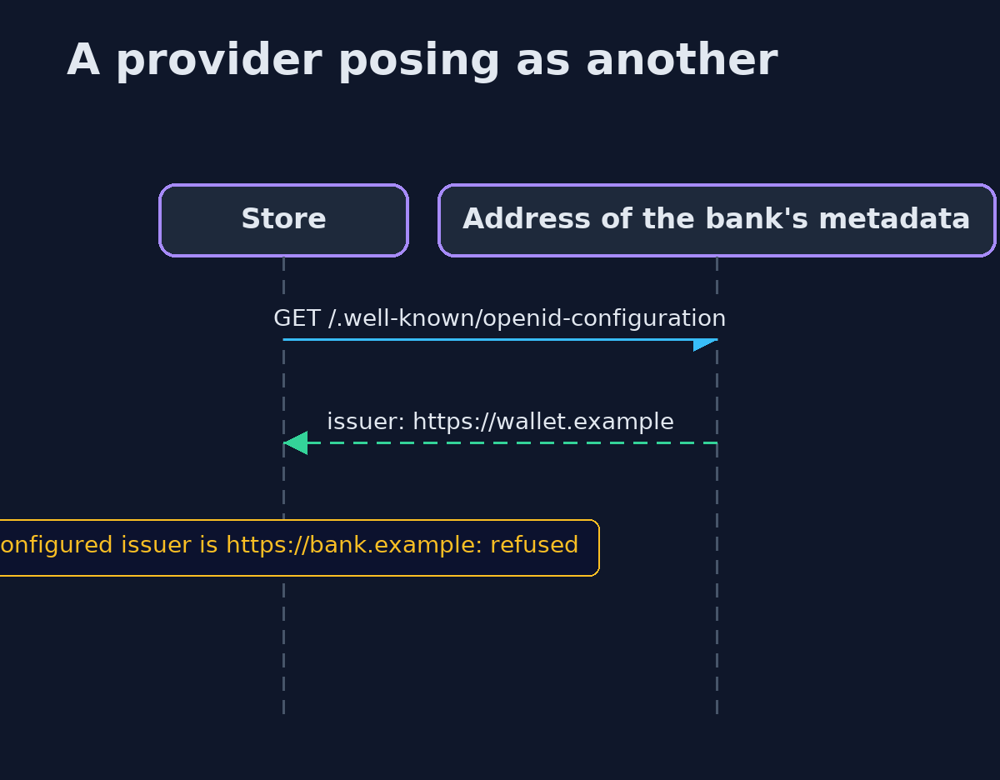
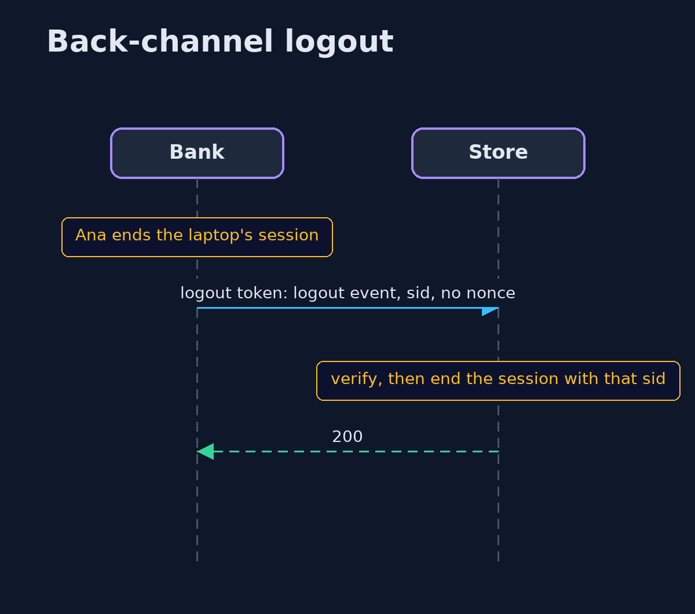

# OpenID Connect — UML Sequence Diagrams

## 1. A provider posing as another

The store checks that the metadata names the issuer it was configured with, so a different issuer's document is refused.

## 2. Back-channel logout

The bank tells the store directly that one session has ended; the store ends only that session.

