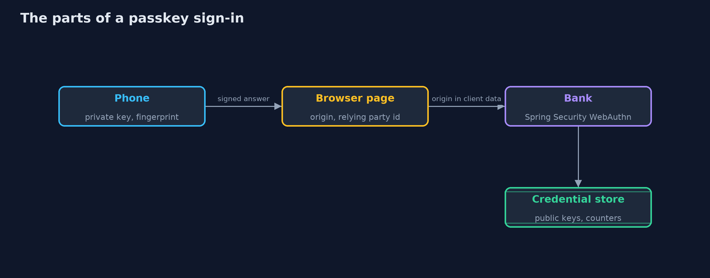
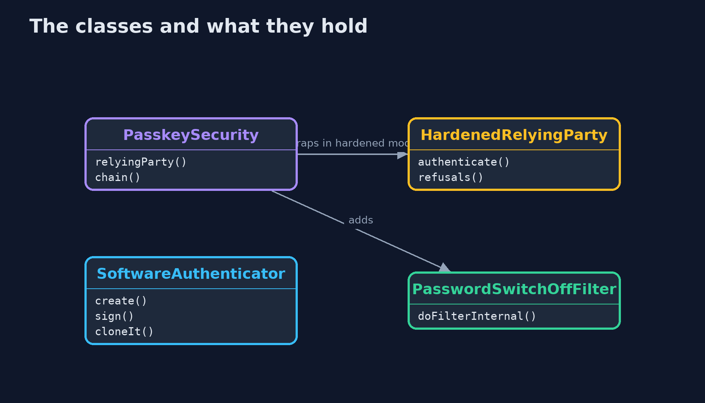
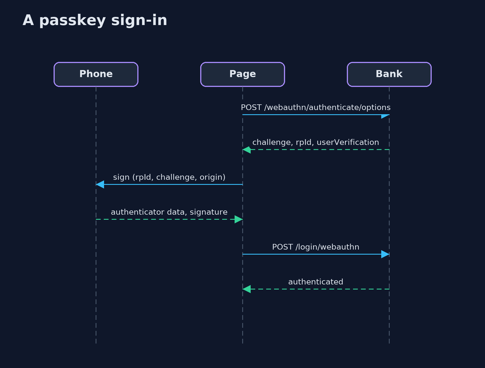

# Passkeys with Spring Security

```
src/main/java/com/jk/explore/security/passkeysspring/
├── B64.java                      base64url without padding, the encoding WebAuthn uses for every binary value in its JSON
├── Cbor.java                     The few CBOR items that an attestation object and a COSE public key need: integers, byte strings, text strings and maps
├── HardenedRelyingParty.java     What Spring Security leaves to the bank
├── PasskeyBrowser.java           A customer's browser and the bank's page script as far as this lesson needs them: it keeps the session cookie, sends the CSRF token in a header, and does what {@code navigator.credentials.create} and {@code navigator.credentials.get} would do, by handing the bank's options to an authenticator and posting what comes back
├── PasskeyController.java        The CSRF token for the page's script, which sends it back in a header on every post
├── PasskeySecurity.java          The bank signs customers in with a password or a passkey
├── PasskeysApp.java              
├── PasskeysSpringDemo.java       Runs the bank's passkey story in five numbered acts against the real Spring Security WebAuthn endpoints, with an authenticator in software
├── PasswordSwitchOffFilter.java  A customer with two passkeys has a way back in if one is lost, so the password, which can be phished, is switched off for them
├── Running.java                  The bank on a free loopback port
└── SoftwareAuthenticator.java    A phone's authenticator in software
```

**Spring Security's WebAuthn support, built on WebAuthn4J, creates and checks the challenges, keeps the public keys and refuses a look-alike origin, a replayed or foreign answer and a wrong key; but by default it only asks for user verification, never compares the signature counter, and leaves the password you keep beside the passkeys, so a bank has to wrap it to require a fingerprint and suspend a cloned passkey, and to switch passwords off once a customer has two passkeys.**

The plain [passkeys](../passkeys) project builds a WebAuthn relying party from scratch. This one uses **Spring Security 7.1**'s WebAuthn support (`http.webAuthn(...)`, built on **WebAuthn4J**): the real registration and sign-in endpoints of a Spring Boot bank on a loopback port, with a phone's authenticator written in software that builds the same bytes a real one does, including the CBOR attestation object and the COSE key. It needs no Docker.

What it shows:
- **Registering.** A signed-in customer asks for options: a challenge of 32 random bytes, the relying party id `bank.example`, a user handle of 32 random bytes. The phone makes a P-256 key pair and returns a credential id and an attestation object with `fmt: none`. The bank stores a **77-byte COSE public key**, a counter of 0 and a label, and nothing that can sign. An answer made with another key under ana's credential id is refused.
- **Signing in.** A fresh challenge each time, signed once; the same answer sent again, an answer for another browser's challenge, and an answer whose user-verified flag was switched on after signing are all refused.
- **A look-alike site.** `bank-example.test` gets nothing: the authenticator has no passkey for that name, the browser will not let it ask for `bank.example`, and a browser that skipped the rule still writes the page's real origin, which the bank refuses. The password typed into the same page works at the bank: **a password can be phished, a passkey cannot.**
- **What the defaults leave open.** Spring Security *asks* for user verification but accepts a touch, never compares the signature counter, so a phone restored from a backup and a **clone** both sign in. A `HardenedRelyingParty` wrapper requires the fingerprint and, after the signature proves the signer holds the key, **suspends a passkey whose counter does not go up**, even for the real phone. A synced passkey reports 0 and is let through.
- **The bill.** Ben's lost phone: the new laptop has no passkey, the security key works, and removing the phone's passkey (`DELETE /webauthn/register/{id}`) ends its use. The password still works beside the passkeys, so it is switched off for a customer with two.

**Maps to:** OWASP Top 10 (2025) A07 Authentication Failures · NIST SP 800-63B-4 (phishing-resistant authenticators) · W3C Web Authentication Level 2 · FIDO2 · CWE-308, CWE-1390.

## The idea in everyday terms

A hotel key card that is cut for one hotel only. A copy of the hotel's records does not open a door, a card cut for another hotel opens nothing here, and a fake lobby can collect a guest's name and room number but not the card's secret.

## The scenario

An online bank lets customers sign in with a password or a passkey. The demo registers Ana's phone, signs her in, shows a look-alike site failing, then compares Spring Security's defaults with a hardened bank, and ends with Ben's lost phone.

## Run

```bash
./gradlew run
```

The demo tells the story in 5 acts, each printing exact numbers that the tests check:

| Act | What it shows |
| --- | --- |
| 1. Registering a passkey: the bank keeps only a public key | The bank sends a challenge, its relying party id and a user handle; the phone returns a credential id and an attestation object; the bank stores a COSE public key and a counter of 0, nothing that can sign. |
| 2. Signing in: a fresh challenge, signed once | Every sign-in gets a new challenge; the phone signs the authenticator data and the hash of the client data; a replayed answer, an answer for another browser's challenge and a flipped flag are refused. |
| 3. A look-alike site gets nothing it can use | A copy of the bank's page cannot get a passkey for the bank's name, the browser refuses the bank's relying party id for it, and the bank refuses the page's real origin; a typed password is not so lucky. |
| 4. User verification, and counters against copies | Spring Security's defaults accept a touch without a fingerprint, a counter going backwards and a clone; a wrapper requires user verification and suspends a passkey whose counter does not go up. |
| 5. The bill: recovery, lost devices and the move away from passwords | Ben has a phone and a security key; the laptop has nothing, the key works, removing the lost phone's passkey ends its use; the password stays beside the passkeys until the bank switches it off for customers with two. |

## Test

```bash
./gradlew test
```

31 tests in `CborTest`, `DemoRunsTest`, `PasskeysSpringTest`, `SoftwareAuthenticatorTest`. No Docker is needed: each test starts a real bank on a free loopback port. Keys and challenges are random on every run; only statuses, lengths and reasons are checked.

## What the simulation got right, and what it left out

The bank is a real Spring Boot application with Spring Security's WebAuthn endpoints, on a loopback port. The authenticator and the browser rules are written in Java and build the same CBOR, COSE keys, authenticator data and signatures that a phone does. The relying party id and origin are bank.example, whatever address the server listens on. Keys, challenges and credential ids are fresh on every run and are never printed.

## Technologies and versions

Every version below is pinned in the project's build files and was the latest stable release when the project was built.

| Technology | Version | Used for |
| --- | --- | --- |
| Java | 25 | the language and runtime; a Gradle toolchain finds or downloads the JDK |
| Gradle | 9.8.1 (wrapper) | build and run; nothing to install, the wrapper downloads it |
| org.springframework.boot:spring-boot-starter-webmvc | 4.1.1, set by spring-boot-dependencies | library the code uses |
| org.springframework.boot:spring-boot-starter-security | 4.1.1, set by spring-boot-dependencies | library the code uses |
| org.springframework.security:spring-security-webauthn | set by the build | library the code uses |
| org.junit.jupiter:junit-jupiter | 6.1.3, set by junit-bom | JUnit 5: the tests (tests only) |
| org.junit.platform:junit-platform-launcher | 6.1.3, set by junit-bom | JUnit platform launcher, which Gradle needs to run the tests (tests only) |
| videokit | repository tool (`tools/videokit`) | the narrated video and animation: Piper `en_US-amy-medium`, speed 0.8, longer pauses (the amy-slow voice) |

## Learning Material

| Document | What it is for |
| --- | --- |
| [Problem statement](docs/problem-statement.md) | the situation and what the project must show |
| [Prerequisites](docs/prerequisites.md) | what you need to know first |
| [Passkeys with Spring Security, explained](docs/passkeys-with-spring-security-explained.md) | the acts in prose |
| [Session guide](docs/session.md) | a one-hour lesson with exercises |
| [Animated walkthrough](docs/animation.html) | the acts step by step, narrated |
| [Threat model](docs/threat-model.md) | what is protected, who could harm it, and how, using STRIDE |
| [Spec](docs/spec.md) | what this project must be true of |
| [Expected output](docs/expected-output.txt) | the golden demo output every test and every port checks against |

### The idea in one picture

The private key never leaves the authenticator; the bank holds the public key.



### Where each piece sits

The hardened relying party wraps Spring Security's and adds two checks.



### How the data moves

In order: the challenge, the origin, the relying party id hash, the flags, the signature and the counter.


### Who calls whom, in order




### Video

`video/passkeys-with-spring-security-explained.mp4` (with `.m4a` audio and `.srt` subtitles) is built by `video/build_video.sh`. Rendered media is not committed.

## What it costs

- **Recovery is the new weak point:** a lost device needs a second passkey or a recovery path, and that path decides the strength of everything.
- **Synced passkeys depend on the cloud account they sync through,** and have a counter of zero, so a copy cannot be spotted by its counter.
- **Requiring user verification excludes authenticators that cannot verify,** such as some old security keys.
- **Customers need two passkeys before the password can go,** which is a change to explain and support.
- **Spring Security's WebAuthn support is young,** so the checks it does not make are the bank's to add and test.

## When this is too much

A site with no accounts worth phishing can stay on passwords with a strong hash. Anything that moves money or holds personal data should offer passkeys, and should plan the loss of a device before the first customer registers.

## Where you have already met this

- "Sign in with a passkey" and a fingerprint prompt.
- `navigator.credentials.create` and `navigator.credentials.get` in front-end code.
- `http.webAuthn()` in a Spring Security configuration.
- A security key (YubiKey) on a keyring.

## Where this sits

This is the tools version of [passkeys](../passkeys), in the [identity-and-access](..) module. It follows the same five acts, on a real library, and finds out what the library leaves to you.
