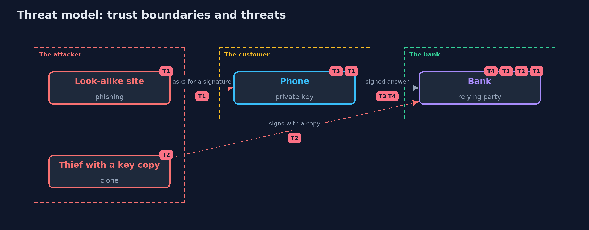

# Threat Model — Passkeys with Spring Security

A threat model answers four questions: what are we protecting, who or what could harm it, how, and what do we do about it. This one covers this project's own demo system, not a production deployment. Domain: an online bank.

## Scope

Passkey registration and sign-in at an online bank using Spring Security's WebAuthn support, and the account recovery and password decisions around it. It does not cover the security of the customer's device.

## What we protect (assets)

- The customer's account.
- The customer's private key, in the authenticator.

## Who and what acts on the system

- A customer with one or more authenticators.
- A phisher with a look-alike site.
- A thief who has copied a key or stolen a phone.

## Trust boundaries

A trust boundary is a line that data or a request crosses between parts that trust each other differently. Threats cluster where those lines are.

- The customer's device: the private key never crosses it.
- The browser to the bank: the origin and the signed answer.

Each dashed box is a trust boundary. A rose tag such as T1 shows where the threat of that number, in the table below, applies.

## Threats, using STRIDE

STRIDE is a checklist of six kinds of threat: **Spoofing** (S), **Tampering** (T), **Repudiation** (R), **Information disclosure** (I), **Denial of service** (D), **Elevation of privilege** (E).

| Id | Kind | Threat | Where it shows up | Control in this project | What is left |
| --- | --- | --- | --- | --- | --- |
| T1 | Spoofing | A look-alike site collects a credential that works at the bank | the relying party id, the origin check | A passkey is made for one relying party id; the browser and the bank check the origin | A password kept beside the passkeys |
| T2 | Spoofing | A copy of the private key signs in | `HardenedRelyingParty` | The signature counter is compared and a passkey that goes backwards is suspended | Synced passkeys, which always report 0 |
| T3 | Spoofing | A stolen phone signs in without the customer | the user verification flag | User verification is required, so a fingerprint or PIN is needed | A thief who also has the PIN |
| T4 | Elevation of privilege | Recovery or the password gives a way around the passkeys | `PasswordSwitchOffFilter`, the recovery path | Two passkeys before the password is switched off, and a recovery path as strong as the passkeys | A recovery path that the bank forgets to design |

## Assumptions

- The browser enforces the relying party id rules and writes the real origin into the client data.
- The customer has a second way to sign in if a device is lost.

## Out of scope

- Malware on the customer's device.
- Theft of the cloud account that a synced passkey syncs through.

## How the tests check this

- `PasskeysSpringTest` starts a real bank for each case and checks registration, the CSRF token, sign-in, the single use of a challenge, another key, the origin and the relying party id hash, the browser's and authenticator's rules, a flipped flag, the defaults, user verification, a clone and its suspension, a forged signature, a synced passkey, removing a passkey and the end of the password.
- `CborTest` and `SoftwareAuthenticatorTest` check the bytes the authenticator builds, and `DemoRunsTest` compares the whole demo with the golden output.

## Where this model goes next

The next project in this module, saml-basics-with-keycloak, looks at the older single sign-on standard that many companies still run.
