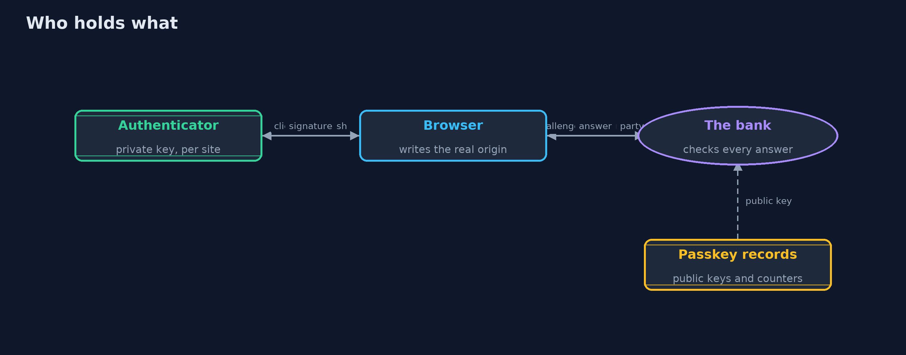
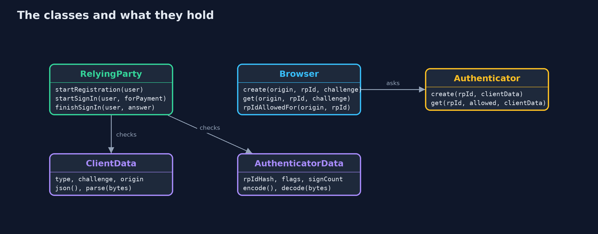
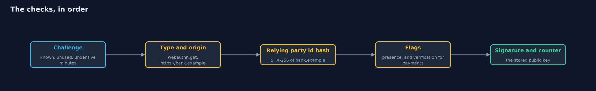
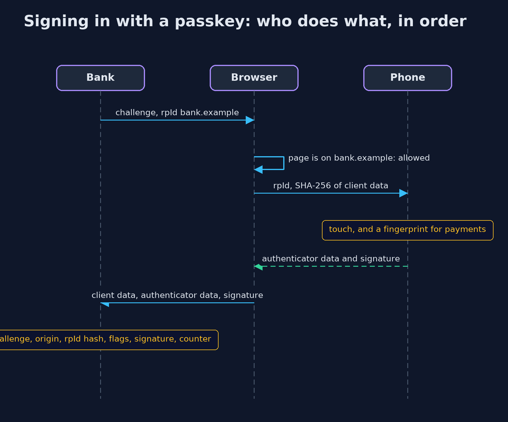

# Passkeys and WebAuthn

```
src/main/java/com/jk/explore/security/passkeys/
├── Authenticator.java      A model authenticator: a phone, a laptop or a security key
├── AuthenticatorData.java  The authenticator data that the authenticator itself writes: the SHA-256 hash of the relying party id it signed for, flags for user presence and user verification, and a signature counter
├── B64.java                Base64url without padding (RFC 4648 section 5), the encoding WebAuthn uses for challenges and credential ids
├── Browser.java            The browser between a web page and the authenticator
├── ClientData.java         The client data that the browser, not the web page, writes for every WebAuthn call: the type of call, the server's challenge and the origin of the page that asked
├── PasskeysDemo.java       Runs the online bank's passwordless sign-in in five numbered acts
├── RelyingParty.java       The bank's side of WebAuthn: it hands out single-use challenges, stores each customer's public keys, and checks every answer in a fixed order: challenge, type, origin, relying party id hash, flags, credential, signature and counter
├── Sha256.java             SHA-256, used for the relying party id hash and for the hash of the client data
└── SimClock.java           A clock in whole seconds that only moves when told to, so challenge expiry is exact and repeatable
```

**A passkey is a key pair made for one site: the bank keeps only the public key, the device signs a fresh challenge for that site and no other, and the browser writes down where it really was, so a look-alike page gets nothing it can use. What is left to guard is recovery, and every older way in that is still switched on.**

A **passkey** is a WebAuthn credential: a key pair made by an **authenticator** (a phone, a laptop or a security key) for one **relying party**,
the site that will check it. The site keeps only the **public key**. To sign in, the site sends a fresh **challenge**; the authenticator signs it,
together with the **SHA-256 of the relying party id** it was made for and a few flags, and the browser adds **client data** that records the
**origin** of the page that asked. Because the browser, not the page, fills in the origin, and the authenticator only signs for the site it was
made for, a passkey cannot be typed into the wrong site. That is what NIST SP 800-63B calls a **phishing-resistant** authenticator.

This project maps to **OWASP Top 10 (2025) A07 Authentication Failures**; to **CWE-287**, improper authentication, and **CWE-294**,
authentication bypass by capture-replay; to **NIST SP 800-63B**, phishing-resistant authenticators; to the **authentication** chapter of
**OWASP ASVS 5.0**; and to **WebAuthn Level 3**.

The demo builds a model relying party, browser and authenticator with the JDK alone, with ES256 (P-256) signatures and data structures laid out
as WebAuthn lays them out: client data JSON, 37 bytes of authenticator data, and a signature over both.

## The idea in everyday terms

Think of a house key cut to fit one front door. A password is a secret anyone can be talked into saying to the wrong person. The passkey is a key
that simply does not turn in any other lock, and the door, not the person holding the key, checks that the key was cut for it. A copy of the lock
tells a burglar nothing, because the lock holds no key. What is left to steal is the spare key under the mat: the recovery path.

## The scenario

An online bank replaces passwords with passkeys. Ana registers her phone, signs in, opens a look-alike page, pays a bill, and has her key copied.
Ben loses his phone. The demo shows, for each step, what the bank checks and what it refuses.

## Run

```bash
./gradlew run
```

The demo tells the story in 5 acts, each printing exact numbers that the tests check:

| Act | What it shows |
| --- | --- |
| 1. Registering a passkey: the bank keeps only a public key | The bank sends a 32-byte challenge; Ana's phone makes a P-256 key pair for bank.example and returns a 16-byte credential id and a 91-byte public key; the bank stores nothing that can sign, so a copy of its records is useless. |
| 2. Signing in: a fresh challenge, signed once | The phone signs 37 bytes of authenticator data and the hash of the client data; the bank accepts it once, then refuses the same answer, an answer 301 seconds late, and an answer whose flags were changed after signing. |
| 3. A look-alike site gets nothing it can use | On bank-example.test the phone has no passkey for that name, the browser will not ask for bank.example, and even a relayed answer carries the real origin, which the bank refuses; a typed password, by contrast, works at the bank. |
| 4. User verification for payments, and counters against copies | A payment with only a touch is refused and accepted with a fingerprint; a copied key signs with counter 7 after the real phone already reached 7, so it is refused and the passkey suspended; synced passkeys always report 0. |
| 5. The bill: recovery, lost devices and the move away from passwords | Ben's lost phone leaves his security key and a one-time recovery code; recovery is now the weakest way in, and Ana's password still works until the bank switches it off. |

## Test

```bash
./gradlew test
```

26 tests in `DemoRunsTest`, `EncodingTest`, `RelyingPartyTest`. Base64url is checked against the RFC 4648 test vectors and SHA-256 against the published abc vector. Every check the relying party makes is a test that refuses an answer with its exact reason, including the five-minute challenge boundary, a copied key caught by the counter, and the browser's relying party id rule.

## What the simulation got right, and what it left out

Everything runs in memory with a simulated clock in whole seconds; no real browser or authenticator is used. Keys, challenges and credential ids
are random, so the demo prints only facts that do not depend on them: sizes, flags, counters and verdicts. The demo password and recovery code
are demo values that protect nothing.

## Technologies and versions

Every version below is pinned in the project's build files and was the latest stable release when the project was built.

| Technology | Version | Used for |
| --- | --- | --- |
| Java | 25 | the language and runtime; a Gradle toolchain finds or downloads the JDK |
| Gradle | 9.8.1 (wrapper) | build and run; nothing to install, the wrapper downloads it |
| org.junit.jupiter:junit-jupiter | 6.1.3, set by junit-bom | JUnit 5: the tests (tests only) |
| org.junit.platform:junit-platform-launcher | 6.1.3, set by junit-bom | JUnit platform launcher, which Gradle needs to run the tests (tests only) |
| videokit | repository tool (`tools/videokit`) | the narrated video and animation: Piper `en_US-amy-medium`, speed 0.8, longer pauses (the amy-slow voice) |

## Learning Material

| Document | What it is for |
| --- | --- |
| [Problem statement](docs/problem-statement.md) | the situation and what the project must show |
| [Prerequisites](docs/prerequisites.md) | what you need to know first |
| [Passkeys and WebAuthn, explained](docs/passkeys-explained.md) | the acts in prose |
| [Session guide](docs/session.md) | a one-hour lesson with exercises |
| [Animated walkthrough](docs/animation.html) | the acts step by step, narrated |
| [Threat model](docs/threat-model.md) | what is protected, who could harm it, and how, using STRIDE |
| [Spec](docs/spec.md) | what this project must be true of |
| [Expected output](docs/expected-output.txt) | the golden demo output every test and every port checks against |

### The idea in one picture

The private key never leaves the authenticator; the browser writes the origin; the bank holds only public keys.



### Where each piece sits

The browser enforces the site rule and writes client data; the authenticator signs; the relying party checks.



### How the data moves

The bank refuses at the first check that fails, and a challenge is used up whatever the outcome.



### Who calls whom, in order




### Video

`video/passkeys-explained.mp4` (with `.m4a` audio and `.srt` subtitles) is built by `video/build_video.sh`. Rendered media is not committed.

## What it costs

- **Recovery becomes the weakest link.** A customer who loses the only device holding the passkey needs another way in. Register two passkeys, issue one-time recovery codes, and treat any recovery flow as carefully as sign-in itself.
- **Old ways in keep old weaknesses.** While a password still works alongside a passkey, the account is only as strong as the password. Switch passwords off once a customer has two passkeys.
- **Synced passkeys trade clone detection for convenience.** A passkey shared between a person's devices reports a counter of zero, so the counter cannot spot a copy; its protection is the account it syncs through.
- **The bank must check every field, in order.** Skipping the origin, the relying party id hash, the flags or the challenge's single use undoes the protection; a maintained library makes those checks for you.
- **A model is for learning.** Real WebAuthn uses CBOR and COSE keys, attestation formats and many authenticators; this project uses an encoded public key instead and no attestation, and the `-with-spring-security` version uses Spring Security's passkey support.

## When this is too much

For a site with no accounts worth stealing, a password and a rate limit may be enough. For a bank, an e-mail provider or anything that recovers
other accounts, passkeys are the default today, with user verification for payments and a carefully guarded recovery path.

## Where you have already met this

- "Sign in with a passkey" buttons, and a fingerprint or face prompt instead of a password field.
- Security keys that plug into a USB port and must be touched.
- Passkeys that appear on a new phone because they were synced through the phone maker's account.
- Bank apps that ask for a fingerprint again before a payment.

## Where this sits

This project is in [identity-and-access](..) in the [intermediate track](../..), after [oauth2-authorization-code-pkce](../oauth2-authorization-code-pkce).
It builds on the beginner projects [digital-signatures](../../../beginner/cryptography/digital-signatures) and
[totp-multi-factor](../../../beginner/passwords-and-mfa/totp-multi-factor), whose one-time codes can still be phished.
