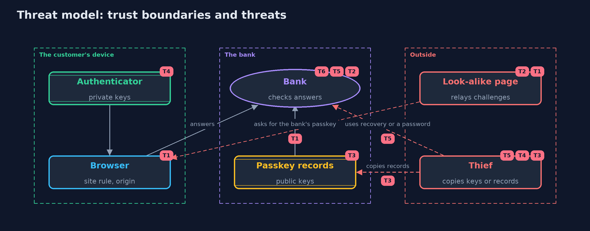

# Threat Model — Passkeys and WebAuthn

A threat model answers four questions: what are we protecting, who or what could harm it, how, and what do we do about it. This one covers this project's own demo system, not a production deployment. Domain: an online bank.

## Scope

Passwordless sign-in at an online bank with passkeys: registration, sign-in, payments with user verification, copied keys, recovery and the
remaining password. It covers a look-alike site, a replayed answer, a copied database or key, and the fallback paths. It does not cover malware
in control of the customer's device or browser, attestation, or the platform that syncs passkeys.

## What we protect (assets)

- Customers' accounts and money.
- The private keys inside customers' authenticators.
- The bank's passkey records: public keys and counters.
- Recovery codes and any remaining passwords.

## Who and what acts on the system

- Customers and their devices.
- A look-alike site that relays the bank's challenges.
- A thief who copies the bank's records, a device's key, or a recovery code.

## Trust boundaries

A trust boundary is a line that data or a request crosses between parts that trust each other differently. Threats cluster where those lines are.

- Customer's device to the bank: every answer crosses it and is checked.
- Web page to the browser: the page cannot choose the origin or another site's relying party id.
- Authenticator to everything else: the private key never leaves it.

Each dashed box is a trust boundary. A rose tag such as T1 shows where the threat of that number, in the table below, applies.

## Threats, using STRIDE

STRIDE is a checklist of six kinds of threat: **Spoofing** (S), **Tampering** (T), **Repudiation** (R), **Information disclosure** (I), **Denial of service** (D), **Elevation of privilege** (E).

| Id | Kind | Threat | Where it shows up | Control in this project | What is left |
| --- | --- | --- | --- | --- | --- |
| T1 | Spoofing | A look-alike site captures the customer's sign-in | the browser, `Browser.rpIdAllowedFor`, `RelyingParty` origin check | The authenticator signs only for its relying party id, the browser allows only the page's own site, and the bank checks the origin in the signed client data | A password or recovery path that is still enabled can be phished instead |
| T2 | Spoofing | An earlier answer is replayed | `RelyingParty` challenge store | Challenges are random, single-use and expire after five minutes | The bank must keep the challenge store on the server, not in a cookie the client can resend |
| T3 | Information disclosure | The bank's passkey records are copied | the passkey records | Only public keys, credential ids and counters are stored; none can sign | Records still reveal which customers use which devices; protect them as personal data |
| T4 | Spoofing | A device-bound key is copied and used | `RelyingParty` counter check | A counter that does not rise is refused and the passkey suspended | Synced passkeys report zero, so their copies cannot be detected this way |
| T5 | Elevation of privilege | The attacker uses the weakest remaining way in: a password or the recovery path | `RelyingParty.passwordSignIn`, `RelyingParty.recover` | One-time recovery codes stored as hashes, two passkeys per customer, passwords switched off | Recovery by a person (a call centre) remains open to persuasion and needs its own checks |
| T6 | Elevation of privilege | An unattended, unlocked device approves a payment with only a touch | `RelyingParty.startSignIn(user, forPayment)` | User verification is required for payments | Malware on an unlocked device is out of scope |

## Assumptions

- The customer's browser enforces the WebAuthn rules.
- The bank's clock is correct to within the challenge lifetime.
- In the demo, keys and challenges are random and never printed, and the password and recovery code are demo values.

## Out of scope

- Malware that controls the customer's device or browser.
- Attestation of authenticator models.
- The security of the account a synced passkey syncs through.

## How the tests check this

- `EncodingTest` checks base64url against RFC 4648, SHA-256 against the abc vector, and the byte layouts of client data and authenticator data.
- `RelyingPartyTest` checks every refusal with its exact reason: used and expired challenges, another customer, type, origin, relying party id, flags, unknown credential, a stranger's key, a copied key, synced passkeys, the browser's site rule, passwords and recovery codes.
- `DemoRunsTest` compares the whole demo with the golden output.

## Where this model goes next

The next project, saml-basics, looks at the older single sign-on standard that many banks still run beside OpenID Connect.
