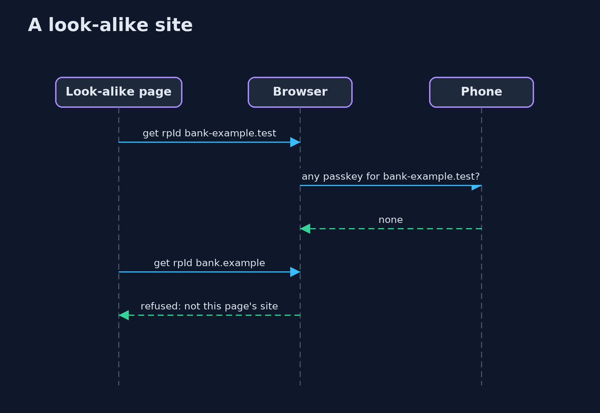
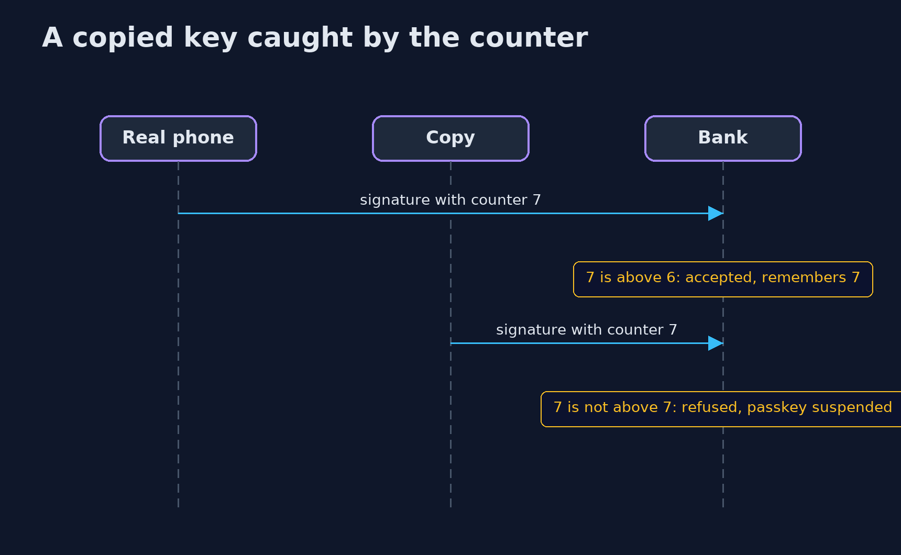

# Passkeys and WebAuthn — UML Sequence Diagrams

## 1. A look-alike site

The page cannot choose the origin, and the phone cannot sign for a name it has no key for.

## 2. A copied key caught by the counter

Only a device-bound passkey counts; a synced one always reports zero.

