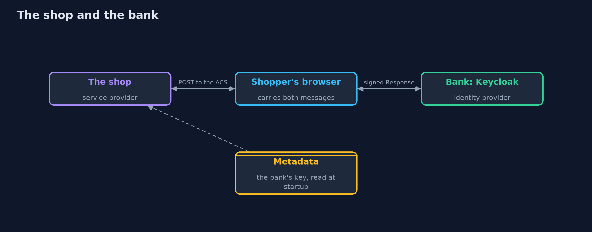
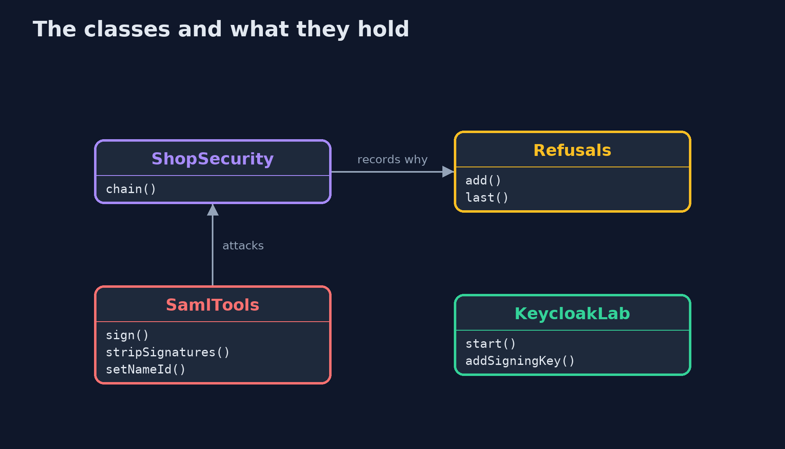
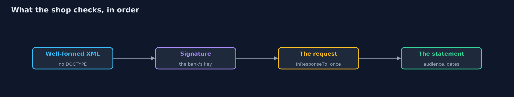
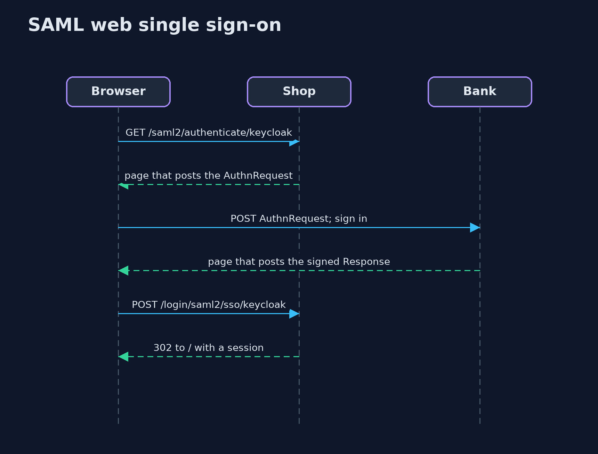

# SAML Basics with Keycloak

```
src/main/java/com/jk/explore/security/samlkeycloak/
├── KeycloakLab.java       One Keycloak in a Docker container, bound to the loopback address on a free port, with the bank and wallet realms imported from {@code infra/} and removed on close
├── Refusals.java          Why the shop refused sign-ins, most recent last
├── Running.java           The shop, a Spring Boot application on a loopback port chosen before Keycloak started, trusting the identity provider of one Keycloak realm
├── SamlKeycloakDemo.java  Runs the shop's single sign-on story in five numbered acts against a real Keycloak in Docker and a real Spring Security SAML 2.0 service provider
├── SamlTools.java         What an attacker does to a signed SAML response, with the JDK's own XML tools: read it, change a name, take signatures off, put a second assertion beside the signed one, and sign with a key of the attacker's own
├── ShopApp.java           The shop, a SAML 2.0 service provider: it sends shoppers to the bank's identity provider and believes only what the bank signs
├── ShopController.java    Who is signed in, as the signed statement says
├── ShopSecurity.java      SAML 2.0 login: {@code /saml2/authenticate/keycloak} sends the shopper to Keycloak with an authentication request, and {@code /login/saml2/sso/keycloak} receives the response
└── Shopper.java           A customer's browser as far as this lesson needs one
```

**Spring Security's SAML 2.0 service provider, on OpenSAML, trusts only the key in the identity provider's metadata, reads only assertions that key signed, and checks the request it answers, its audience and its dates; edited, self-signed, wrapped, unsigned and foreign-signed responses are all refused, and the cost is that metadata is read once, so a key rotation at the bank must reach the shop before the bank starts signing with it.**

The plain [saml-basics](../saml-basics) project builds a service provider with a trusting, a pinned and a strict reader. This one uses what a real Spring Boot shop uses: **Spring Security 7**'s `saml2Login()` on **OpenSAML 5**, against a real **Keycloak 26.8** SAML identity provider in Docker. It needs Docker; its tests are tagged `integration`: `./gradlew integrationTest`.

What it shows:
- **Signing in.** The shop's authentication request (unsigned, from the shop's entity id, naming its assertion consumer address) goes to the bank; Ana signs in there; the bank's response is signed as a whole and its assertion is signed on its own (2 signatures), answers the shop's request, is addressed to the shop and is for the shop's entity id only.
- **A valid signature is not the bank's signature.** The name edited to `admin`, a response **self-signed with a valid key of the attacker's**, and a **genuine response from the wallet realm**, signed by the wallet, are all refused with `invalid_signature`: the shop trusts the key in the bank's metadata and no other.
- **Signature wrapping.** An unsigned admin assertion before or after the bank's signed one, no signature at all, and a response with a DOCTYPE that reads a file are refused (`invalid_signature`, `malformed_response_data`).
- **The statement itself.** A response replayed from another browser or the same one (`invalid_in_response_to`: the shop's request is used once), an assertion four seconds old when it lasts two (`invalid_assertion`), and a response the bank signed for **another shop** (`invalid_assertion`, the audience).
- **The bill.** The shop reads the bank's metadata when it starts. When the bank adds a signing key, **every shopper is refused** (`invalid_signature`) until the shop restarts and reads the metadata again.

**Maps to:** OWASP Top 10 (2025) A07 Authentication Failures · OASIS SAML 2.0 Core, Bindings and Profiles · CWE-347, CWE-611 (XXE), CWE-290 · XML Signature Wrapping.

## The idea in everyday terms

A passport control that checks the stamp, not the passport's owner's story. The stamp must be from the country the officer was told to trust, on the page the officer is reading, for this border, today. A beautiful stamp from another country, or a real stamp on another page, is still no entry.

## The scenario

A shop signs shoppers in through the bank's SAML identity provider. The demo starts a real Keycloak with the bank and wallet realms and the real shop, signs Ana in, and then posts to the shop every kind of response an attacker or an accident could produce.

## Run

```bash
./gradlew run
```

The demo tells the story in 5 acts, each printing exact numbers that the tests check:

| Act | What it shows |
| --- | --- |
| 1. Signing in through the bank | The shop sends an unsigned authentication request; the bank answers with a response signed as a whole and an assertion signed on its own, for this shop and this request only. |
| 2. A valid signature is not the same as the bank's signature | An edited name, a response self-signed with a valid key of the attacker's, and a genuine response signed by the wallet are all refused as invalid_signature. |
| 3. A valid signature on one assertion, and another one read | An unsigned admin assertion beside the bank's signed one, no signature at all, and a DOCTYPE are all refused. |
| 4. The statement itself is checked | A replayed response, an expired assertion and a response signed for another shop are refused even though their signatures are the bank's. |
| 5. The bill: keys, metadata and XML | The shop reads the bank's metadata once; when the bank adds a signing key every shopper is refused until the shop reads the metadata again. |

## Test

```bash
./gradlew test
```

21 tests in `DemoRunsTest`, `RealmFilesTest`, `SamlFlowTest`, `SamlToolsTest`. The tests that need Keycloak are tagged integration and share one container and one shop per class (./gradlew integrationTest). The attacker's tools and the realm files are tested without Docker.

## What the simulation got right, and what it left out

Keycloak is a real container bound to 127.0.0.1 on a free port, with a bank realm and a wallet realm imported from infra/ and the shop's port written into a temporary copy. The shop is a real Spring Boot application. The browser keeps cookies and submits the pages' automatic forms. The attacker's changes use the JDK's own XML and XML signature tools. Ports, ids, keys and signatures are never printed.

## Technologies and versions

Every version below is pinned in the project's build files and was the latest stable release when the project was built.

| Technology | Version | Used for |
| --- | --- | --- |
| Java | 25 | the language and runtime; a Gradle toolchain finds or downloads the JDK |
| Gradle | 9.8.1 (wrapper) | build and run; nothing to install, the wrapper downloads it |
| org.springframework.boot:spring-boot-starter-webmvc | 4.1.1, set by spring-boot-dependencies | library the code uses |
| org.springframework.boot:spring-boot-starter-security | 4.1.1, set by spring-boot-dependencies | library the code uses |
| org.springframework.boot:spring-boot-starter-security-saml2 | 4.1.1, set by spring-boot-dependencies | library the code uses |
| org.junit.jupiter:junit-jupiter | 6.1.3, set by junit-bom | JUnit 5: the tests (tests only) |
| org.junit.platform:junit-platform-launcher | 6.1.3, set by junit-bom | JUnit platform launcher, which Gradle needs to run the tests (tests only) |
| videokit | repository tool (`tools/videokit`) | the narrated video and animation: Piper `en_US-amy-medium`, speed 0.8, longer pauses (the amy-slow voice) |

## Learning Material

| Document | What it is for |
| --- | --- |
| [Problem statement](docs/problem-statement.md) | the situation and what the project must show |
| [Prerequisites](docs/prerequisites.md) | what you need to know first |
| [SAML Basics with Keycloak, explained](docs/saml-basics-with-keycloak-explained.md) | the acts in prose |
| [Session guide](docs/session.md) | a one-hour lesson with exercises |
| [Animated walkthrough](docs/animation.html) | the acts step by step, narrated |
| [Threat model](docs/threat-model.md) | what is protected, who could harm it, and how, using STRIDE |
| [Spec](docs/spec.md) | what this project must be true of |
| [Expected output](docs/expected-output.txt) | the golden demo output every test and every port checks against |

### The idea in one picture

The shopper's browser carries the request and the response between the two.



### Where each piece sits

The shop is small; OpenSAML does the XML.



### How the data moves

The document, the signature, the request, then the statement.



### Who calls whom, in order




### Video

`video/saml-basics-with-keycloak-explained.mp4` (with `.m4a` audio and `.srt` subtitles) is built by `video/build_video.sh`. Rendered media is not committed.

## What it costs

- **XML signatures are subtle,** so the shop depends on a library and on patching it.
- **Metadata is read once at startup in this configuration,** so a key rotation at the bank is an outage at the shop unless the shop reloads in time.
- **Clock skew and assertion lifetimes need agreeing,** or real shoppers are refused.
- **Every shop must be registered** at the bank with its entity id and exact address.
- **Single logout is a second protocol** that has to be set up on both sides, and is not covered here.

## When this is too much

A new application with a choice should use OpenID Connect, which is simpler. SAML is for the partners and products that only speak it.

## Where you have already met this

- An XML blob with `<saml2p:Response>` in a browser's network tab.
- `saml2Login()` in a Spring Security configuration.
- An identity provider's metadata file with an `X509Certificate`.
- An error such as "Invalid InResponseTo" or "Invalid signature" after a key change.

## Where this sits

This is the tools version of [saml-basics](../saml-basics), in the [identity-and-access](..) module. It follows the same four attacks and adds the key rotation, against a real identity provider.
