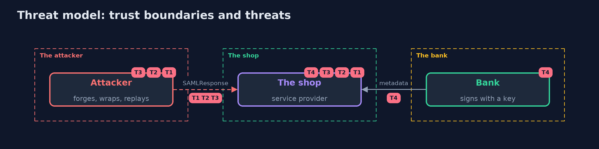

# Threat Model — SAML Basics with Keycloak

A threat model answers four questions: what are we protecting, who or what could harm it, how, and what do we do about it. This one covers this project's own demo system, not a production deployment. Domain: single sign-on through a bank.

## Scope

A SAML 2.0 service provider in Spring Security against one identity provider. It covers the response, its signatures, the statement's request, audience and dates, and the provider's key rotation. It does not cover single logout or the provider's own security.

## What we protect (assets)

- The shoppers' identities at the shop.
- The bank's signing key.

## Who and what acts on the system

- A shopper, who carries the messages.
- An attacker who can post any XML to the shop's address.
- The bank's operator, who rotates keys.

## Trust boundaries

A trust boundary is a line that data or a request crosses between parts that trust each other differently. Threats cluster where those lines are.

- The browser to the shop: the SAMLResponse is untrusted until checked.
- The metadata: where the shop learns the bank's key.

Each dashed box is a trust boundary. A rose tag such as T1 shows where the threat of that number, in the table below, applies.

## Threats, using STRIDE

STRIDE is a checklist of six kinds of threat: **Spoofing** (S), **Tampering** (T), **Repudiation** (R), **Information disclosure** (I), **Denial of service** (D), **Elevation of privilege** (E).

| Id | Kind | Threat | Where it shows up | Control in this project | What is left |
| --- | --- | --- | --- | --- | --- |
| T1 | Spoofing | A forged or edited response signs the attacker in as someone else | signature validation | Trust only the key in the identity provider's metadata, and require every assertion to be signed by it | A stolen signing key |
| T2 | Spoofing | Signature wrapping makes the shop read an unsigned assertion | assertion selection | A maintained library that validates every assertion it reads | A library bug |
| T3 | Spoofing | A genuine response is replayed, or is meant for another shop or time | InResponseTo, audience and dates | A single-use request, an exact audience and a short validity | Clock skew set too wide |
| T4 | Denial of service | A key rotation at the identity provider refuses every shopper | the shop's metadata | Reload metadata on a schedule and before a rotation, and announce rotations | The hours between a rotation and a reload |

## Assumptions

- The metadata is fetched over a trusted channel.
- The bank's private key is not stolen.

## Out of scope

- Compromise of the bank.
- Encrypted assertions.

## How the tests check this

- `SamlFlowTest` starts a real Keycloak and the shop and checks the genuine sign-in, the signatures, the request, an edited name, a self-signed response, an unsigned one, wrapping in both orders, a DOCTYPE, replay, another audience, an expired assertion and a wallet response.
- `SamlToolsTest` and `RealmFilesTest` check the attacker's tools and the realm files without Docker.
- `DemoRunsTest` compares the whole demo with the golden output.

## Where this model goes next

This is the last project of the identity-and-access module; the next module is tls-in-practice.
