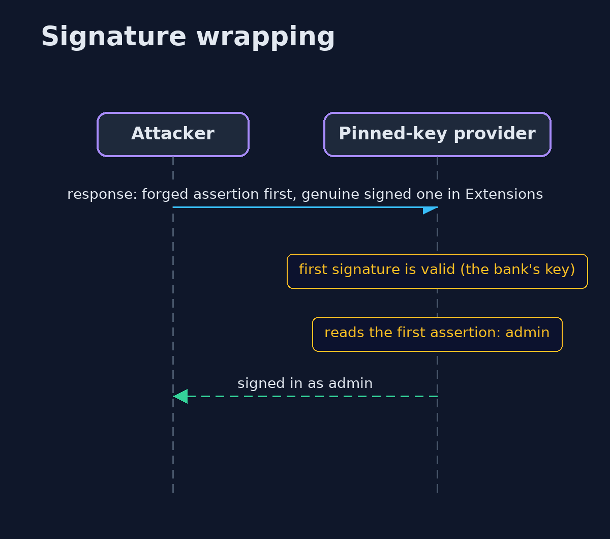

# SAML Single Sign-On and Signature Wrapping

```
src/main/java/com/jk/explore/security/saml/
├── Attacks.java                   Edits of a genuine response, the way an attacker with a text editor would make them
├── Idp.java                       An identity provider: it signs the <em>assertion</em> (the statement "this is ana@bank.example") with its private key
├── PinnedKeyServiceProvider.java  The second version: it trusts only the identity provider's own key, which fixes the self-signed response
├── SamlDemo.java                  Runs the single sign-on story in four numbered acts and prints exact, repeatable results
├── SamlRefused.java               The sign-in response was refused
├── ServiceProvider.java           The shop's side of single sign-on: reads the identity provider's response and decides who the customer is
├── SignatureCheck.java            Validates one XML signature and says which URI it covers
├── StrictServiceProvider.java     The fixed version
├── TrustingServiceProvider.java   The first version: any valid signature will do, with the key it carries, and then the first assertion in the file is the one believed
└── Xml.java                       XML helpers shared by the identity provider and the service providers
```

**A SAML service provider must trust only the identity provider's own key and then read only the element that the signature covers, because a valid signature somewhere in an XML document says nothing about the assertion that code happens to read.**

**SAML** is the older single sign-on standard that many companies and banks still use. A customer signs in at an **identity provider (IdP)**, which sends the shop (the **service provider, SP**) an XML **assertion**: "this is ana@bank.example",
signed with the IdP's private key. The shop's job is to be sure that the statement came from the IdP, is about the right person, and is fresh. XML makes that hard, because a signature covers *an element*, and an XML document can hold many.

What goes wrong, in the order this project shows it:
- **Trusting the key in the signature.** The signature carries a public key in `KeyInfo`. If the SP trusts that key, anybody can sign anything.
- **Reading a different element than the one that was signed** (**XML signature wrapping**): the genuine signed assertion is moved aside, an unsigned forged one is put first, and the SP checks "is some signature valid?" and then reads "the first assertion".
- **Skipping the statement's own checks:** expiry, audience, which request it answers, where it was sent, and replay.

The defences:
- **Pin the IdP's key** and ignore the one in the message.
- **Use only what the signature covers:** exactly one assertion, the signature inside it, and the validated reference is the element that is read.
- **Check the conditions** and remember used assertion ids. Refuse a DOCTYPE.

**Maps to:** OWASP Top 10 (2025) A07 Authentication Failures and A08 Software or Data Integrity Failures · CWE-347 · CWE-345 · OWASP ASVS 5.0, the authentication and SAML requirements · OASIS SAML 2.0 Web Browser SSO profile.

## The idea in everyday terms

Think of a notary's stamp on one page of a bundle. A clerk who checks "the bundle has a genuine stamp somewhere" and then signs for the first page is fooled by a bundle whose first page is forged and whose stamped page is tucked in the back.
The careful clerk reads only the page under the stamp, and first checks that the stamp is the notary's own and not one the visitor brought.

## The scenario

A shop lets customers sign in through their bank. The demo builds real SAML-style responses and signs them with the JDK's XML signature API (RSA-SHA256, enveloped, exclusive canonicalization). It then runs three service providers
against genuine, self-signed, edited, wrapped and stale responses.

## Run

```bash
./gradlew run
```

The demo tells the story in 4 acts, each printing exact numbers that the tests check:

| Act | What it shows |
| --- | --- |
| 1. Signing in through the bank | A genuine response signs Ana in with both the trusting provider and the strict one. |
| 2. A valid signature is not the same as the bank's signature | A response the attacker signs with their own key signs them in as admin at the trusting provider; a provider that pins the bank's key refuses it, and any edit of a signed name breaks the signature. |
| 3. A valid signature on one assertion, and another one read | Signature wrapping fools the pinned-key provider into signing in the attacker as admin; the strict provider refuses the wrapped response, a self-signed one and an edited one. |
| 4. The statement itself is checked | The strict provider refuses a replayed response, an expired assertion, one for another shop, one that answers another request, and a document with a DOCTYPE. |

## Test

```bash
./gradlew test
```

10 tests in `DemoRunsTest`, `SamlTest`. Keys and ids are random and never printed, and the clock is fixed, so the demo prints the same text on every run.

## What the simulation got right, and what it left out

The signatures are real: the JDK's `javax.xml.crypto.dsig` API signs and validates the assertions with RSA-2048 and SHA-256. The responses are shaped like SAML 2.0 responses with the elements that matter here, not the full schema.
Keys and ids are random and never printed; the clock is fixed.

## Technologies and versions

Every version below is pinned in the project's build files and was the latest stable release when the project was built.

| Technology | Version | Used for |
| --- | --- | --- |
| Java | 25 | the language and runtime; a Gradle toolchain finds or downloads the JDK |
| Gradle | 9.8.1 (wrapper) | build and run; nothing to install, the wrapper downloads it |
| org.junit.jupiter:junit-jupiter | 6.1.3, set by junit-bom | JUnit 5: the tests (tests only) |
| org.junit.platform:junit-platform-launcher | 6.1.3, set by junit-bom | JUnit platform launcher, which Gradle needs to run the tests (tests only) |
| videokit | repository tool (`tools/videokit`) | the narrated video and animation: Piper `en_US-amy-medium`, speed 0.8, longer pauses (the amy-slow voice) |

## Learning Material

| Document | What it is for |
| --- | --- |
| [Problem statement](docs/problem-statement.md) | the situation and what the project must show |
| [Prerequisites](docs/prerequisites.md) | what you need to know first |
| [SAML Single Sign-On and Signature Wrapping, explained](docs/saml-basics-explained.md) | the acts in prose |
| [Session guide](docs/session.md) | a one-hour lesson with exercises |
| [Animated walkthrough](docs/animation.html) | the acts step by step, narrated |
| [Threat model](docs/threat-model.md) | what is protected, who could harm it, and how, using STRIDE |
| [Spec](docs/spec.md) | what this project must be true of |
| [Expected output](docs/expected-output.txt) | the golden demo output every test and every port checks against |

### The idea in one picture

The response passes through the customer's browser, so the shop must treat it as untrusted until it is checked.


### Where each piece sits

Three service providers share an interface; they differ in what they trust and what they read.


### How the data moves

Structure first, then the signature, then the statement.


### Who calls whom, in order




### Video

`video/saml-basics-explained.mp4` (with `.m4a` audio and `.srt` subtitles) is built by `video/build_video.sh`. Rendered media is not committed.

## What it costs

- **XML signatures are hard to use correctly.** Canonicalization, references and IDs are easy to get subtly wrong, which is why most teams use a vetted SAML library. This project shows what the library must be doing.
- **Pinning needs key rotation:** the SP must accept a new IdP key with an overlap period, from signed metadata.
- **Clock skew** makes strict time windows fail; a small allowance (here 60 seconds) is the usual compromise.
- **Replay protection needs state** shared by all SP servers, kept at least as long as the assertion is valid.
- **Encrypted assertions, logout and attribute mapping** add more code that this project does not show.

## When this is too much

If the shop can use OpenID Connect instead, do: JSON tokens and a simpler validation story. If SAML is required, use a maintained library with strict defaults and test it with the attacks here. Never write your own SAML validation for production.

## Where you have already met this

- `<saml:Assertion>`, `<ds:Signature>` and `<saml:AudienceRestriction>` in browser traffic of enterprise sign-in.
- "XML signature wrapping" in lists of famous SSO vulnerabilities.
- SAML metadata files and certificates exchanged during setup.
- A finding titled "Improper Verification of Cryptographic Signature" with CWE-347.

## Where this sits

This project is in [identity-and-access](..) and follows [xml-and-template-injection](../../web-security/xml-and-template-injection), whose DOCTYPE refusal it reuses.
The OAuth and OIDC projects ([oauth2-authorization-code-pkce](../oauth2-authorization-code-pkce), [openid-connect](../openid-connect)) are the modern version of the same job.
