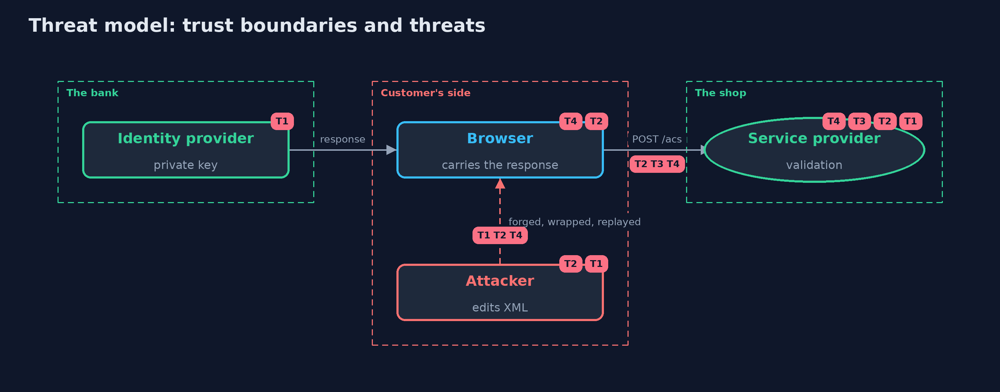

# Threat Model — SAML Single Sign-On and Signature Wrapping

A threat model answers four questions: what are we protecting, who or what could harm it, how, and what do we do about it. This one covers this project's own demo system, not a production deployment. Domain: single sign-on through a bank.

## Scope

A shop's SAML service provider that accepts responses through the customer's browser. It covers the validation of signed assertions.
It does not cover the identity provider's security, SAML logout or encryption, or the customer's device.

## What we protect (assets)

- The shop's accounts, and the identity they are given to.
- The identity provider's signing key.

## Who and what acts on the system

- A customer signing in.
- An attacker who can edit and replay the response on its way through their own browser.

## Trust boundaries

A trust boundary is a line that data or a request crosses between parts that trust each other differently. Threats cluster where those lines are.

- Identity provider to shop, through the customer's browser: everything in the response is untrusted until validated.

Each dashed box is a trust boundary. A rose tag such as T1 shows where the threat of that number, in the table below, applies.

## Threats, using STRIDE

STRIDE is a checklist of six kinds of threat: **Spoofing** (S), **Tampering** (T), **Repudiation** (R), **Information disclosure** (I), **Denial of service** (D), **Elevation of privilege** (E).

| Id | Kind | Threat | Where it shows up | Control in this project | What is left |
| --- | --- | --- | --- | --- | --- |
| T1 | Spoofing | A response signed by the attacker's own key is accepted | `TrustingServiceProvider` | Pin the identity provider's key; ignore KeyInfo | A compromised or mis-pinned key |
| T2 | Tampering | Signature wrapping: the signed element is not the one that is read | `PinnedKeyServiceProvider` | One assertion, signature inside it, validated reference equals the element read, unique ID | Parser differences between the signature library and the code that reads the document |
| T3 | Repudiation | A captured response is replayed, or used for another shop or request | `StrictServiceProvider` | Audience, recipient, InResponseTo, validity period and remembered assertion ids | Replay state lost on restart; keep it as long as the assertion is valid |
| T4 | Denial of service | Entities in the response read files or exhaust memory | `Xml.parse` | DOCTYPE refused, secure processing on | Very large documents within the size limit of the web server |

## Assumptions

- The identity provider's public key was obtained out of band and pinned.
- The shop's clock is correct to within the allowed skew.

## Out of scope

- A compromised identity provider.
- SAML logout, encrypted assertions and attribute mapping.

## How the tests check this

- `SamlTest` checks every provider against genuine, self-signed, edited, wrapped, replayed, expired, misdirected and malformed responses and unsigned or misplaced signatures.
- `DemoRunsTest` compares the whole demo with the golden output.

## Where this model goes next

The next module, tls-in-practice, looks at the certificates and channels underneath all of these exchanges, starting with a local certificate authority.
