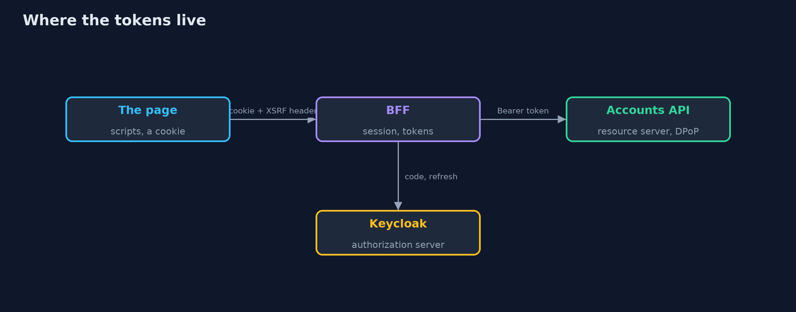

# Tokens in the Browser with Spring Boot: a BFF and DPoP

```
src/main/java/com/jk/explore/security/bffspring/
├── BffSpringDemo.java           Runs the bank's story of tokens and the browser in five numbered acts against a real Keycloak in Docker, a real backend for the frontend and a real accounts API
├── DpopKey.java                 The key that the single-page app creates in the browser and never lets out (in a real browser, a non-extractable WebCrypto key)
├── KeycloakLab.java             One Keycloak in a Docker container, bound to the loopback address on a free port, with the bank realm imported from {@code infra/bank-realm.json} and removed on close
├── OffsetClock.java             The system clock plus an offset the demo can move forward, so minutes and days take no time to wait for
├── Running.java                 A Spring Boot application on a loopback port: the accounts API or the backend for the frontend
├── Shopper.java                 A customer's browser as far as this lesson needs one
├── SpaClient.java               The single-page app: a public client that signs the customer in with the authorization code flow and PKCE, gets tokens in the browser, and calls the accounts API with them
├── api/AccountsController.java  
├── api/ApiApp.java              The bank's accounts API: a resource server that accepts bearer tokens and DPoP-bound tokens
├── api/ApiSecurity.java         The accounts API checks the key, issuer, audience, dates and scope of every token, and, because DPoP is switched on, also accepts a token that is bound to a key when it comes with a proof signed by that key, and refuses such a token without one
├── api/Ledger.java              The transfers the API has made, so the demo can count them
├── bff/BffApp.java              The bank's backend for the frontend: it signs the customer in with Keycloak, keeps the tokens on the server, and calls the accounts API for the browser
├── bff/BffController.java       The calls the page makes
├── bff/BffSecurity.java         The browser gets one session cookie and, for changes, one more cookie its script copies into a header
└── bff/CsrfCookieFilter.java    Spring Security creates the token lazily; reading it here makes it write the XSRF-TOKEN cookie that the page's script copies into a header
```

**A single-page app that keeps tokens in localStorage hands them to every script on the page, and a stolen refresh token is a long visit; a Spring Boot backend for the frontend keeps the tokens in its own session store and gives the browser a __Host- cookie and an XSRF cookie, refreshes the access token on the server, and refuses requests that another site started; and where a token must reach the browser, DPoP binds it to a key, so Spring Security's resource server refuses it without a fresh proof, though a script on the open page can still ask the key for one.**

The plain [tokens-in-the-browser](../tokens-in-the-browser) project builds a BFF and DPoP from scratch. This one runs them with **Spring Boot 4.1**, **Spring Security 7.1** (whose resource server now checks DPoP proofs) and a real **Keycloak 26.8** in Docker, with three real parts on the loopback address: Keycloak, the bank's accounts API and the bank's backend for the frontend. It needs Docker; its tests are tagged `integration`: `./gradlew integrationTest`.

What it shows:
- **Tokens kept in the browser.** A single-page app keeps its tokens in `localStorage`. A third-party script takes **2 tokens**, the stolen access token reads the balance from elsewhere, it expires after five minutes, and the stolen **refresh token** gets a new access token from Keycloak.
- **A backend for the frontend.** Spring Security's `oauth2Login` and `OAuth2AuthorizedClientManager` keep the tokens in the server. The browser gets a `__Host-bff` cookie (`Path=/; Secure; HttpOnly; SameSite=Strict`) and an `XSRF-TOKEN` cookie. A script reading `document.cookie` takes **0 tokens**; while the page is open it can still ask the BFF for the balance. Six minutes later the BFF **refreshes the token on the server**.
- **Requests started by another site.** `SameSite=Strict` keeps the cookie off a link or hidden form from evil.example. An older browser that ignores it still needs the XSRF header (403), the preflight names no allowed origin, and the bank's own page sends the transfer with the header (201).
- **DPoP.** Keycloak issues a token bound to the app's key (`cnf.jkt`). The accounts API accepts it with a fresh proof and refuses it as a plain bearer token, with a proof from another key, **a proof used twice**, a proof for another request, an old proof, or a proof that does not hash the token. A stolen refresh token needs the key too.
- **The bill.** A second BFF server does not know the first one's sessions, every call has one more hop, clearing the browser's storage loses the key, and a script on the open page can still ask the key for a proof.

**Maps to:** OWASP Top 10 (2025) A07 Authentication Failures · OAuth 2.0 for Browser-Based Applications (BCP) · RFC 9449 (DPoP) · RFC 9700 · RFC 6750 · CWE-922 (insecure storage of sensitive information).

## The idea in everyday terms

A hotel safe against a note in your pocket. The BFF is the safe at the front desk: the key card in your pocket opens nothing by itself and is useless anywhere else. DPoP is a key card that only works with the ring on your finger.

## The scenario

An online bank has a single-page app that calls its accounts API. The demo starts a real Keycloak, the real API and a real BFF, lets a third-party script on the page do what scripts do, and compares what each design leaves it.

## Run

```bash
./gradlew run
```

The demo tells the story in 5 acts, each printing exact numbers that the tests check:

| Act | What it shows |
| --- | --- |
| 1. Tokens kept in the browser | A third-party script takes 2 tokens from localStorage, the stolen access token reads the balance until it expires, and the stolen refresh token gets a new one from Keycloak. |
| 2. A backend for the frontend keeps the tokens on the server | The BFF signs Ana in on the server, the browser gets a __Host-bff cookie, the script takes 0 tokens, a script on the open page can still act as Ana, and the BFF refreshes the token itself. |
| 3. Requests started by another site | SameSite=Strict keeps the cookie off a link or form from evil.example, an older browser still needs the XSRF header, the preflight names no allowed origin, and the bank's own page transfers with the header. |
| 4. Tokens bound to a key, with DPoP | Keycloak binds the token to the app's key, and Spring Security's resource server refuses it as a bearer token, with another key's proof, with a reused, old or mismatched proof; a stolen refresh token needs the key too. |
| 5. The bill | A second BFF does not know the first one's sessions, every call has one more hop, clearing storage loses the DPoP key, and a script on the open page can still ask the key for a proof. |

## Test

```bash
./gradlew test
```

26 tests in `BffFlowTest`, `DemoRunsTest`, `DpopKeyTest`, `RealmFileTest`, `ShopperTest`. The tests that need Keycloak are tagged integration and share one container, one API and one BFF per class (./gradlew integrationTest). The realm file, proof and cookie tests need no Docker.

## What the simulation got right, and what it left out

Keycloak is a real container bound to 127.0.0.1 on a free port, with the bank realm imported from infra/ and the BFF's port written into a temporary copy. The accounts API and the BFF are real Spring Boot applications. The browser is a few lines of Java that keep cookies with their HttpOnly and SameSite attributes. The proofs are signed with real keys. Ports, tokens and keys are never printed.

## Technologies and versions

Every version below is pinned in the project's build files and was the latest stable release when the project was built.

| Technology | Version | Used for |
| --- | --- | --- |
| Java | 25 | the language and runtime; a Gradle toolchain finds or downloads the JDK |
| Gradle | 9.8.1 (wrapper) | build and run; nothing to install, the wrapper downloads it |
| org.springframework.boot:spring-boot-starter-webmvc | 4.1.1, set by spring-boot-dependencies | library the code uses |
| org.springframework.boot:spring-boot-starter-security | 4.1.1, set by spring-boot-dependencies | library the code uses |
| org.springframework.boot:spring-boot-starter-security-oauth2-client | 4.1.1, set by spring-boot-dependencies | library the code uses |
| org.springframework.boot:spring-boot-starter-security-oauth2-resource-server | 4.1.1, set by spring-boot-dependencies | library the code uses |
| org.junit.jupiter:junit-jupiter | 6.1.3, set by junit-bom | JUnit 5: the tests (tests only) |
| org.junit.platform:junit-platform-launcher | 6.1.3, set by junit-bom | JUnit platform launcher, which Gradle needs to run the tests (tests only) |
| videokit | repository tool (`tools/videokit`) | the narrated video and animation: Piper `en_US-amy-medium`, speed 0.8, longer pauses (the amy-slow voice) |

## Learning Material

| Document | What it is for |
| --- | --- |
| [Problem statement](docs/problem-statement.md) | the situation and what the project must show |
| [Prerequisites](docs/prerequisites.md) | what you need to know first |
| [Tokens in the Browser with Spring Boot: a BFF and DPoP, explained](docs/tokens-in-the-browser-with-spring-boot-explained.md) | the acts in prose |
| [Session guide](docs/session.md) | a one-hour lesson with exercises |
| [Animated walkthrough](docs/animation.html) | the acts step by step, narrated |
| [Threat model](docs/threat-model.md) | what is protected, who could harm it, and how, using STRIDE |
| [Spec](docs/spec.md) | what this project must be true of |
| [Expected output](docs/expected-output.txt) | the golden demo output every test and every port checks against |

### The idea in one picture

In the BFF design the browser holds a cookie and the server holds the tokens.



### Where each piece sits

The BFF, the API and the page are three programs that share only a realm.


### How the data moves

In each design, the things a script on the page can read.


### Who calls whom, in order


### Video

`video/tokens-in-the-browser-with-spring-boot-explained.mp4` (with `.m4a` audio and `.srt` subtitles) is built by `video/build_video.sh`. Rendered media is not committed.

## What it costs

- **The BFF is another server to run,** scale, patch and keep alive, and every API call passes through it.
- **Its sessions need a shared store** as soon as there are two of them.
- **Cookies bring CSRF back:** SameSite, a header and a preflight are needed, and they are three more things to get right.
- **DPoP needs support at the authorization server and at every resource server,** and a key that survives only as long as the browser's storage.
- **Neither stops a script on the open page,** which can use the session or ask the key for a proof; only keeping scripts off the page does.

## When this is too much

A site with no third-party scripts, a strict content security policy and short-lived tokens may accept tokens in memory. A bank should use a BFF, and add DPoP where tokens must reach the browser.

## Where you have already met this

- `localStorage.setItem("access_token", ...)` in a tutorial.
- A cookie named `__Host-` something, `HttpOnly` and `SameSite=Strict`.
- `TokenRelay` or an API gateway that adds the access token to calls.
- `Authorization: DPoP ...` and a `DPoP:` header in a request log.

## Where this sits

This is the tools version of [tokens-in-the-browser](../tokens-in-the-browser), in the [identity-and-access](..) module. It follows the same five acts, on real servers, and ends with what the design still cannot do.
