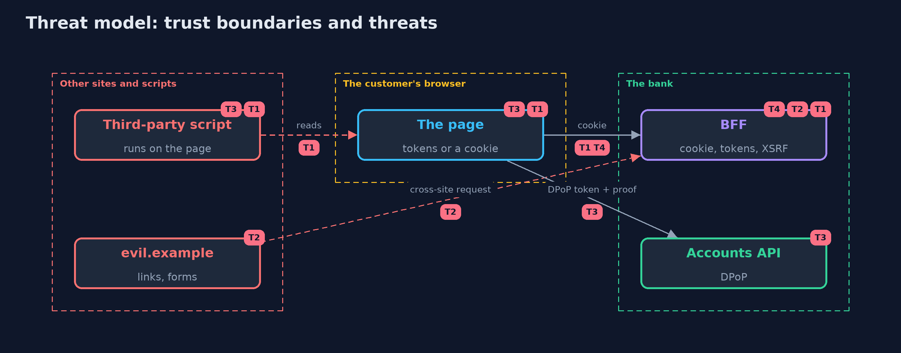

# Threat Model — Tokens in the Browser with Spring Boot: a BFF and DPoP

A threat model answers four questions: what are we protecting, who or what could harm it, how, and what do we do about it. This one covers this project's own demo system, not a production deployment. Domain: an online bank.

## Scope

How a single-page bank app holds and uses OAuth tokens, with and without a BFF and DPoP. It covers theft by a script, requests that another site starts, replay of stolen tokens and sessions across BFF servers. It does not cover an attacker who controls the page's own code.

## What we protect (assets)

- The customer's access token and refresh token.
- The customer's session with the BFF.

## Who and what acts on the system

- A customer using the bank's web app.
- A third-party script on the page.
- A site that the customer also visits and an attacker controls.

## Trust boundaries

A trust boundary is a line that data or a request crosses between parts that trust each other differently. Threats cluster where those lines are.

- The page to its scripts: everything on the page can read the page's storage.
- The browser to the BFF: a cookie and a header.
- The page to the API: a bound token and a proof.

Each dashed box is a trust boundary. A rose tag such as T1 shows where the threat of that number, in the table below, applies.

## Threats, using STRIDE

STRIDE is a checklist of six kinds of threat: **Spoofing** (S), **Tampering** (T), **Repudiation** (R), **Information disclosure** (I), **Denial of service** (D), **Elevation of privilege** (E).

| Id | Kind | Threat | Where it shows up | Control in this project | What is left |
| --- | --- | --- | --- | --- | --- |
| T1 | Information disclosure | A script reads tokens from the page and uses them elsewhere | localStorage, the BFF's cookie | Tokens stay on the server; the cookie is HttpOnly; a strict Content-Security-Policy | A script on the open page can still use the session |
| T2 | Spoofing | Another site makes the customer's browser send a request to the BFF | the BFF's cookies and CSRF check | SameSite=Strict, an XSRF header that must match, and no allowed origin | A browser that ignores SameSite and a missing header check |
| T3 | Spoofing | A stolen access or refresh token is used from another machine | the accounts API, the token endpoint | DPoP: tokens bound to a key with a proof for each request, and bound refresh tokens | Use through the key while the page is open |
| T4 | Denial of service | The BFF's sessions are not shared and customers are signed out | the BFF's session store | A shared session store behind the BFF servers | The store being down |

## Assumptions

- The page is served over https and keeps its own code free of injection.
- The BFF's session store is not readable from the browser.

## Out of scope

- Cross-site scripting in the bank's own pages.
- Malware on the customer's device.

## How the tests check this

- `BffFlowTest` starts a real Keycloak, accounts API and BFF and checks the stolen tokens, the cookie, the tokens held on the server, the refresh, the XSRF header, requests that another site starts, the preflight, DPoP with a good proof and with every bad one, a stolen DPoP refresh token and a second BFF.
- `DpopKeyTest`, `ShopperTest` and `RealmFileTest` check the proofs, the cookie rules and the realm file without Docker.
- `DemoRunsTest` compares the whole demo with the golden output.

## Where this model goes next

The next project in this module, passkeys-with-spring-security, replaces the password at the start of all of this with a credential that cannot be phished.
