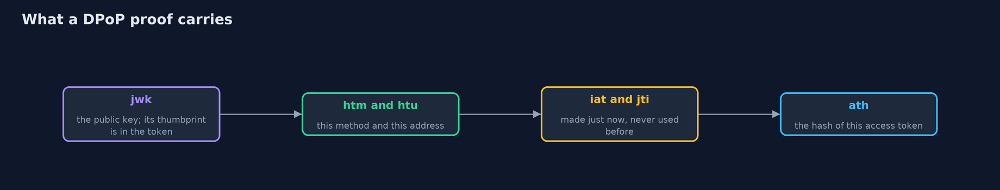

# Tokens in the Browser: BFF and DPoP

```
src/main/java/com/jk/explore/security/tokens/
├── ApiReply.java     A status and a short message
├── AuthServer.java   The authorization server's token table: opaque random tokens, each for one user and optionally bound to one key's thumbprint
├── B64.java          Base64url without padding, the encoding every JOSE part uses
├── Bff.java          A backend for the frontend at {@code https://app.bank.example}
├── BrowserPage.java  What a script running <em>on the page</em> can reach, which is the whole point: web storage is readable by every script on the page (including an injected one), {@code document.cookie} shows cookies that are not HttpOnly, and an HttpOnly cookie can be used by the page (the browser attaches it) but never read
├── DpopProof.java    A DPoP proof (RFC 9449): a small signed statement "I, the holder of this key, am sending this method to this address now, with this token", made fresh for each request
├── Jwk.java          A P-256 public key as a JSON Web Key, and its RFC 7638 thumbprint, which is how an access token names the one key it is bound to
├── MiniJson.java     Reads the small subset of JSON a DPoP proof uses: objects, strings and whole numbers
├── ResourceApi.java  The bank API at {@code https://api.bank.example}
├── SimClock.java     A clock in whole seconds that only moves when the demo or a test says so
└── TokensDemo.java   Runs the single-page app story in four numbered acts and prints exact, repeatable results
```

**A single-page app that keeps an access token where its scripts can read it loses the token to one injected script, and the stolen bearer token works from anywhere; keep the token on a backend behind an HttpOnly session cookie, or bind it to a key the browser holds with DPoP.**

A single-page app (SPA) gets an **access token** after sign-in and sends it to the API. The easy place to keep it is `localStorage`. But every script on the page can read web storage,
and one **cross-site scripting** bug, or one compromised third-party script, is enough to copy the token. A **bearer token** is accepted from whoever presents it, so the attacker uses it from their own computer,
long after the page is closed.

The ways out, in the order this project shows them:
- **A backend for the frontend (BFF).** The tokens stay on a server the customer's browser never sees. The browser holds only a session cookie (`__Host-` prefix, `HttpOnly`, `Secure`, `SameSite`). An injected script cannot read the cookie, so it cannot take the session away,
  though it can still use the session *while the page is open*, which is why XSS must also be fixed.
- **Proof of possession (DPoP, RFC 9449).** The token is bound to a key pair made in the browser. Each request carries a small signed proof for that method, address, time and token. A stolen token without the private key is useless.

**Maps to:** OAuth 2.0 for Browser-Based Applications (IETF BCP draft) · RFC 9449 (DPoP) · RFC 9700 (OAuth security best current practice) · OWASP Top 10 (2025) A07 · OWASP ASVS 5.0, the OAuth and session management chapters.

## The idea in everyday terms

A bearer token is cash: whoever holds it can spend it, and a pickpocket in the crowd (an injected script) is enough. A BFF is a bank that keeps your cash in its vault and gives you a numbered claim ticket that only works at its own counter.
DPoP is a cheque that also needs your signature: a stolen cheque without the pen that signs it is paper.

## The scenario

A single-page banking app at app.bank.example calls an API at api.bank.example. The demo models a page and what an injected script can reach, a small BFF, an authorization server's token table, and a resource API that accepts
bearer tokens and DPoP-bound tokens. DPoP proofs use real ES256 (P-256) signatures from the JDK.

## Run

```bash
./gradlew run
```

The demo tells the story in 4 acts, each printing exact numbers that the tests check:

| Act | What it shows |
| --- | --- |
| 1. A token in local storage | The app stores its access token in local storage and calls the API with it: 200. |
| 2. One injected script takes the token away | A script injected into the page reads localStorage and sends the token to the attacker, who uses it from their own computer: 200. |
| 3. A backend for the frontend keeps the token | The script finds nothing to read; the attacker's computer gets 401; a cross-site form post gets 403; the script can still use the session while the page is open; sign-out kills the cookie. |
| 4. A token that needs the key as well (DPoP) | A bound token works only with a fresh proof signed by its own key: replays, bearer use, no proof, another key, another method and old proofs are all 401; the real key gets 200. |

## Test

```bash
./gradlew test
```

12 tests in `DemoRunsTest`, `TokensTest`. Tokens, session ids and keys are random, so the demo prints only statuses and messages.

## What the simulation got right, and what it left out

The page, its storage and its cookies are a small Java model that follows the rule that matters: scripts read web storage and non-HttpOnly cookies, and the browser attaches HttpOnly cookies to requests without showing them.
The DPoP proofs are real: ES256 over P-256, JWK thumbprints per RFC 7638, and the checks in RFC 9449 (typ, alg, key, method, address, time, token hash, replay).

## Technologies and versions

Every version below is pinned in the project's build files and was the latest stable release when the project was built.

| Technology | Version | Used for |
| --- | --- | --- |
| Java | 25 | the language and runtime; a Gradle toolchain finds or downloads the JDK |
| Gradle | 9.8.1 (wrapper) | build and run; nothing to install, the wrapper downloads it |
| org.junit.jupiter:junit-jupiter | 6.1.3, set by junit-bom | JUnit 5: the tests (tests only) |
| org.junit.platform:junit-platform-launcher | 6.1.3, set by junit-bom | JUnit platform launcher, which Gradle needs to run the tests (tests only) |

## Learning Material

| Document | What it is for |
| --- | --- |
| [Problem statement](docs/problem-statement.md) | the situation and what the project must show |
| [Prerequisites](docs/prerequisites.md) | what you need to know first |
| [Tokens in the Browser: BFF and DPoP, explained](docs/tokens-in-the-browser-explained.md) | the acts in prose |
| [Session guide](docs/session.md) | a one-hour lesson with exercises |
| [Animated walkthrough](docs/animation.html) | the acts step by step |
| [Threat model](docs/threat-model.md) | what is protected, who could harm it, and how, using STRIDE |
| [Spec](docs/spec.md) | what this project must be true of |
| [Expected output](docs/expected-output.txt) | the golden demo output every test and every port checks against |

### The idea in one picture

Each design changes what a script on the page can take away.


### Where each piece sits

The page models what scripts reach; the API accepts two kinds of token.


### How the data moves

Every field of the proof stops a different attack.



### Who calls whom, in order


## What it costs

- **A BFF is another server to run,** with sessions to store, expire and revoke, and it sits on the path of every API call.
- **A BFF does not fix XSS.** While the page is open, an injected script can still make requests through the session; the cookie only stops the script from carrying the token away.
- **A BFF needs CSRF protection** because it uses cookies: the origin check and the custom header here are examples.
- **DPoP needs a key the script cannot export** (a non-extractable WebCrypto key), or XSS can copy the key as easily as the token. Even then, an injected script can ask the key to sign while the page is open.
- **DPoP adds a signature to every request and a replay cache to the API,** and clock and nonce handling to get right.

## When this is too much

If the app is server-rendered, with its own session cookie and no token in the browser, there is nothing to protect in storage. For a small internal tool, a BFF may be the simplest sound choice. DPoP matters most when tokens must reach
the browser, or when tokens pass through places that log them.

## Where you have already met this

- `localStorage.setItem('access_token', ...)` in single-page app tutorials.
- The advice "never store tokens in localStorage" and the argument over cookies versus storage.
- `Authorization: DPoP ...` and a `DPoP:` header in newer OAuth libraries.
- A BFF (backend for the frontend) in the OAuth working group's browser-apps guidance.

## Where this sits

This project is in [identity-and-access](..) and builds on [oauth2-authorization-code-pkce](../oauth2-authorization-code-pkce) and [openid-connect](../openid-connect), which get the tokens; here the question is where they live afterwards.
It relies on [session-management](../../api-security/session-management) for the cookie and [cross-site-scripting](../../web-security/cross-site-scripting) for how a script gets onto the page.
