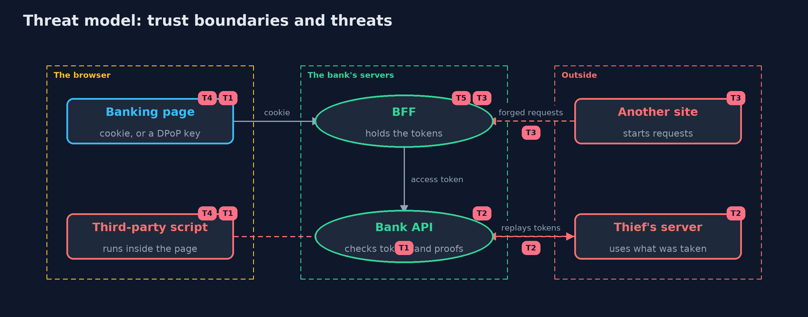

# Threat Model — Tokens in the Browser

A threat model answers four questions: what are we protecting, who or what could harm it, how, and what do we do about it. This one covers this project's own demo system, not a production deployment. Domain: an online bank.

## Scope

Where an online bank's single-page app keeps its OAuth tokens, and how the bank's API and a backend for the frontend accept requests from it. It covers
scripts running on the page, sites that start requests in the customer's browser, and thieves who replay what was taken. It does not cover how the page
came to run a bad script, the OAuth flow itself, or the authorization server's internals.

## What we protect (assets)

- Ana's access token and refresh token.
- The BFF session cookie.
- The client's DPoP private key.
- Ana's balance and her ability to move money.

## Who and what acts on the system

- Ana, using the bank's page.
- A third-party script included in the page.
- Another site Ana visits.
- A thief using tokens away from Ana's browser.

## Trust boundaries

A trust boundary is a line that data or a request crosses between parts that trust each other differently. Threats cluster where those lines are.

- Page to scripts: anything scripts can read is shared with every script on the page.
- Browser to BFF: the cookie goes automatically, so the BFF must tell its own page from other sites.
- Client to API: a bearer token works for whoever holds it, unless it is bound to a key.

Each dashed box is a trust boundary. A rose tag such as T1 shows where the threat of that number, in the table below, applies.

## Threats, using STRIDE

STRIDE is a checklist of six kinds of threat: **Spoofing** (S), **Tampering** (T), **Repudiation** (R), **Information disclosure** (I), **Denial of service** (D), **Elevation of privilege** (E).

| Id | Kind | Threat | Where it shows up | Control in this project | What is left |
| --- | --- | --- | --- | --- | --- |
| T1 | Information disclosure | A script on the page reads tokens kept in the browser and sends them away | `Browser.readableByScripts`, `PageScript.collect` | A backend for the frontend keeps the tokens on the server; the browser holds only an HttpOnly cookie | A script on the open page can still make requests as the user, so scripts must be kept off the page |
| T2 | Spoofing | A stolen access or refresh token is replayed from elsewhere | `BankApi.handle`, `AuthServer.refresh` | DPoP binds tokens to a key; proofs are checked for method, address, time, token hash and a single-use id | Bearer tokens without binding still work for whoever holds them until they expire |
| T3 | Tampering | Another site starts a state-changing request that carries the session cookie | `Bff.handle` | SameSite=Strict, a request header required on every change, and no cross-origin preflight allowed | A script running on the bank's own page can send the header, which is threat T1 again |
| T4 | Elevation of privilege | A script on the open page uses the non-extractable DPoP key to sign its own requests | `Browser.keyForThisPage` | None that DPoP itself can give: keep scripts off the page with a strict Content-Security-Policy | Use while the page is open stays possible; theft of the key does not |
| T5 | Denial of service | Sessions stop working when requests reach a BFF instance that does not have them | `Bff` session store | A shared session store for every instance | The store becomes a dependency to run and protect |

## Assumptions

- The BFF, the API and the authorization server are run by the bank and keep their keys safe.
- Browsers apply HttpOnly and the CORS preflight; older ones may ignore SameSite.
- In the demo, keys come from fixed seeds and the browser and script are models.

## Out of scope

- Preventing scripts from being injected: the cross-site-scripting project.
- The OAuth code flow and PKCE: the oauth2-authorization-code-pkce project.
- Mobile apps, which keep tokens in the operating system's secure storage.

## How the tests check this

- `DpopTest` checks the RFC 8037 thumbprint, good proofs, every refusal reason, replays, and that a refused proof does not use up its id.
- `BffAndBrowserTest` checks the cookie, what scripts can read, the request header, SameSite, the preflight, server-side refresh and the closed page.
- `TokensTest` checks expiry, issuer keys, refresh rotation, bound refresh tokens and bound access tokens.
- `DemoRunsTest` compares the whole demo with the golden output.

## Where this model goes next

The next projects in this module are passkeys, which removes the password, and openid-connect, which adds identity on top of OAuth.
