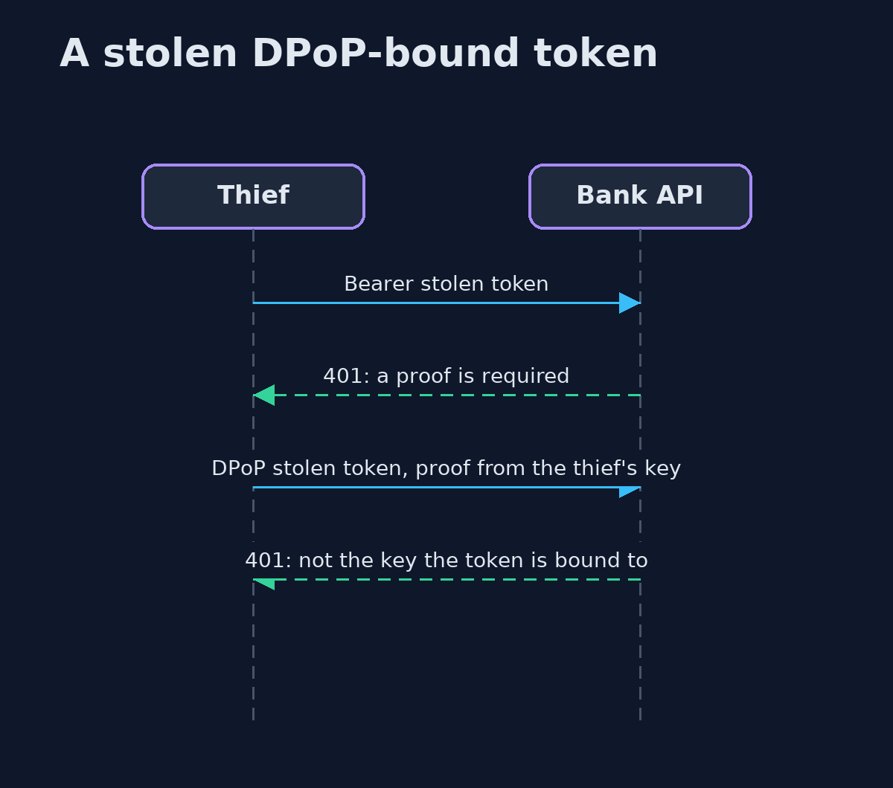
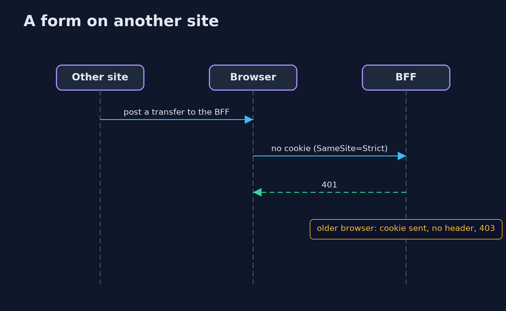

# Tokens in the Browser — UML Sequence Diagrams

## 1. A stolen DPoP-bound token

The token alone is refused, and a proof from any other key does not match the thumbprint in the token.

## 2. A form on another site

SameSite keeps the cookie off; an older browser sends it, but the request header is missing, and adding it needs a preflight the BFF refuses.

