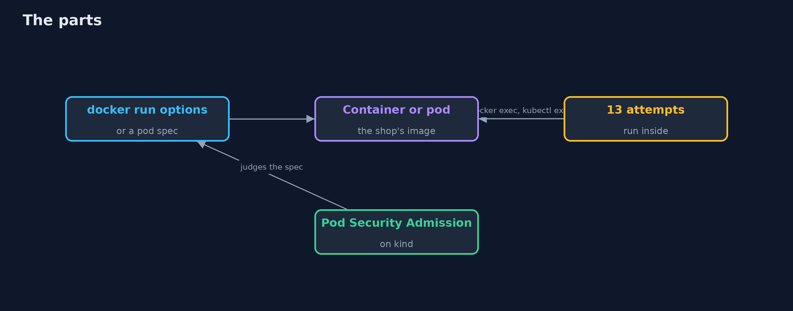
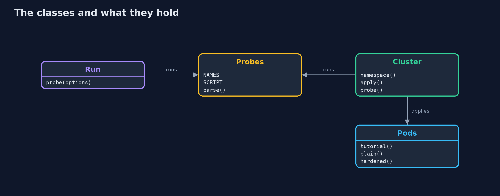
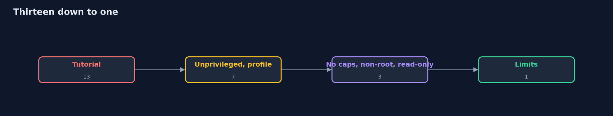
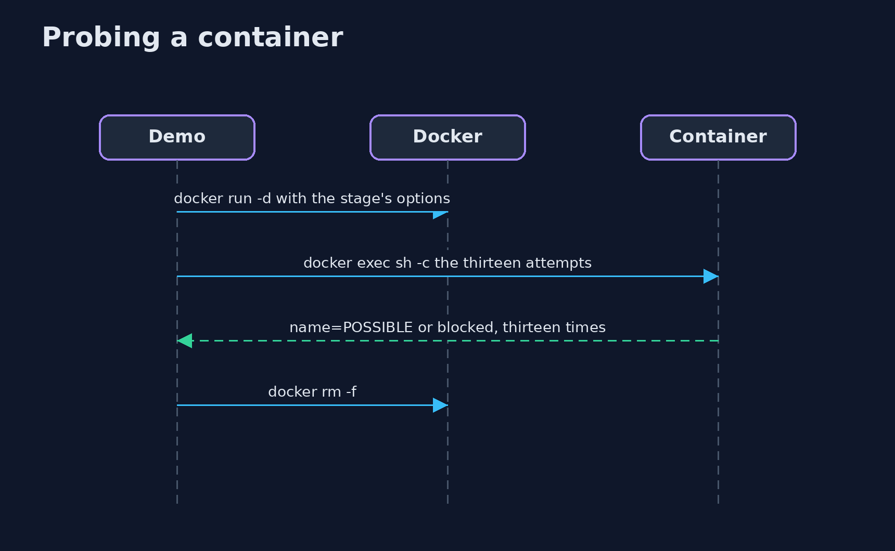

# Container Hardening with Docker and kind

```
src/main/java/com/jk/explore/security/containerhard/
├── Capabilities.java            A teaching class: reads the {@code CapEff} line of {@code /proc/self/status}, a hexadecimal bit mask in which bit n is the capability with number n (from linux/capability.h)
├── Cluster.java                 A real Kubernetes cluster made by kind (one node, itself a container), with its own kubeconfig file, deleted on close
├── ContainerHardeningDemo.java  Starts the shop's image with different docker run options and a kind cluster with Pod Security Standards, runs thirteen real attempts inside each container, and prints the results in six numbered acts
├── Image.java                   The shop's application image, as an ordinary team would have built it: an app user that owns the app, and a secret in the environment
├── Pods.java                    The three pods of the lesson as manifests: the tutorial's, the default, and the hardened one
├── Probes.java                  Thirteen things a hijacked process tries, written as shell commands that run inside the container as whatever user the container runs as
├── Report.java                  How the demo prints what the probes and the cluster returned: labelled sections, at most {@link #WIDTH} characters a line
├── Run.java                     One container started with a list of docker run options, probed, and removed
├── Seccomp.java                 A seccomp profile that denies the system calls Docker's own default profile denies (mount, unshare, ptrace, kernel modules, keys, bpf, clock changes...)
└── Sh.java                      Runs a program and returns what it printed, whether it worked or not
```

**Thirteen real attempts run inside a real container as the user it runs as: the tutorial's docker run gives all thirteen, no options gives seven, and adding a seccomp profile, dropping capabilities, running as another user, a read-only root with a noexec temporary directory and memory and process limits brings it to one, the secret the application has to read; the same on a kind cluster, where Pod Security Standards refuse the tutorial's pod, a plain pod in a restricted namespace, and admit the hardened pod, which still has two attacks left; the layers cover for each other's mistakes, and the standards judge only the spec.**

The plain [container-hardening](../container-hardening) project scores `docker run` options and pod specs with a model. This one measures: it builds the shop's image, starts **real containers** with different options and runs **thirteen real attempts** inside each (write to the application, run a dropped file, become root, sniff the network, mount a file system, find the Docker socket, the host's files, the host's network and processes, a missing memory or process limit, the secret in the environment). Then it makes a real **kind** cluster and lets **Pod Security Admission** judge three pods. It needs Docker, `kind` and `kubectl` (`brew install kind kubernetes-cli`); the tests are tagged `integration`: `./gradlew integrationTest`.

What it shows:
- **No options: 7 of 13.** The shop's image run as it is: secrets in the environment, a writable root, a dropped file that runs, root, raw sockets, no memory or process limit.
- **The tutorial's command: 13 of 13.** `--privileged`, no seccomp, the host's network and processes, the Docker socket, the host's `/etc`.
- **One setting at a time.** 13, 8, 7, 5, 5, 5, 3, **1**. The number stays the same where the set changes (a non-root user closes `become-root` and opens `tamper-with-app`, which the app user owns), and `--security-opt no-new-privileges` moves nothing in an image with no set-user-id program.
- **The hardened container.** `--user 10001 --cap-drop=ALL --read-only --tmpfs /tmp:noexec --security-opt no-new-privileges --memory --pids-limit` and a seccomp profile: one attack left, **the secret** that the application must read. Add NET_RAW and nothing changes; add root and SYS_ADMIN and only the seccomp profile still stands between it and `mount`.
- **Kubernetes on kind.** Namespaces that enforce privileged, baseline and restricted: the tutorial's pod is refused twice (3 and 7 violations), a plain pod is admitted by baseline and refused by restricted (4), a warn-only namespace admits it with a warning, and the hardened pod is admitted. Probed from inside: the plain pod 7 attacks, the hardened pod 2.

**Maps to:** OWASP Top 10 (2025) A02 Security Misconfiguration · CIS Docker and Kubernetes Benchmarks · Kubernetes Pod Security Standards · CWE-250 (execution with unnecessary privileges), CWE-269.

## The idea in everyday terms

A bank's back office after a break-in. Instead of asking whether the lock was good, ask what the burglar can reach once inside: the safe, the keys, the neighbours' doors. Each rule you add, a cage around the safe, no keys on the desk, no phone line out, takes something away, and the measuring is done by walking the burglar's route.

## The scenario

An online store runs its application in a container. The demo assumes that a process in it has been taken over, runs the attacker's thirteen first steps in containers started in different ways, and then asks a Kubernetes cluster to refuse the worst of them.

## Run

```bash
./gradlew run
```

The demo tells the story in 6 acts, each printing exact numbers that the tests check:

| Act | What it shows |
| --- | --- |
| 1. What docker run with no options gives an attacker | The input: the shop's image run with only a seccomp profile (the lab's Docker has none of its own). The probes read id -u 0, CapEff 00000000a80425fb (14 capabilities, NET_RAW bit 13 set, SYS_ADMIN bit 21 clear), Seccomp 2, no memory or process limit. The result: container 4 + kernel 1 + host 0 + resources 2 = 7 of 13. |
| 2. The configuration from the tutorial | The input: --privileged, seccomp=unconfined, the host network and PID namespace, the Docker socket and the host's /etc mounted. The result: every attempt works, 4 + 3 + 4 + 2 = 13 of 13. |
| 3. One setting at a time | From 13 of 13: no host access 8, a seccomp profile 7, drop all capabilities 5, a user that is not root 5 (blocks become-root, opens tamper-with-app), no new privileges 5 (nothing to stop), a read-only root with a noexec /tmp 3, memory and process limits 1: read-secrets is left. |
| 4. The hardened container | The input: a seccomp profile, --cap-drop ALL, --user 10001, no new privileges, a read-only root with a noexec /tmp, --memory 512m and --pids-limit 200. The probes read id -u 10001, CapEff 0, Seccomp 2, memory.max 536870912 (= 512 MiB) and pids.max 200. The result: 1 of 13, read-secrets. |
| 5. Settings that look harmless | Before: the hardened container, 1 of 13. --cap-add NET_RAW: still 1, because NET_RAW works only for root. --user 0 --cap-add SYS_ADMIN: 2 (become-root), and only the seccomp profile still blocks mount. And with seccomp=unconfined as well: 4 (become-root, dangerous-syscalls, mount-host). |
| 6. The same on Kubernetes, with Pod Security Standards on kind | The input: a one-node kind cluster with namespaces that enforce privileged, baseline and restricted, and three pods sent with --dry-run=server. The result: the tutorial's pod is refused by baseline (3 checks) and restricted (7), a plain pod is admitted by baseline and refused by restricted (4), the hardened pod is admitted everywhere; probed from inside, the plain pod has 7 attempts left and the hardened pod 2. |

## Test

```bash
./gradlew test
```

24 tests in `DemoRunsTest`, `HardeningTest`, `ParsingTest`, `ReportTest`. The readers of the probe output and of admission messages are tested on text. The rest starts containers and a kind cluster and removes them (./gradlew integrationTest). They need Docker, kind and kubectl.

## What the simulation got right, and what it left out

The containers are real, started by docker run and probed with docker exec; the cluster is real, made by kind with its own kubeconfig file and deleted at the end; the pods are probed with kubectl exec. Ports, names and addresses are never printed; the demo takes about two minutes, most of it the cluster.

## Technologies and versions

Every version below is pinned in the project's build files and was the latest stable release when the project was built.

| Technology | Version | Used for |
| --- | --- | --- |
| Java | 25 | the language and runtime; a Gradle toolchain finds or downloads the JDK |
| Gradle | 9.8.1 (wrapper) | build and run; nothing to install, the wrapper downloads it |
| org.junit.jupiter:junit-jupiter | 6.1.3, set by junit-bom | JUnit 5: the tests (tests only) |
| org.junit.platform:junit-platform-launcher | 6.1.3, set by junit-bom | JUnit platform launcher, which Gradle needs to run the tests (tests only) |
| videokit | repository tool (`tools/videokit`) | the narrated video and animation: Piper `en_US-amy-medium`, speed 0.8, longer pauses (the amy-slow voice) |

## Learning Material

| Document | What it is for |
| --- | --- |
| [Problem statement](docs/problem-statement.md) | the situation and what the project must show |
| [Prerequisites](docs/prerequisites.md) | what you need to know first |
| [Container Hardening with Docker and kind, explained](docs/container-hardening-with-docker-and-kind-explained.md) | the acts in prose |
| [Session guide](docs/session.md) | a one-hour lesson with exercises |
| [Animated walkthrough](docs/animation.html) | the acts step by step, narrated |
| [Threat model](docs/threat-model.md) | what is protected, who could harm it, and how, using STRIDE |
| [Spec](docs/spec.md) | what this project must be true of |
| [Expected output](docs/expected-output.txt) | the golden demo output every test and every port checks against |

### The idea in one picture

Options go in, thirteen attempts run inside, a cluster judges the spec.



### Where each piece sits

A run, the probes, and the cluster.



### How the data moves

Each option takes away something.



### Who calls whom, in order




### Video

`video/container-hardening-with-docker-and-kind-explained.mp4` (with `.m4a` audio and `.srt` subtitles) is built by `video/build_video.sh`. Rendered media is not committed.

## What it costs

- **Every restriction can break the application:** a read-only root needs a temporary directory, a non-root user needs ownership of its files.
- **The secret the application must read, a hijacked application can read too.**
- **Kubernetes standards judge the spec,** and do not see what happens at run time.
- **Limits need numbers** that someone measures.
- **A lab daemon may differ from production:** here, Docker applies no seccomp filter by itself.

## When this is too much

A throw-away container on a developer's laptop that runs a trusted test for a minute does not need all of this. Harden what is exposed to the network, holds secrets or runs for long.

## Where you have already met this

- `docker run --privileged` in a tutorial.
- `securityContext` in a manifest.
- A namespace label `pod-security.kubernetes.io/enforce`.
- A "permission denied" after someone added `readOnlyRootFilesystem`.

## Where this sits

This is the tools version of [container-hardening](../container-hardening), in the [platform-hardening](..) module, after [linux-hardening-with-docker](../linux-hardening-with-docker), which scanned the inside of the image.
