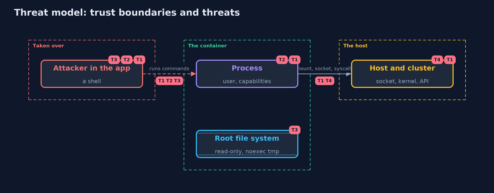

# Threat Model — Container Hardening with Docker and kind

A threat model answers four questions: what are we protecting, who or what could harm it, how, and what do we do about it. This one covers this project's own demo system, not a production deployment. Domain: an online store.

## Scope

A container of the shop's application assumed to be taken over, the options it is started with, and the Kubernetes admission that judges its pod spec. It does not cover container escapes through kernel bugs.

## What we protect (assets)

- The host and the cluster.
- The shop's secrets and data inside the container.

## Who and what acts on the system

- An attacker with a shell in the application.
- An operator who copies a command from a tutorial.

## Trust boundaries

A trust boundary is a line that data or a request crosses between parts that trust each other differently. Threats cluster where those lines are.

- The container and the host's kernel.
- The admission controller: the last check before a pod is created.

Each dashed box is a trust boundary. A rose tag such as T1 shows where the threat of that number, in the table below, applies.

## Threats, using STRIDE

STRIDE is a checklist of six kinds of threat: **Spoofing** (S), **Tampering** (T), **Repudiation** (R), **Information disclosure** (I), **Denial of service** (D), **Elevation of privilege** (E).

| Id | Kind | Threat | Where it shows up | Control in this project | What is left |
| --- | --- | --- | --- | --- | --- |
| T1 | Elevation of privilege | A taken-over process reaches the host | privileged, host namespaces, mounts, capabilities | No privileged, no host namespaces or paths, all capabilities dropped, a seccomp filter | Kernel bugs |
| T2 | Elevation of privilege | The process is root, or becomes root | the user of the container | A numeric user that is not root, no new privileges | Files the user owns |
| T3 | Tampering | The attacker changes the application or drops a tool | the root file system | A read-only root and a temporary directory mounted noexec | A writable temporary directory that runs code (as on Kubernetes emptyDir) |
| T4 | Denial of service | One container uses all the memory or processes | cgroup limits | Memory and process limits | Limits set too high |

## Assumptions

- The attacker starts as the process the container runs.
- The cluster's labels on namespaces are protected by access control.

## Out of scope

- Kernel vulnerabilities.
- Network policies and service meshes.

## How the tests check this

- `ParsingTest` checks the readers of probe output and admission messages, the stages and the manifests, on text.
- `HardeningTest` runs thirteen real attempts in containers started in each way, and the three pods in a real kind cluster.
- `DemoRunsTest` compares the whole demo with the golden output.

## Where this model goes next

The next module, detection-and-response, starts with security-logging-with-loki-and-grafana.
