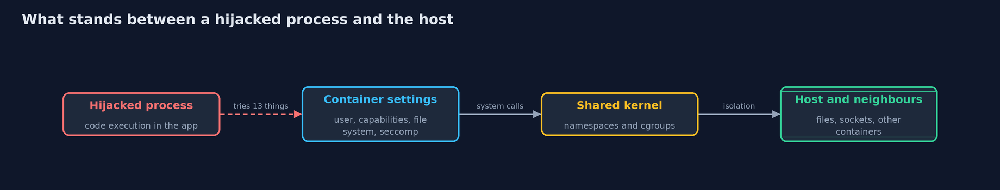
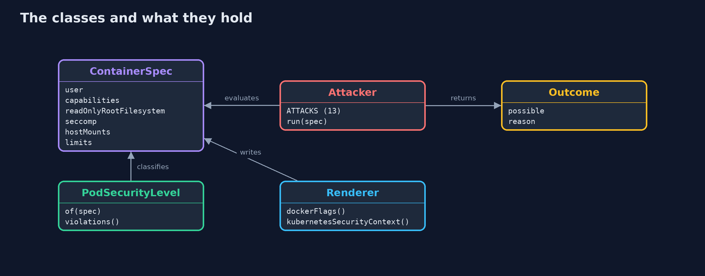
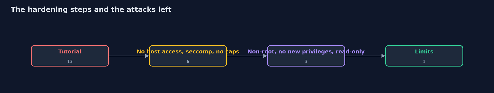
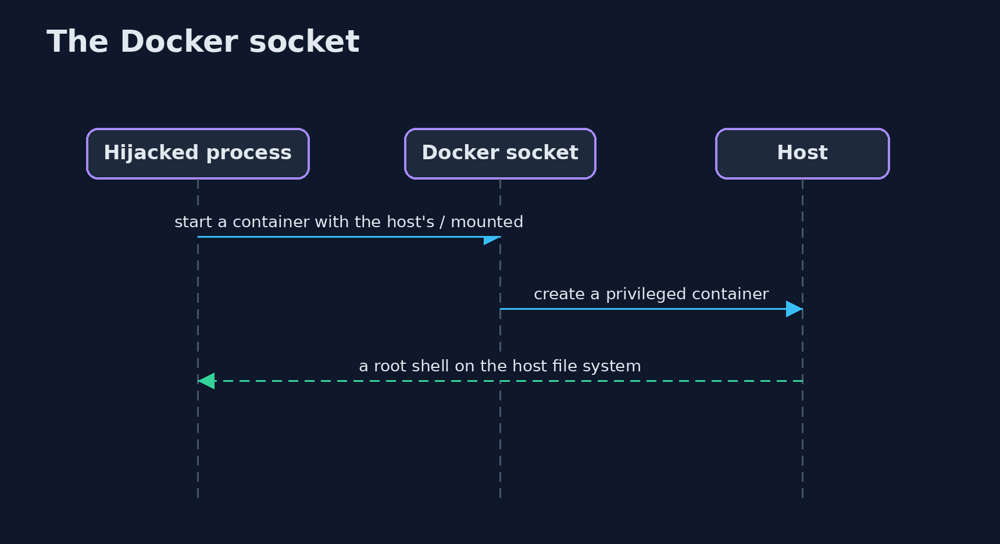

# Container Hardening

```
src/main/java/com/jk/explore/security/container/
├── Attack.java            One thing an attacker with code execution inside the container tries
├── Attacker.java          "What can a process do once it is taken over?" For each attack, a rule that says whether this container's settings allow it
├── ContainerDemo.java     Runs the container story in five numbered acts and prints exact, repeatable results
├── ContainerSpec.java     The settings of a container that matter when the process inside is taken over: who it runs as, what it may do to the kernel, what it can write, what of the host it can see, and how much it may use
├── Outcome.java           Whether an attack works against a container, and the setting that decides it
├── PodSecurityLevel.java  The three Kubernetes Pod Security Standards levels, strictest last
├── Renderer.java          Writes the settings as Docker flags and as a Kubernetes container {@code securityContext}, so the checked configuration is the one that is deployed
└── Seccomp.java           Which system calls the container may make
```

**A container is a process with settings, so decide what a hijacked process can do before it happens: run as a non-root user, drop all capabilities, forbid new privileges, make the root file system read-only, keep the host out, and set limits; each setting removes specific attacks, and the Pod Security Standards name the levels.**

An attacker who finds a flaw in the shop's application gets code execution **inside the container**. What they can do next depends on the container's settings, and the defaults are generous: a plain `docker run` gives root inside the container, 14 Linux capabilities, a writable file system, and no limits on memory or processes.
Tutorials add more to "make it work": `--privileged`, the Docker socket, the host network. Each setting is a door for the attacker.

This project turns the question into code. A `ContainerSpec` holds the settings that matter (user, capabilities, privileged, read-only file system, privilege escalation, seccomp, host mounts and namespaces, memory and process limits, how secrets are passed, the image), and an
**attacker model** asks thirteen questions of it: can a hijacked process read secrets, tamper with the app, drop and run a tool, become root, use dangerous system calls, sniff the network, mount host things, talk to the Docker socket, touch host files, reach the host network, see host processes, exhaust memory, fork without limit? Each answer names the setting that decides it.

What the project shows, in order:
- **Defaults:** 7 of the 13 attacks are possible. **The tutorial configuration:** all 13.
- **Hardening one setting at a time**, with the effect of each: host access, seccomp, capabilities, non-root user, no new privileges, read-only root, limits, down to 1 of 13.
- **Pod Security Standards:** the Privileged, Baseline and Restricted levels, with the reasons a container fails the next level, and the same settings rendered as Docker flags and as a Kubernetes `securityContext`.
- **What is left:** the application's own secrets. Hardening limits the blast radius; it does not make the application safe.

**Maps to:** OWASP Top 10 (2025) A02 Security Misconfiguration · CIS Docker and Kubernetes Benchmarks · Kubernetes Pod Security Standards · NIST SP 800-190 (Application Container Security) · CWE-250 · CWE-269.

## The idea in everyday terms

A guest in a hotel room can do what the room allows: with the master key and the service lift (privileged, host mounts), they can reach every floor; with a plain key, only their room; with a room that has no phone line to the safe and a lock on the minibar, much less. You design the room for the day a guest turns out to be a thief.

## The scenario

A containerised web shop with a flaw that gives an attacker code execution. The demo evaluates five configurations: Docker's defaults, the configuration from the tutorial, eight steps of hardening, the hardened container, and two settings that look harmless.

## Run

```bash
./gradlew run
```

The demo tells the story in 5 acts, each printing exact numbers that the tests check:

| Act | What it shows |
| --- | --- |
| 1. What 'docker run' with no options gives an attacker | 7 of 13 attacks are possible and the level is Baseline: root, a writable file system, raw sockets, and no memory or process limits. |
| 2. The configuration from the tutorial | --privileged, the Docker socket, the host's /etc, the host network and PID namespace, and unconfined seccomp make all 13 attacks possible; the level is Privileged. |
| 3. One setting at a time | Removing host access takes 13 down to 9, seccomp 8, dropping capabilities 6, a non-root user alone changes nothing, no new privileges 5, a read-only root 3, and limits 1. |
| 4. The hardened container | The result as Docker flags and a Kubernetes securityContext, at the Restricted level; the one thing still possible is reading the secrets the application needs. |
| 5. Settings that look harmless | NET_RAW added to the hardened container drops it to Baseline with 1 attack possible because it is not root; root with SYS_ADMIN makes it Privileged with 3 possible. |

## Test

```bash
./gradlew test
```

11 tests in `ContainerTest`, `DemoRunsTest`. Everything is fixed data, so the demo prints the same text on every run.

## What the simulation got right, and what it left out

The attacks are rules, not a kernel: each rule states the documented effect of a Linux or Docker setting (capabilities, user namespaces, seccomp, mounts, cgroup limits). That keeps the project runnable anywhere and the output exact. The Pod Security Standards checks follow the Baseline and Restricted profiles of the Kubernetes documentation.

## Technologies and versions

Every version below is pinned in the project's build files and was the latest stable release when the project was built.

| Technology | Version | Used for |
| --- | --- | --- |
| Java | 25 | the language and runtime; a Gradle toolchain finds or downloads the JDK |
| Gradle | 9.8.1 (wrapper) | build and run; nothing to install, the wrapper downloads it |
| org.junit.jupiter:junit-jupiter | 6.1.3, set by junit-bom | JUnit 5: the tests (tests only) |
| org.junit.platform:junit-platform-launcher | 6.1.3, set by junit-bom | JUnit platform launcher, which Gradle needs to run the tests (tests only) |
| videokit | repository tool (`tools/videokit`) | the narrated video and animation: Piper `en_US-amy-medium`, speed 0.8, longer pauses (the amy-slow voice) |

## Learning Material

| Document | What it is for |
| --- | --- |
| [Problem statement](docs/problem-statement.md) | the situation and what the project must show |
| [Prerequisites](docs/prerequisites.md) | what you need to know first |
| [Container Hardening, explained](docs/container-hardening-explained.md) | the acts in prose |
| [Session guide](docs/session.md) | a one-hour lesson with exercises |
| [Animated walkthrough](docs/animation.html) | the acts step by step, narrated |
| [Threat model](docs/threat-model.md) | what is protected, who could harm it, and how, using STRIDE |
| [Spec](docs/spec.md) | what this project must be true of |
| [Expected output](docs/expected-output.txt) | the golden demo output every test and every port checks against |

### The idea in one picture

Each layer is a setting; the hardened container has all of them.



### Where each piece sits

A spec goes into the attacker model and the level check, and comes out as flags and YAML.



### How the data moves

Each step removes specific attacks; the user change alone removes none.



### Who calls whom, in order




### Video

`video/container-hardening-explained.mp4` (with `.m4a` audio and `.srt` subtitles) is built by `video/build_video.sh`. Rendered media is not committed.

## What it costs

- **Read-only file systems need writable scratch space** (a tmpfs for `/tmp`, volumes for data), and applications that write next to their code must be changed.
- **Non-root needs the image prepared:** file ownership, ports above 1024 (or the NET_BIND_SERVICE capability), and a user that exists.
- **Limits need numbers** from load tests; too low gives out-of-memory kills, too high protects nothing.
- **The default seccomp profile is generous on purpose.** A custom profile for your application is stronger and costs maintenance.
- **Hardening is not isolation.** Containers share the host kernel: a kernel bug can still escape. For hostile code use a sandboxed runtime or virtual machines.

## When this is too much

Do not turn every flag on at once without tests: add one setting, run the application's tests and a smoke test, and record the result. And do not mistake the container for the whole defence: network policy, secrets management and patching still apply.

## Where you have already met this

- `docker run --privileged` and `-v /var/run/docker.sock:/var/run/docker.sock` in tutorials.
- `securityContext` in Kubernetes manifests, and Pod Security admission labels.
- Distroless and non-root base images.
- A scanner report titled "container runs as root".

## Where this sits

This project is in [platform-hardening](..) and follows [linux-hardening](../linux-hardening): the host settings below the container. The Docker and kind version (container-hardening-with-docker-and-kind) applies these flags to real containers and enforces Pod Security Standards.
