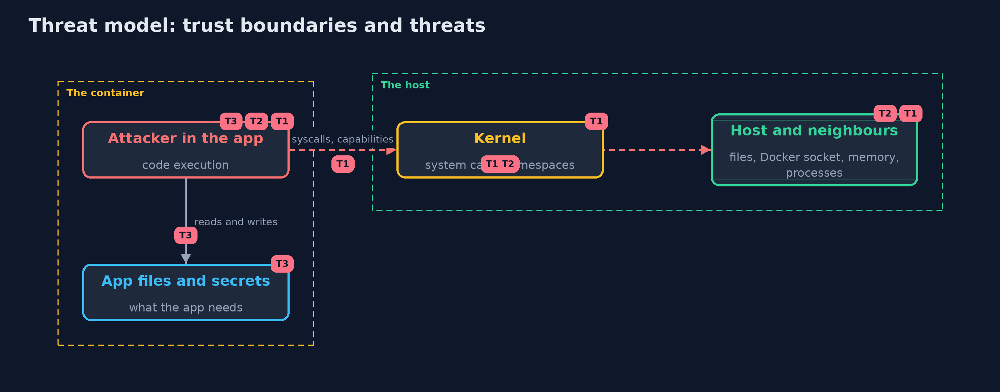

# Threat Model — Container Hardening

A threat model answers four questions: what are we protecting, who or what could harm it, how, and what do we do about it. This one covers this project's own demo system, not a production deployment. Domain: a containerised web shop.

## Scope

The runtime settings of an application container, after an attacker has gained code execution inside it. It covers what that process can do to the container, the host and its neighbours.
It does not cover how the attacker got in, kernel vulnerabilities, or the network policy around the container.

## What we protect (assets)

- The host and the other containers on it.
- The application's files and the secrets it holds.
- The availability of the node.

## Who and what acts on the system

- An attacker with code execution in the application.
- The operator who writes the container settings.

## Trust boundaries

A trust boundary is a line that data or a request crosses between parts that trust each other differently. Threats cluster where those lines are.

- The container to the host: the kernel interface, mounts and shared namespaces.
- The container to its neighbours: shared resources and the network.

Each dashed box is a trust boundary. A rose tag such as T1 shows where the threat of that number, in the table below, applies.

## Threats, using STRIDE

STRIDE is a checklist of six kinds of threat: **Spoofing** (S), **Tampering** (T), **Repudiation** (R), **Information disclosure** (I), **Denial of service** (D), **Elevation of privilege** (E).

| Id | Kind | Threat | Where it shows up | Control in this project | What is left |
| --- | --- | --- | --- | --- | --- |
| T1 | Elevation of privilege | A hijacked process escapes to the host through privileges, capabilities, seccomp gaps, mounts or the Docker socket | `Attacker` rules: become-root, mount-host, docker-socket, host-files, dangerous-syscalls | Non-root, drop ALL capabilities, no new privileges, default seccomp, no host mounts or namespaces, never --privileged | Kernel vulnerabilities: patch and consider sandboxed runtimes |
| T2 | Denial of service | A hijacked process uses all the memory or processes of the node | `Attacker` rules: exhaust-memory, fork-bomb | Memory and process limits, and CPU limits | Limits set too high, or noisy neighbours that share a limit |
| T3 | Tampering | A hijacked process changes the application, drops a tool, or reads its secrets | `Attacker` rules: tamper-with-app, drop-and-run, read-secrets | Read-only root, noexec temporary directory; secrets as files from a secret store, short-lived | The application's own secrets stay readable by the application: rotate them and limit their reach |

## Assumptions

- The kernel and the container runtime are patched.
- The thirteen attacks are representative, not exhaustive.

## Out of scope

- Kernel exploits and runtime escapes: patch, and use sandboxed runtimes for hostile code.
- Network policy and egress control.

## How the tests check this

- `ContainerTest` checks the attack rules for each setting, the three configurations, the Docker socket, the effect of a non-root user with and without no_new_privs, root with SYS_ADMIN, the Pod Security levels and violations, and the rendered flags and YAML.
- `DemoRunsTest` compares the whole demo with the golden output.

## Where this model goes next

The next module, detection-and-response, asks how an attack is noticed and handled once it gets through, starting with detecting attacks in logs.
