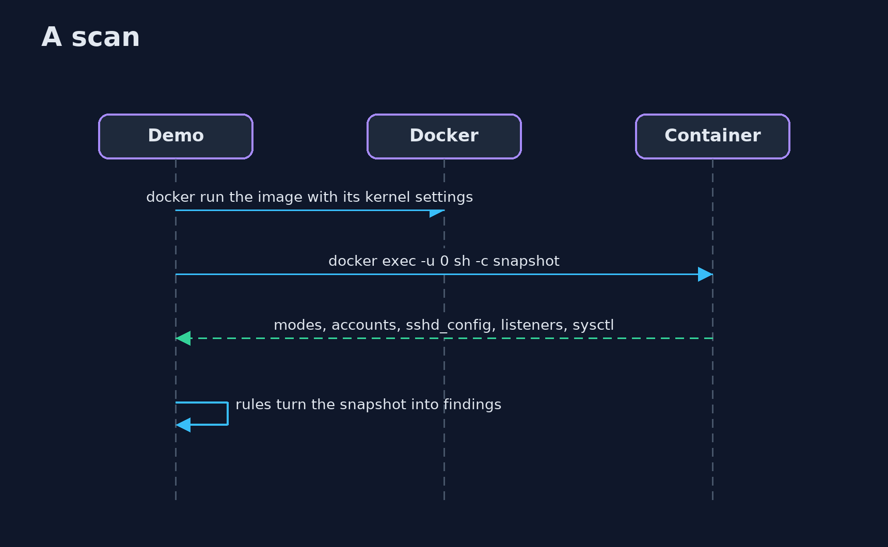

# Linux Hardening with Docker

```
src/main/java/com/jk/explore/security/hostscan/
├── Docker.java        The docker command, as a program
├── Finding.java       One thing the scan found: how bad it is, which rule, where, and why it matters
├── Host.java          A running container from one of the images, removed on close
├── HostScanDemo.java  
├── Images.java        The two images of the lesson, built from Dockerfiles written here: a typical one with the usual mistakes, and one that was hardened in its recipe
└── Scanner.java       Reads a running container the way an auditor reads a host: one script run as root inside it, and rules over what it printed
```

**A script run as root inside a real container reads its file modes, accounts, sshd_config, listening ports and kernel settings; a typical image has 19 findings, a machine can fix the 7 permission ones, but a fix inside a running container is gone in the next one, so the decisions belong in the image's recipe, which gives a hardened image with 0 findings; a container cannot change the kernel it shares, and how it is started is a separate matter.**

The plain [linux-hardening](../linux-hardening) project checks a prepared directory tree that stands in for a container image. This one checks **real containers**: it builds two Docker images from Dockerfiles written by the demo (`alpine:3.24.3` underneath), starts them, and runs one script as root inside each to read the files and modes, accounts, `sshd_config`, listeners and kernel settings. It needs Docker; the tests are tagged `integration`: `./gradlew integrationTest`.

What it shows:
- **A typical image.** 19 findings: an account with no password and a second UID 0 account, a copied shell with the set-user-id bit, a world-writable upload folder and file, a shadow file, a host key and a config that are too open, a group-writable cron script, root login and empty passwords in `sshd_config`, and three listeners on every interface (telnet, an unauthenticated Docker API, Redis).
- **What a machine can fix, and where the fix lives.** Seven are permission changes. They are applied in the running container; `docker diff` lists them in its writable layer; **a new container from the same image has all 19 again.**
- **The decisions, in the recipe.** A hardened Dockerfile: no second root, no test account, a locked service account, private modes, no copied shell, one listener on 8080, the process runs as `app`, and the container started with `accept_redirects` 0 and `syncookies` 1: **0 findings**.
- **Running it again.** Loosen the config inside a running hardened container and the scan finds the drift; a new container has none.
- **The bill.** A container shares the host's kernel: `kernel.randomize_va_space` cannot be changed from inside (read-only file system). Allow-lists are the shop's decisions, and how a container is started is the subject of [container-hardening](../container-hardening).

**Maps to:** OWASP Top 10 (2025) A02 Security Misconfiguration · CIS Benchmarks for Linux and Docker · CWE-732 (incorrect permission assignment), CWE-250 (execution with unnecessary privileges), CWE-1188.

## The idea in everyday terms

A building inspector who checks a flat in a block and tightens a loose handrail on the spot. When the tenants move out the handrail is loose again, because it was the flat that was fixed and not the plans. The fix that lasts is the one made in the plans.

## The scenario

An online store ships its server as a container image. The demo builds the typical image that nobody reviewed and the same shop with its decisions made, and scans both.

## Run

```bash
./gradlew run
```

The demo tells the story in 5 acts, each printing exact numbers that the tests check:

| Act | What it shows |
| --- | --- |
| 1. What the scan finds in a typical image | A real container, one script run as root inside it, and 19 findings from critical to low. |
| 2. The fixes a machine can make, and where they live | Seven permission fixes applied in the running container are in its writable layer, and a new container from the same image has all 19 findings again. |
| 3. The decisions a person makes, in the recipe | A hardened Dockerfile with the decisions made, started with safe kernel settings, scans with 0 findings and runs as app. |
| 4. Running it again | Loosening a file in a running hardened container is found as drift, and a new container from the image has none. |
| 5. The bill | A container shares the host's kernel, the allow-lists are the shop's own, and how it is started is another scan. |

## Test

```bash
./gradlew test
```

14 tests in `ContainerScanTest`, `DemoRunsTest`, `ScannerTest`. The rule tests run on text and need no container. The scan tests build the two images and start containers, and remove them (./gradlew integrationTest). They need Docker.

## What the simulation got right, and what it left out

The images are real, built from Dockerfiles written here on a pinned Alpine; the containers are real, with their own namespaced kernel settings; the scan is one script run through docker exec. Container names are never printed; the demo takes about half a minute.

## Technologies and versions

Every version below is pinned in the project's build files and was the latest stable release when the project was built.

| Technology | Version | Used for |
| --- | --- | --- |
| Java | 25 | the language and runtime; a Gradle toolchain finds or downloads the JDK |
| Gradle | 9.8.1 (wrapper) | build and run; nothing to install, the wrapper downloads it |
| org.junit.jupiter:junit-jupiter | 6.1.3, set by junit-bom | JUnit 5: the tests (tests only) |
| org.junit.platform:junit-platform-launcher | 6.1.3, set by junit-bom | JUnit platform launcher, which Gradle needs to run the tests (tests only) |
| videokit | repository tool (`tools/videokit`) | the narrated video and animation: Piper `en_US-amy-medium`, speed 0.8, longer pauses (the amy-slow voice) |

## Learning Material

| Document | What it is for |
| --- | --- |
| [Problem statement](docs/problem-statement.md) | the situation and what the project must show |
| [Prerequisites](docs/prerequisites.md) | what you need to know first |
| [Linux Hardening with Docker, explained](docs/linux-hardening-with-docker-explained.md) | the acts in prose |
| [Session guide](docs/session.md) | a one-hour lesson with exercises |
| [Animated walkthrough](docs/animation.html) | the acts step by step, narrated |
| [Threat model](docs/threat-model.md) | what is protected, who could harm it, and how, using STRIDE |
| [Spec](docs/spec.md) | what this project must be true of |
| [Expected output](docs/expected-output.txt) | the golden demo output every test and every port checks against |

### The idea in one picture

A recipe makes an image; a container is a copy; the scan reads the copy.


### Where each piece sits

Images and containers on one side, rules on the other.


### How the data moves

A fix in the copy is lost with the copy.


### Who calls whom, in order




### Video

`video/linux-hardening-with-docker-explained.mp4` (with `.m4a` audio and `.srt` subtitles) is built by `video/build_video.sh`. Rendered media is not committed.

## What it costs

- **The scan needs a rule for each setting,** and each rule needs an allow-list that someone owns.
- **A running container is a copy:** fixing it fixes nothing that lasts.
- **The kernel is the host's,** so some checks cannot be answered by the image.
- **Hardening can break the application,** so the scan runs where the tests do.
- **Images age:** new packages and new files bring new findings.

## When this is too much

A throw-away container that runs one trusted command for a few seconds does not need a scan. Scan images that run for long, accept connections or hold data.

## Where you have already met this

- A `USER` line, or its absence, in a Dockerfile.
- `chmod 777` in a deployment script to "make it work".
- A CIS benchmark report.
- `docker exec` used to fix something in production.

## Where this sits

This is the tools version of [linux-hardening](../linux-hardening), in the [platform-hardening](..) module. How the container is started, with which user, capabilities and mounts, comes next in [container-hardening](../container-hardening).
